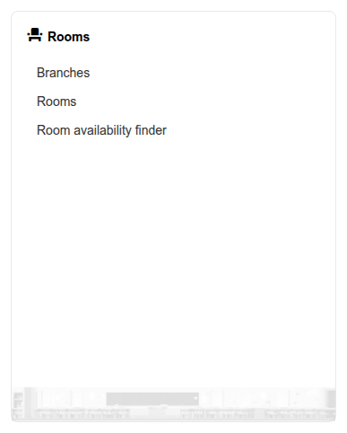

# Ruimtes

Het blok **Ruimtes** op het beheerdersdashboard beheert de fysieke locaties die Chamilo kan bijhouden voor klassikale of blended training: vestigingen (sites), de ruimtes daarbinnen en een hulpmiddel om te zien welke ruimtes op een bepaald tijdstip vrij zijn.

Dit hoofdstuk behandelt het beheer van vestigingen en ruimtes aan de beheerderszijde. Voor de docentenzijde — het toewijzen van een ruimte aan een cursussessie — zie [Vestigingen en ruimtes](../../teacher-guide/branches-and-rooms.md) in de Docentenhandleiding.

## Het blok Ruimtes openen

Vanuit het beheerpaneel verschijnt het blok **Ruimtes** naast de andere dashboardblokken. Klik op een van de koppelingen om het bijbehorende hulpmiddel te openen.

## Wat het blok bevat

* **[Ruimtes beheren](managing-rooms.md)** — Vestigingen (sites) aanmaken en organiseren, en de ruimtes binnen elke vestiging
* **[Zoeker naar beschikbaarheid van ruimtes](room-availability-finder.md)** — Controleren welke ruimtes vrij zijn voor een bepaalde datum en tijdsperiode

## Opmerking over Multi-URL

Bij een installatie met meerdere URL's (multi-tenant) zijn vestigingen en ruimtes elk gekoppeld aan één toegangs-URL — ze worden nooit gedeeld tussen portalen.