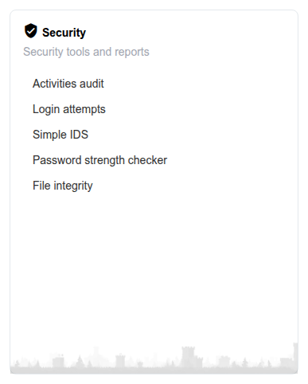

# Beveiliging

Het blok **Beveiliging** op het beheerdashboard bundelt de ingebouwde tools voor beveiligingsmonitoring en auditing van het platform. Het staat los van [Beveiligingsinstellingen](../platform-settings/security-settings.md), waarmee het beveiligings*beleid* wordt geconfigureerd (wachtwoordregels, CAPTCHA, HTTP-beveiligingsheaders, enzovoort) — dit blok biedt de *rapporten en tools* die het platform bewaken op verdachte activiteit en ongewenste wijzigingen.

Het blok is geïntroduceerd in Chamilo 2.0 met vier tools en in Chamilo 3.0 uitgebreid met een vijfde, **Bestandsintegriteit**.

## Het blok Beveiliging openen

Vanuit het beheerpaneel verschijnt het blok **Beveiliging** naast de andere dashboardblokken (Gebruikers, Cursussen, Platformbeheer, Systeem, enzovoort). Klik op een van de koppelingen om de bijbehorende tool te openen.

## Inhoud van het blok

* **[Activiteitenaudit](activities-audit.md)** — Belangrijke beheer- en platformgebeurtenissen (gebruiker, cursus, sessie en andere wijzigingen) doorbladeren op gebeurtenistype
* **[Aanmeldpogingen](login-attempts.md)** — Mislukte en geslaagde aanmeldpogingen bekijken, met grafieken en een doorzoekbaar logboek
* **[Simple IDS](simple-ids.md)** — Verzoeken bekijken die zijn gemarkeerd door het ingebouwde, lichtgewicht inbraakdetectiesysteem van Chamilo
* **[Wachtwoordsterktecontrole](password-strength-checker.md)** — Actieve gebruikers scannen op wachtwoorden die overeenkomen met een lijst van veelgebruikte wachtwoorden
* **[Bestandsintegriteit](file-integrity.md)** *(nieuw in Chamilo 3.0)* — Onverwachte toevoegingen, wijzigingen, verwijderingen of wijzigingen in machtigingen in de geïnstalleerde bestanden detecteren

## Aanvullende workflow voor vertrouwelijke meldingen

[Vertrouwelijke meldingen](confidential-reporting.md) is een optionele, rechtengecontroleerde functie voor melding en onderzoek. Deze staat los van de vijf hierboven genoemde monitoringtools voor beheerders.

## Wie er toegang toe heeft

Voor alle vijf de tools is toegang als **Portaalbeheerder** vereist. De acties voor scannen, pauzeren en het opnieuw vastleggen van een basislijn van Bestandsintegriteit vereisen daarnaast toegang als **Globale beheerder**, en het pauzeren van waarschuwingen of het vastleggen van een nieuwe basislijn vereist dat u uw eigen wachtwoord opnieuw invoert — zie [Bestandsintegriteit](file-integrity.md#actions) voor details.