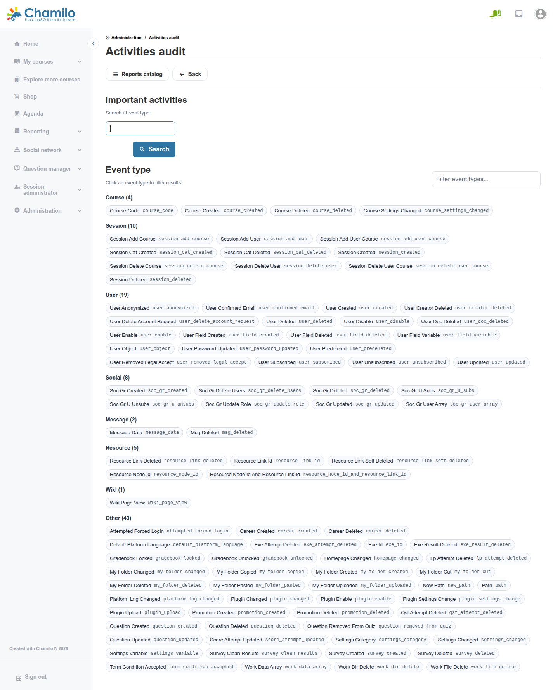

# Activiteitencontrole

Het rapport Activiteitencontrole laat u belangrijke administratieve en platformactiviteiten doorbladeren, gefilterd op gebeurtenistype. Het is hetzelfde onderliggende rapport dat voorheen bereikbaar was via **Opvolging > Controle van administratieve activiteiten**; het is nu ook rechtstreeks gekoppeld vanuit het blok Beveiliging, omdat het in de eerste plaats een hulpmiddel voor beveiliging en verantwoording is.

## Activiteitencontrole openen

Klik in het beheerpaneel op **Beveiliging > Activiteitencontrole**.

## Wat het toont

Gebeurtenissen zijn gegroepeerd in categorieën:

* **Cursus** — Aanmaken, verwijderen en instellingswijzigingen van cursussen
* **Sessie** — Aanmaken, verwijderen en inschrijvingswijzigingen van sessies en sessiecategorieën
* **Gebruiker** — Aanmaken en verwijderen van accounts, wachtwoordupdates, veldwijzigingen en meer
* **Sociaal** — Aanmaken, verwijderen en lidmaatschapswijzigingen van sociale groepen
* **Bericht** — Wijzigingen en verwijderingen van berichtgegevens
* **Bron** — Aanmaken en verwijderen van bronnen en bronkoppelingen
* **Wiki** — Weergaven van wikipagina's
* **Overig** — Al het overige, inclusief pluginactiviteit, vergrendeling van het cijferboek, verwijderingen van oefenpogingen, pogingen tot geforceerde aanmelding en wijzigingen van platforminstellingen

Klik op een chip voor een gebeurtenistype (bijvoorbeeld **Poging tot geforceerde aanmelding**) om het rapport te filteren tot een tabel met overeenkomende vermeldingen. U kunt ook rechtstreeks op trefwoord zoeken via het veld **Zoeken** boven de lijst met gebeurtenistypen.

## Toepassingen

* Onderzoek wie een cursus, sessie of gebruikersaccount heeft verwijderd, en wanneer
* Bevestig of een specifieke administratieve wijziging (een instellingsupdate, een plugininstallatie) is uitgevoerd door een verwachte beheerder
* Volg gebeurtenissen **Poging tot geforceerde aanmelding** op naast het rapport [Aanmeldpogingen](login-attempts.md)