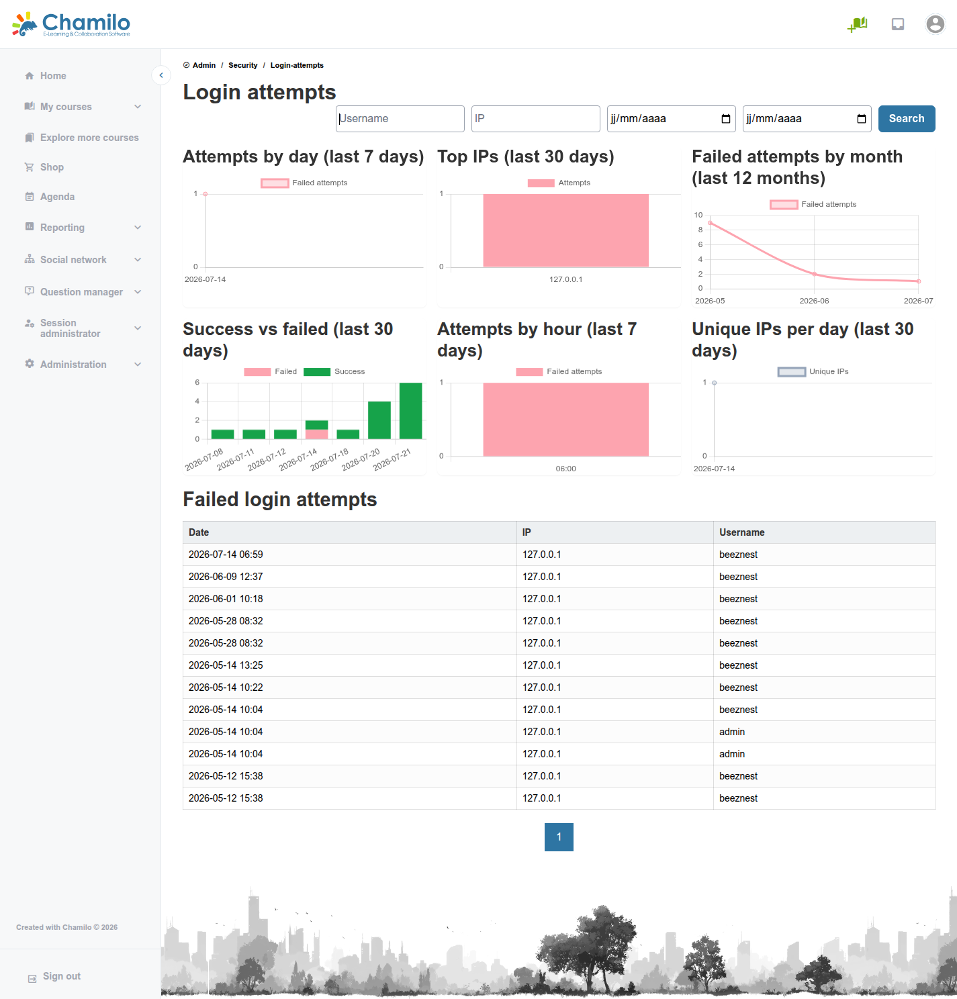

# Inlogpogingen

Het rapport Inlogpogingen toont een overzicht van mislukte inlogpogingen, met grafieken waarmee u brute-force- of credential-stuffingpatronen kunt herkennen.

## Inlogpogingen openen

Klik in het beheerpaneel op **Beveiliging > Inlogpogingen**.

## Wat het toont

* **Pogingen per dag (laatste 7 dagen)** — Dagelijks aantal mislukte pogingen
* **Top-IP's (laatste 30 dagen)** — Welke IP-adressen de meeste pogingen hebben gegenereerd
* **Mislukte pogingen per maand (laatste 12 maanden)** — Trend op langere termijn
* **Geslaagd versus mislukt (laatste 30 dagen)** — Dagelijkse uitsplitsing van geslaagde versus mislukte aanmeldingen
* **Pogingen per uur (laatste 7 dagen)** — Verdeling over het tijdstip van de dag, nuttig om geautomatiseerde of gescripte pogingen te herkennen
* **Unieke IP's per dag (laatste 30 dagen)** — Hoeveel verschillende IP's elke dag hebben geprobeerd in te loggen
* **Tabel met mislukte inlogpogingen** — Elke mislukte poging, met datum, IP-adres en geprobeerde gebruikersnaam

Gebruik de velden **Gebruikersnaam**, **IP** en het datumbereik boven de grafieken om het rapport te filteren.

## Gerelateerde instellingen

Dit rapport is een monitoringhulpmiddel; de daadwerkelijke bescherming tegen brute force wordt geconfigureerd in [Beveiligingsinstellingen](../platform-settings/security-settings.md):

* **Maximaal aantal inlogpogingen vóór vergrendeling** (`login_max_attempt_before_blocking_account`) — Vergrendelt een account na te veel mislukte pogingen
* **CAPTCHA** (`allow_captcha`) en **Toegestane CAPTCHA-fouten** (`captcha_number_mistakes_to_block_account`) — Vertraagt geautomatiseerde pogingen en vergrendelt accounts die de CAPTCHA blijven missen

Zie ook de [Beveiligingsgids](../appendix/security-guide.md) voor bescherming tegen brute force op serverniveau (fail2ban).