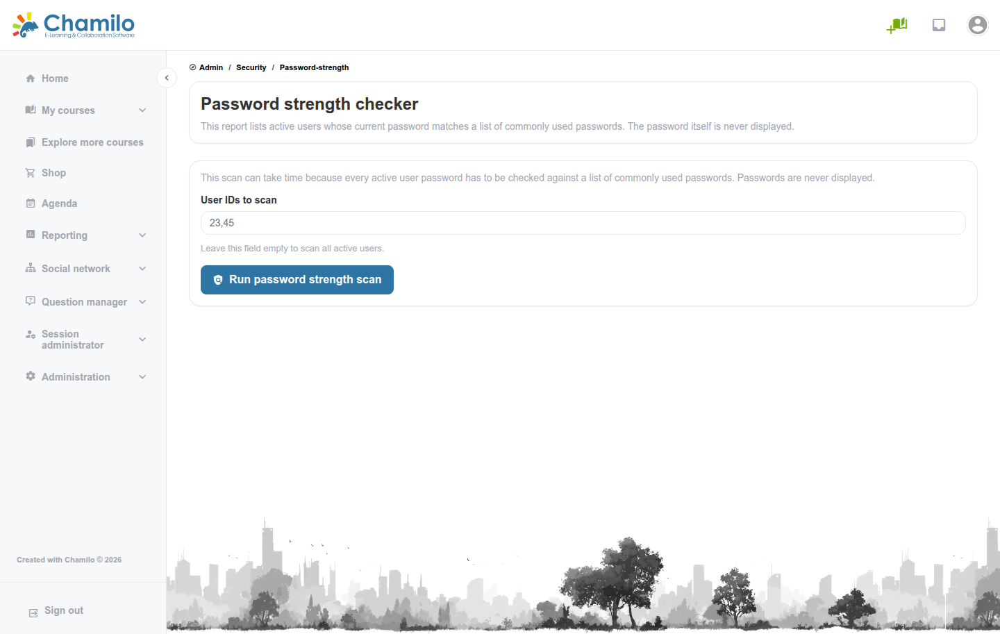
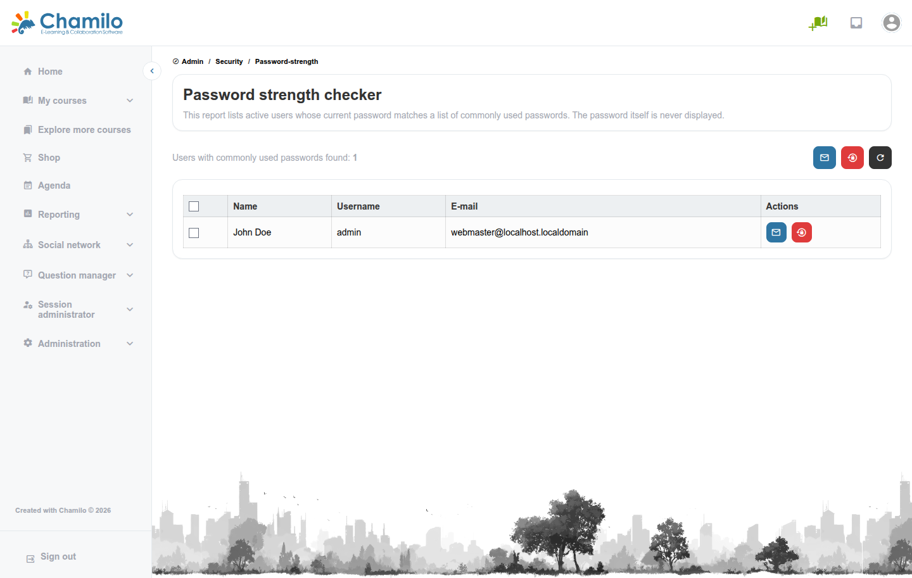

# Wachtwoordsterktecontrole

De wachtwoordsterktecontrole vergelijkt de opgeslagen wachtwoordhashes van actieve gebruikers met een korte lijst van veelgebruikte wachtwoorden (`123456`, `password`, `qwerty123`, en vergelijkbare). De wachtwoorden zelf worden nooit weergegeven of verzonden — alleen of het huidige wachtwoord van een gebruiker overeenkomt met een van de bekende zwakke kandidaten.

## De wachtwoordsterktecontrole openen

Klik in het beheerpaneel op **Beveiliging > Wachtwoordsterktecontrole**.

## Een scan uitvoeren

* Laat **Te scannen gebruikers-ID's** leeg om elke actieve gebruiker te scannen, of voer een door komma's gescheiden lijst van gebruikers-ID's in om een deelverzameling te controleren
* Klik op **Wachtwoordsterktescan uitvoeren**

De scan wordt asynchroon op de achtergrond uitgevoerd, zodat de pagina niet vastloopt, en toont de voortgang live (tot dusver gecontroleerde gebruikers, van het totaal, en hoeveel zwakke wachtwoorden zijn gevonden). Omdat elk kandidaatwachtwoord moet worden gecontroleerd tegen de hash van elke geselecteerde gebruiker, kan het scannen van alle gebruikers op een groot platform enige tijd duren — de kandidatenlijst wordt bewust kort gehouden om deze kosten te beperken.

## Actie ondernemen op basis van de resultaten

Zodra de scan is voltooid, worden gemarkeerde gebruikers weergegeven met twee beschikbare acties, per gebruiker of als bulkactie voor alle geselecteerde gebruikers:

* **Wachtwoordwijziging aanvragen** (enveloppictogram) — Stuurt de gebruiker een e-mail met het verzoek het wachtwoord te wijzigen
* **Wachtwoordreset afdwingen** (resetpictogram) — Maakt het huidige wachtwoord van de gebruiker onmiddellijk ongeldig en stuurt per e-mail een nieuw wachtwoord

Beide acties controleren de geselecteerde gebruikers opnieuw tegen de lijst met zwakke wachtwoorden voordat ze worden uitgevoerd, zodat een verouderd of gemanipuleerd verzoek niet kan worden gebruikt om een account te resetten dat geen zwak wachtwoord meer heeft.

## Accounts met zwakke wachtwoorden uitschakelen

Nadat de scan accounts met zwakke wachtwoorden heeft geïdentificeerd, kunnen bevoegde beheerders een in aanmerking komend account afzonderlijk uitschakelen of meerdere accounts selecteren en **Geselecteerde accounts uitschakelen** gebruiken. Bevestig de actie voordat u doorgaat. Het hulpmiddel behoudt ook de bestaande herstelacties voor wachtwoordreset.

De controle beperkt scans en herstelacties tot de toepasselijke toegangs-URL. Beheerders kunnen via deze workflow hun eigen accounts of andere beheerdersaccounts niet uitschakelen. Een uitgeschakeld account heeft een passend, geautoriseerd heractiveringsproces nodig voordat de persoon zich opnieuw kan aanmelden. Zie [PR #9373 over het uitschakelen bij zwakke wachtwoorden](https://github.com/chamilo/chamilo-lms/pull/9373).

## Illustratie van het wachtwoordkasteel

De beveiligingspagina bevat een gelokaliseerde demonstratie van het **wachtwoordkasteel**; het scherm voor wachtwoordwijziging gebruikt eveneens de visuele gids. Deze illustreert progressieve kenmerken van wachtwoordsterkte, maar het is een **illustratie**, geen vervanging van de daadwerkelijke validatie van het wachtwoordbeleid. Het demonstratiewachtwoord wordt niet verzonden of opgeslagen door de visualisatie. Blijf het geconfigureerde wachtwoordbeleid afdwingen in plaats van alleen op de afbeelding te vertrouwen. Zie [PR #9447 over het wachtwoordkasteel](https://github.com/chamilo/chamilo-lms/pull/9447).

## Aanbevolen gebruik

* Voer deze scan periodiek uit, vooral na een bulkimport van gebruikers (geïmporteerde accounts worden soms geleverd met eenvoudige standaardwachtwoorden)
* Combineer dit met de instellingen **Minimale syntaxisvereisten voor wachtwoorden** en **Interval voor wachtwoordrotatie** in [Beveiligingsinstellingen](../platform-settings/security-settings.md) om te voorkomen dat zwakke wachtwoorden überhaupt worden ingesteld, in plaats van ze alleen achteraf te signaleren