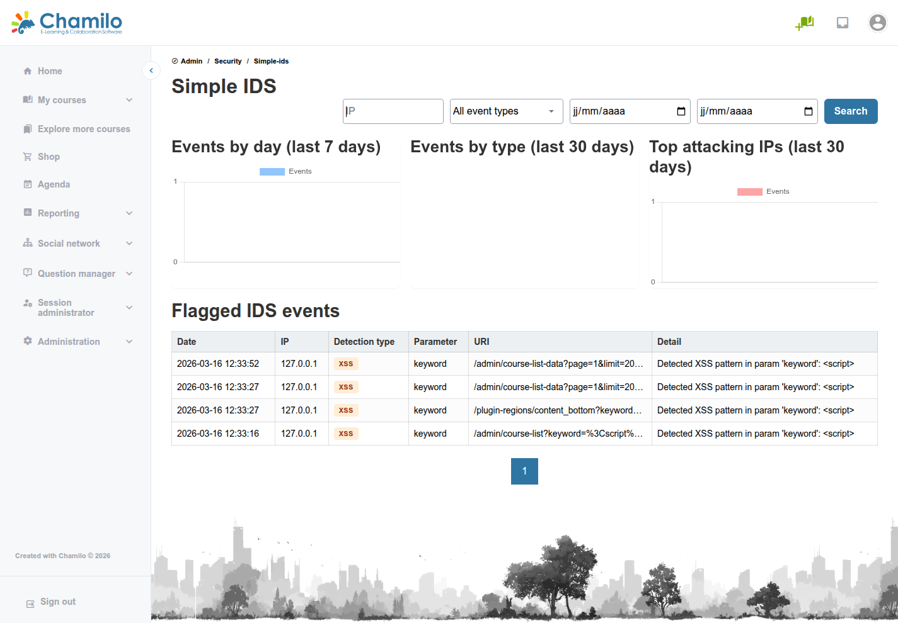

# Simple IDS

Chamilo bevat een lichtgewicht, in de applicatie geïntegreerd inbraakdetectiesysteem (IDS). Bij elk verzoek scant het de queryparameters van de URL, het aanvraagpad en een paar headers (`User-Agent`, `Referer`) op veelvoorkomende aanvalssignaturen — bijvoorbeeld XSS-payloads of path-traversalpatronen — en logt alles wat verdacht is. Op de pagina Simple IDS kunt u bekijken wat het heeft gemarkeerd.

Request-**body's** worden bewust niet gescand, om fout-positieven te vermijden door inhoud van de rich-texteditor (cursustekst bevat legitiem HTML-/JavaScript-achtige markup).

## Simple IDS openen

Klik in het beheerpanel op **Beveiliging > Simple IDS**.

## Wat het toont

* **Gebeurtenissen per dag (laatste 7 dagen)**, **Gebeurtenissen per type (laatste 30 dagen)** en **Meest aanvallende IP-adressen (laatste 30 dagen)** — Overzichtsgrafieken
* **Tabel met gemarkeerde IDS-gebeurtenissen** — Elke vermelding toont de datum, het bron-IP, het detectietype (bijvoorbeeld `XSS`), de betrokken parameter, de request-URI en een korte beschrijving van wat is gedetecteerd

Gebruik de filters **IP**, gebeurtenistype en datumbereik boven de grafieken om de resultaten te verfijnen.

## Hoe het werkt

* Elk verzoek wordt bij binnenkomst gescand; overeenkomsten worden toegevoegd aan `var/logs/ids/ids_events.log`
* Bij het verlaten voegt dezelfde subscriber de door OWASP aanbevolen beveiligingsheaders toe aan het antwoord
* Als blokkeren is ingeschakeld, wordt een verzoek dat overeenkomt met een signatuur onmiddellijk gestopt met een HTTP 400-antwoord in plaats van uw applicatiecode te bereiken

## Configuratie

Simple IDS wordt beheerd via omgevingsvariabelen, ingesteld in `config/packages/chamilo_ids.yaml`:

| Variabele | Doel |
|----------|---------|
| `IDS_ENABLED` | Schakelt het scannen en loggen van verzoeken in of uit |
| `IDS_BLOCK` | Indien ingeschakeld, wordt een gedetecteerd verzoek geweigerd (HTTP 400) in plaats van alleen gelogd |
| `IDS_SECURITY_HEADERS` | Bepaalt of de door OWASP aanbevolen antwoordheaders worden toegevoegd |

Dit is een lichtgewicht detector die naar beste vermogen duidelijke scan- en exploitatiepogingen moet opvangen — het vervangt geen dedicated web application firewall (WAF) voor implementaties met een hoog risico.