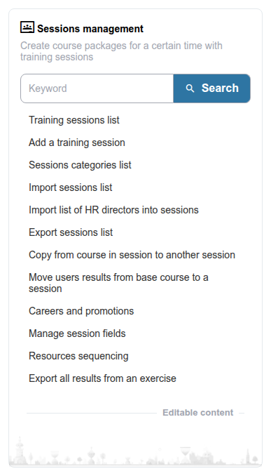

# Sessies

Sessies zijn een van de krachtigste functies van Chamilo. Hiermee kunt u dezelfde cursussen op verschillende momenten aan verschillende groepen cursisten aanbieden, zonder de cursusinhoud te dupliceren.

* **[Sessies beheren](managing-sessions.md)** — Trainingssessies aanmaken, configureren en beheren
* **[Sessiecategorieën](session-categories.md)** — Sessies indelen in categorieën
* **[Loopbanen en promoties](careers-and-promotions.md)** — Loopbaantrajecten en promotieworkflows definiëren
* **[Klassen](classes.md)** — Cursistenklassen beheren voor bulkinschrijving

## Sessies begrijpen

Sessies zijn **optioneel**. U kunt uw portaal laten werken door alleen cursussen te gebruiken, maar we raden **ten zeerste** aan om de extra complexiteit van sessies te overwegen als manier om op de lange termijn beheerswerk te besparen.

Een **cursus** bevat de inhoud (documenten, oefeningen, leerpaden). Een **sessie** wijst die cursus (of meerdere cursussen) toe aan een specifieke groep cursisten *voor een specifieke periode*.

Deze architectuur betekent:

* Docenten maken de inhoud eenmalig aan in de cursus
* Beheerders maken sessies aan om die inhoud aan verschillende cohorten aan te bieden
* Elke sessie heeft een eigen inschrijving, trackinggegevens en resultaten
* De basiscursusinhoud wordt gedeeld, maar sessietutoren kunnen bepaalde elementen aanpassen

## Wanneer sessies gebruiken

Gebruik sessies wanneer:

* U dezelfde training meerdere keren aanbiedt (bijv. maandelijkse onboardingsessies)
* U cohortgebaseerde programma's hebt (bijv. semestergebonden klassen)
* U afzonderlijke tracking per groep cursisten nodig hebt
* U wilt dat verschillende tutoren verschillende edities van dezelfde cursus beheren