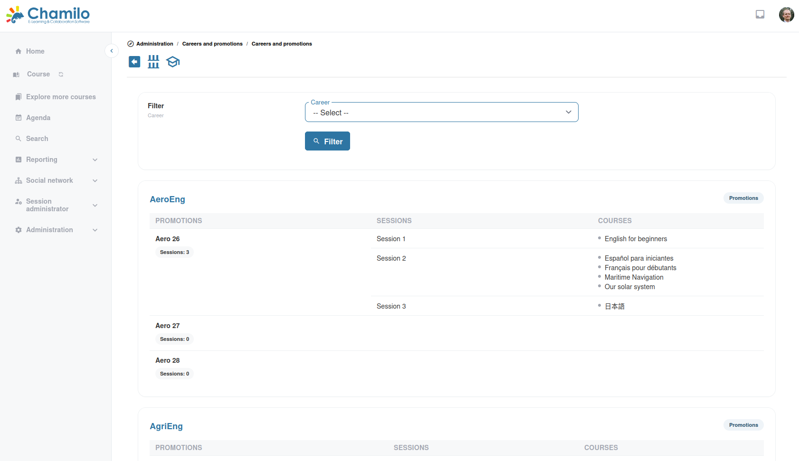

# Carrières en promoties

Chamilo bevat een carrièrebeheersysteem waarmee u opleidingspaden kunt definiëren en de voortgang van cursisten door gestructureerde programma's kunt volgen.

## Carrières

Een **carrière** is een gestructureerd opleidingspad — een reeks opleidingsstappen die een cursist volgt om een professioneel doel te bereiken.

### Een carrière aanmaken

1. Ga vanuit het beheerpaneel naar **Carrières**
2. Klik op **Een carrière aanmaken**
3. Voer een **naam** en **beschrijving** in
4. Opslaan

## Promoties

Een **promotie** vertegenwoordigt een cohort of groep cursisten die een carrière doorlopen. Beschouw het als een groep mensen die tegelijkertijd hetzelfde carrièrepad volgen.

### Koppelen aan sessies

Nadat u een promotie hebt aangemaakt, koppelt u er sessies aan. Dit bepaalt de volgorde van de opleiding die een cursist moet voltooien.

U kunt later promoties repliceren om de volgende promotie te helpen aanmaken met kopieën van dezelfde sessies, zodat uw volgende promotie in een oogwenk kan worden opgebouwd.

### Een promotie aanmaken

1. Ga naar **Promoties**
2. Klik op **Een promotie aanmaken**
3. Voer een **naam** en **beschrijving** in
4. Koppel deze aan een **carrière**
5. Wijs **sessies** toe aan de promotie
6. Opslaan

## Hoe het samenhangt

* Een **carrière** definieert het pad (bijv. "Certificering Junior Developer")
* Een **promotie** vertegenwoordigt een cohort (bijv. "Klas van maart 2026")
* **Sessies** binnen de promotie leveren de daadwerkelijke opleidingsinhoud

## Tips

* **Gebruik voor gestructureerde programma's** — Carrières en promoties zijn het nuttigst voor meerfasige opleidingsprogramma's waarin cursisten een vastgelegde volgorde doorlopen
* **Volg de voltooiing** — Gebruik de rapportagetools om te volgen hoe promoties vorderen op hun carrièrepaden