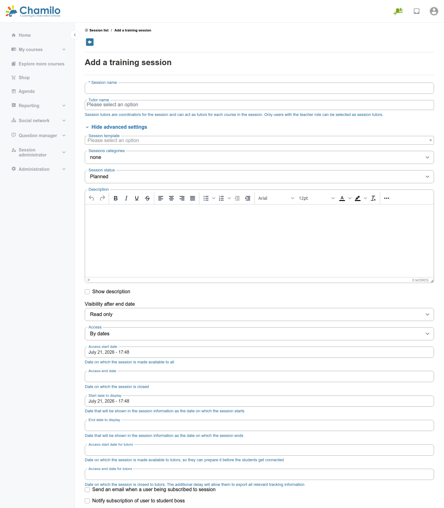
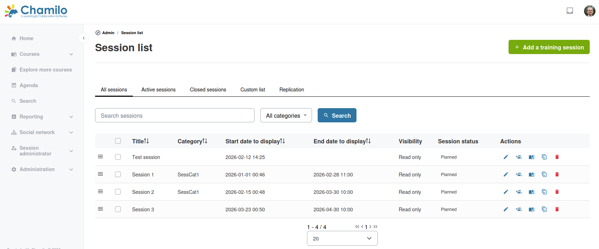
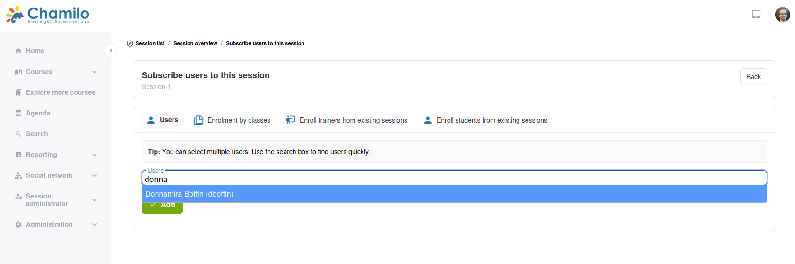

# Sessies beheren

## Een sessie aanmaken

1. Klik in het beheerpaneel op **Een sessie aanmaken**
2. Vul de sessiegegevens in:
   * **Sessienaam** — Een beschrijvende naam (bijv. "Onboarding voorjaar 2026")
   * **Begin- en einddatum** — Wanneer de sessie plaatsvindt (optioneel — sessies kunnen open zijn). Er zijn 3 sets datums: datums om weer te geven, datums om de toegang van cursisten te beperken en datums om de toegang van tutors te beperken
   * **Sessietutor** — De persoon die de gehele sessie begeleidt
   * **Categorie** — Wijs toe aan een sessiecategorie voor de organisatie
   * **Zichtbaarheid** — Bepaal de toegang en het gedrag in overzichten
3. **Cursussen toevoegen** — Selecteer een of meer cursussen om in de sessie op te nemen
4. **Cursisten inschrijven** — Voeg individuele gebruikers of klassen van gebruikers toe
5. **Cursustutors toewijzen** — Wijs voor elke cursus een docent (cursustutor) toe
6. Opslaan

## Sessiedatums

Sessies ondersteunen een flexibele datumconfiguratie:

| Datum | Doel |
|------|---------|
| **Weergave begin/einde** | Wanneer de sessie in de overzichten van cursisten verschijnt |
| **Toegang begin/einde** | Wanneer cursisten daadwerkelijk toegang hebben tot de sessie-inhoud |
| **Toegang tutor begin/einde** | Wanneer tutors toegang hebben tot de sessie (begint vaak eerder en eindigt later dan de toegang van cursisten) |

Zo kunt u de sessie voorbereiden voordat cursisten arriveren en de toegang van tutors openhouden nadat de sessie is afgelopen, voor beoordeling en rapportage.

## Sessielijst

De sessielijst toont alle sessies met:

* Sessienaam
* Begin- en einddatum
* Status (actief, aankomend, afgelopen)

Gebruik zoeken en filters om sessies te vinden op naam, datum, categorie of status.

## Een sessie bewerken

Klik op een sessie om deze te bewerken:

* Datums, naam of categorie wijzigen
* Cursussen toevoegen of verwijderen
* Cursustutors wijzigen
* Cursisten toevoegen of verwijderen
* Trackinggegevens van de sessie bekijken

## Gebruikers inschrijven

U kunt gebruikers op de volgende manieren in een sessie inschrijven:

* **Individuele inschrijving** — Zoek individuele gebruikers en voeg ze toe
* **Klasinschrijving** — Voeg in één keer een volledige klas (groep van vooraf gedefinieerde gebruikers) toe
* **CSV-import** — Upload een bestand met toewijzingen van gebruikers aan sessies

## Toegang tot sessies

Cursisten openen hun sessies via **Mijn sessies** in de zijbalk. Sessies zijn ingedeeld in:

* **Huidige sessies** — Momenteel actief
* **Afgelopen sessies** — Beëindigd
* **Aankomende sessies** — Nog niet gestart

## Inschrijving via API

Externe systemen kunnen de [API voor inschrijving van sessiecursisten](../../developer-guide/api/session-students.md) gebruiken om cursist-ID's op te vragen, geselecteerde cursisten toe te voegen of geselecteerde cursisten te verwijderen. Deze routes vereisen platformbeheerdersrechten en behouden andere inschrijvingen wanneer een nieuwe lijst met ID's wordt ingediend.

## Tips

* **Plan datums zorgvuldig** — Zorg ervoor dat de toegangsdatums van tutors verder reiken dan die van cursisten, zodat tutors kunnen voorbereiden en opvolgen
* **Gebruik klassen voor terugkerende inschrijving** — Als u vaak dezelfde groepen inschrijft, maak dan klassen aan en wijs deze aan sessies toe
* **Houd sessies georganiseerd** — Gebruik categorieën en duidelijke naamgevingsconventies voor eenvoudig beheer