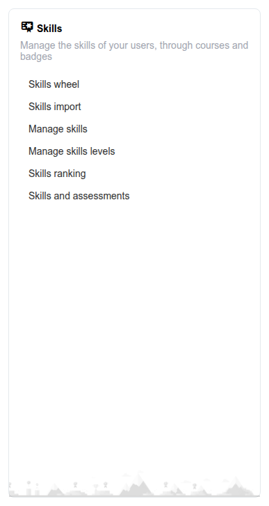

# Vaardigheden

Het blok **Vaardigheden** op het beheerdersdashboard groepeert de tools voor het definiëren, organiseren en volgen van competentiebadges ("vaardigheden") op het platform. Een vaardigheid kan automatisch worden toegekend wanneer een cursist een drempel in het cijferboek bereikt, specifieke cursussen voltooit, of handmatig door een docent, en kan een badge-achtig pictogram en een niveau dragen (bijvoorbeeld Brons/Zilver/Goud).

Het hele blok verschijnt alleen als de instelling **Vaardighedentool inschakelen** (`skill.allow_skills_tool`, onder Configuratie-instellingen > Vaardigheden) is ingeschakeld — deze is standaard ingeschakeld.

## Het blok Vaardigheden openen

Vanuit het beheerpaneel verschijnt het blok **Vaardigheden** naast de andere dashboardblokken. Klik op een van de links om de bijbehorende tool te openen.

## Wat het blok bevat

* **[Vaardigheden beheren](managing-skills.md)** — Maak vaardigheden aan, importeer ze in bulk en wijs elk toe aan een niveauschaal
* **[Vaardighedenwiel](skills-wheel.md)** — Een zoombaar visueel overzicht van de volledige vaardighedenboom
* **[Vaardighedenranglijst](skills-ranking.md)** — Een ranglijst van gebruikers op basis van verworven vaardigheden
* **[Vaardigheden en beoordelingen](skills-assessments.md)** — Koppel cijferboekcategorieën aan de vaardigheden die ze toekennen

## Gerelateerde instellingen

Enkele andere instellingen onder Configuratie-instellingen > Vaardigheden bepalen wie wat met dit blok kan doen:

* **HR-vaardighedenbeheer toestaan** (`allow_hr_skills_management`) — Laat gebruikers met de rol Human Resources Manager vaardigheden beheren naast beheerders
* **Privévaardigheden toestaan** (`allow_private_skills`)
* **Docenten kunnen vaardigheden toewijzen** (`skills_teachers_can_assign_skills`)
* **Vaardigheidsniveaus verbergen** (`hide_skill_levels`)
* **Volledige vaardigheidsnaam tonen op het vaardighedenwiel** (`show_full_skill_name_on_skill_wheel`)