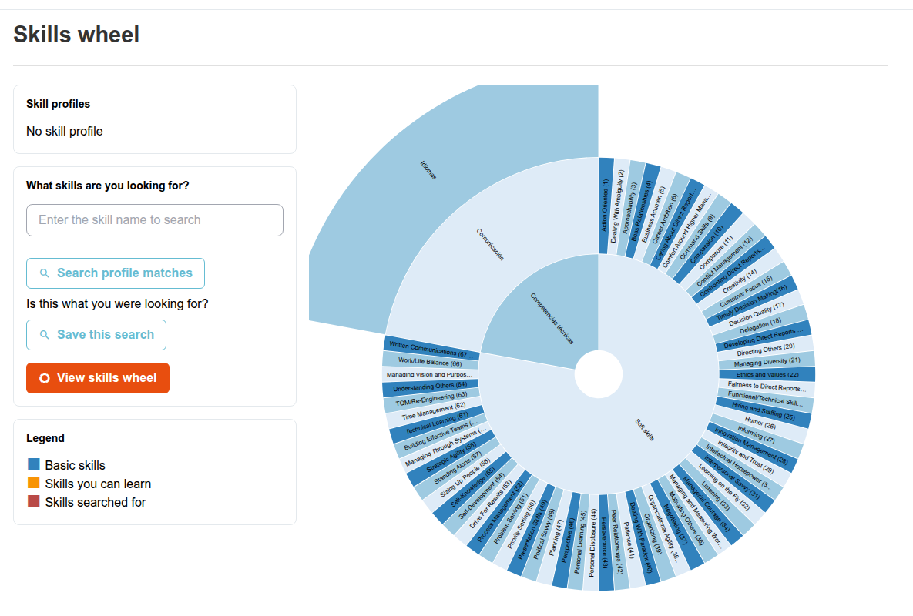
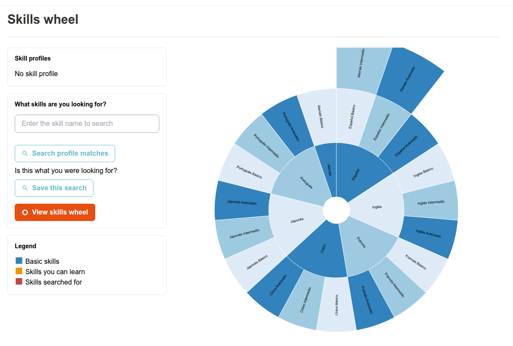
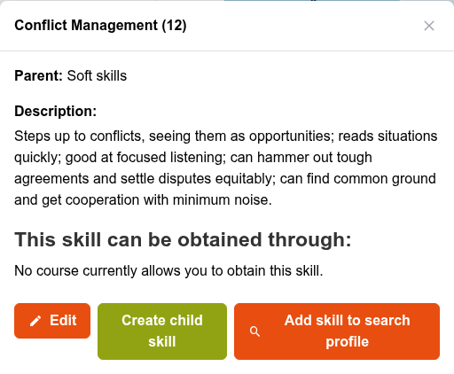

# Vaardighedenwiel

Het Vaardighedenwiel is een zoombaar, wielvormig diagram van de volledige vaardighedenboom — een visueel alternatief voor het doorbladeren van de platte lijst in [Vaardigheden beheren](managing-skills.md).

## Het Vaardighedenwiel openen

Klik in het beheerpaneel op **Vaardigheden > Vaardighedenwiel**.

## Wat het toont

Elk segment van het wiel is een vaardigheid, uitklapbaar naar de onderliggende vaardigheden. Een segment geeft aan of de vaardigheid een gekoppeld cijferboek heeft (zie [Vaardigheden en beoordelingen](skills-assessments.md)) en, bij het bekijken van een specifieke gebruiker, of die gebruiker de vaardigheid al heeft behaald.

Klik op een segment om erop in te zoomen en de onderliggende vaardigheden te tonen; klik op de middelste cirkel om weer uit te zoomen. De moderne verkenner toont de huidige hiërarchie ook als broodkruimels, zodat u terug kunt navigeren door de vertakkingen.

### Vaardigheden verkennen en vinden (3.1)

Het bijgewerkte wiel gebruikt een responsieve **verkenner in 3D-stijl** met een diepte-effect wanneer u de aanwijzer over het diagram beweegt. Dit is een visualisatie van de vaardighedenhiërarchie, geen afzonderlijke set vaardigheden.

* Open **Welke vaardigheden zoekt u?** om te zoeken op vaardigheidsnaam. U kunt meerdere vaardigheden selecteren en vervolgens **Vaardighedenwiel bekijken** gebruiken om een geselecteerde vaardigheid in de hiërarchie te vinden.
* Druk op `/` of **Ctrl+K** (op macOS **Cmd+K**) wanneer u niet in een formulierveld typt om het zoekvenster te openen.
* Gebruik **Focusmodus** voor een vergrote weergave van het wiel; **Esc** verlaat de focusmodus. Het besturingselement **Help** legt de navigatie en de legenda uit.
* Selecteer een vaardigheid om de contextuele inspector te openen, met de vaardigheidscode, beschrijving, bovenliggende hiërarchie en cursussen of beoordelingen waarmee de vaardigheid kan worden verworven, indien beschikbaar.

De detailinspector van de vaardigheid biedt **Bewerken**, **Onderliggende vaardigheid aanmaken** en **Vaardigheid toevoegen aan zoekprofiel** aan geautoriseerde beheerders en HR-managers. Na het aanmaken of bewerken van een vaardigheid vanuit het wiel keert de interface terug naar de context van het wiel in plaats van u in een niet-gerelateerde lijst te plaatsen.

Klik met de rechtermuisknop op een segment om de details te openen: beschrijving, bovenliggende vaardigheid en de cursussen (indien aanwezig) die de vaardigheid toekennen. Vanuit dit dialoogvenster kunnen beheerders de vaardigheid ook bewerken, er een onderliggende vaardigheid onder aanmaken of deze toevoegen aan de hieronder beschreven profielzoekopdracht.

Beheerders en gebruikers met de rol Human Resources Manager krijgen hier ook een profielzoekfunctie: vaardigheden kunnen worden gegroepeerd in "profielen" (sets vaardigheden die voor een bepaalde rol of functiebeschrijving worden verwacht), en op deze pagina kunt u zoeken naar gebruikers van wie de verworven vaardigheden overeenkomen met een bepaald profiel — handig om te bepalen wie klaar is voor een rol, of waar de hiaten binnen een team liggen.

### Vaardigheidsprofielen gebruiken

Het besturingselement **Vaardigheidsprofielen** is beschikbaar voor beheerders en HR-managers. Open het om opgeslagen profielen te vinden en te zoeken naar gebruikers van wie de vaardigheden daarmee overeenkomen. U kunt ook meerdere vaardigheden selecteren in het zoekvenster en **Profielovereenkomsten zoeken** of **Deze zoekopdracht opslaan** kiezen. Deze acties voor profielbeheer zijn rolgebonden; niet iedereen die het wiel bekijkt, ziet ze.

Deze interfaceverbetering is geïmplementeerd in [PR #9201](https://github.com/chamilo/chamilo-lms/pull/9201).