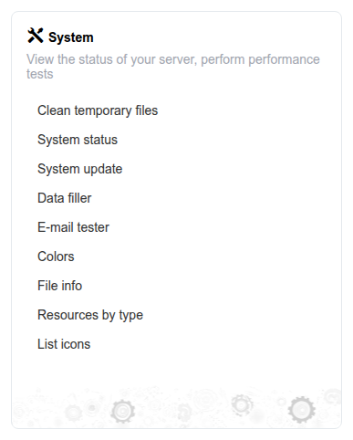

# Systeem

Het blok **Systeem** op het beheerdashboard groepeert onderhoudstools op serverniveau, de workflow voor zelfupdates, hulpprogramma's voor de inspectie van opslag en bronnen, en de branding van het platform.

## Het blok Systeem openen

Vanuit het beheerpaneel verschijnt het blok **Systeem** naast de andere dashboardblokken. Klik op een van de koppelingen om het bijbehorende hulpmiddel te openen.

## Inhoud van het blok

* **[Systeemtools](system-tools.md)** — Tijdelijke bestanden opschonen, de workflow voor zelfupdates uitvoeren, opgeslagen bestanden en bronnen inspecteren en de ingebouwde pictogrammenset bekijken
* **Systeemstatus** — Behandeld in [Systeemstatus](../maintenance/system-status.md), onder Onderhoud
* **[Branding](branding/README.md)** — Kleurthema's (de koppeling "Kleuren" van het blok opent dezelfde pagina Kleurthema's), portalaanpassing en sjablonen

Twee extra items — **Data filler** en **E-mail tester** — verschijnen alleen wanneer de server een map `tests/` bevat, wat een ontwikkel-/QA-omgeving is en geen productieomgeving. Ze verschijnen niet bij een typische productie-installatie; zie [Systeemtools](system-tools.md#development-only-tools) voor wat ze doen wanneer ze aanwezig zijn.