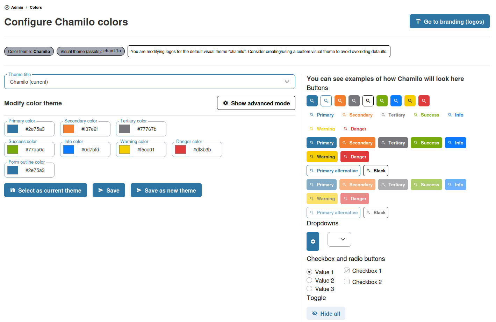

# Kleurthema's

Chamilo 2.0 introduceert een systeem voor kleurthema's waarmee u het visuele uiterlijk van het platform kunt aanpassen.

## Hoe thema's werken

Kleurthema's bepalen het palet dat in de hele Chamilo-interface wordt gebruikt — primaire kleuren, accentkleuren, achtergronden en tekstkleuren. Een thema is gekoppeld aan een toegangs-URL: in een portaal met één URL wordt het in feite het globale thema, en in een configuratie met meerdere URL's kan elke URL een eigen thema hebben.

## Een thema toepassen

1. Ga vanuit het beheerpaneel naar **Kleurthema's**
2. Blader door de beschikbare thema's
3. Selecteer een thema en klik op **Toepassen**
4. Het thema wordt onmiddellijk op het platform toegepast

## Pagina-achtergronden

Sommige pagina's tonen onderaan een decoratieve afbeelding die horizontaal wordt herhaald: **Mijn cursussen** en **Mijn sessies** (een landschap), de pagina's **Beheer** (een stadsgezicht), de pagina's **Sessiebeheer** (velden) en het **Sociaal netwerk** (een zeegezicht). Elk visueel thema levert deze afbeeldingen mee.

Op de pagina Kleurthema's toont de sectie **Pagina-achtergronden** de afbeelding van elk van deze plaatsen in het actieve visuele thema. Voor elk daarvan kunt u:

* **Vervangen** — Klik op **Bestand kiezen**, selecteer een PNG-, JPEG- of WebP-afbeelding van maximaal 2 MB en klik vervolgens op **Uploaden**. De afbeelding wordt 180 pixels hoog weergegeven en over de pagina herhaald, dus een brede strook waarvan de randen op elkaar aansluiten geeft het beste resultaat.
* **Verbergen** — Klik op **Verbergen** om de afbeelding van die pagina's te verwijderen, en op **Tonen** om ze terug te brengen. Een geüploade afbeelding verbergen bewaart deze voor later.
* **De afbeelding van het thema herstellen** — Verwijdert de geüploade afbeelding na bevestiging en toont opnieuw de afbeelding die het thema meelevert.

Net als de logo's behoren deze afbeeldingen tot het actieve visuele thema: in een configuratie met meerdere URL's heeft elke URL met een eigen thema eigen afbeeldingen. Wijzig ze niet in het standaardthema `chamilo`, waarvan de afbeeldingen de standaardwaarden van elk ander thema zijn.

De geüploade afbeeldingen worden opgeslagen in de themamap (`var/themes/<theme>/images/bg-<place>-custom.<extension>`, of de externe opslag van de thema's), naast een bestand `page-backgrounds.json` dat de keuzes vastlegt. Om een afbeelding in plaats daarvan rechtstreeks op de server te vervangen, plaatst u een bestand met de naam `images/bg-landscape.png` (of `bg-cityscape.png`, `bg-fieldscape.png`, `bg-seascape.png`) in de map van het actieve thema: dit wordt gebruikt wanneer er geen afbeelding vanaf de pagina is geüpload. Browsers bewaren deze afbeeldingen een dag, dus een op de server vervangen bestand kan zo lang nodig hebben om zichtbaar te worden, terwijl een geüploade afbeelding meteen zichtbaar is.

## Thema's per URL

In een configuratie met meerdere URL's kan elke toegangs-URL een eigen kleurthema hebben. Zo kunnen verschillende portalen een eigen visuele identiteit hebben terwijl ze dezelfde Chamilo-installatie delen.

## Kleurthema's importeren, exporteren en onderhouden

Portaalbeheerders kunnen herbruikbare ZIP-pakketten voor kleurthema's beheren vanuit de configuratie-interface voor kleurthema's:

1. Selecteer een bestaand thema en kies **Thema-ZIP exporteren** om een pakket te downloaden.
2. Om een pakket te importeren, kiest u **Kleurthema-ZIP importeren**, geeft u een **Nieuwe themanaam** op, selecteert u het ZIP-bestand en bevestigt u. Het uploadbesturingselement accepteert ZIP-bestanden kleiner dan 10 MB.
3. Gebruik **Thema hernoemen** om de weergavenaam van een thema te wijzigen zonder de technische slug te wijzigen.
4. Gebruik **Thema verwijderen** alleen voor een ongebruikt aangepast thema. Ingebouwde thema's en thema's waarnaar het platform verwijst, zijn beschermd tegen verwijdering.

Dubbele imports en ongeldige archieven worden geweigerd. Controleer het gebruik van thema's over toegangs-URL's voordat u aangepaste assets verwijdert; scenario's met meerdere portalen verdienen extra tests. Zie [PR #9404 over kleurthemapakketten](https://github.com/chamilo/chamilo-lms/pull/9404).

## Tips

* **Sluit aan bij uw huisstijl** — Kies of pas een thema aan dat overeenkomt met de merkkleuren van uw organisatie
* **Test de leesbaarheid** — Controleer na het toepassen van een thema of tekst leesbaar is tegen de achtergrondkleuren, vooral in situaties met hoog contrast
* **Houd rekening met toegankelijkheid** — Zorg voor voldoende kleurcontrast voor gebruikers met een visuele beperking