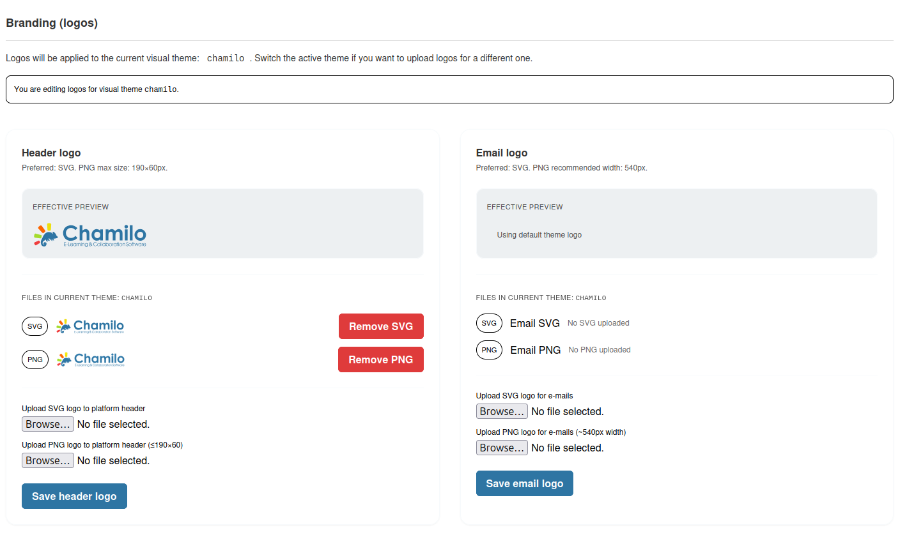

# Aanpassing van het portaal

Pas aan hoe uw Chamilo-platform eruitziet en welke informatie aan gebruikers wordt getoond.

## Platformidentiteit

Configureer de basisidentiteit van uw portaal:

* **Platformnaam** — De naam die wordt weergegeven in de browsertitel en in de hele interface
* **Naam van de instelling** — De naam van uw organisatie
* **URL van de instelling** — Een link naar de website van uw organisatie
* **Platformlogo** — Upload het logo van uw organisatie (weergegeven in de bovenste balk)

## Tips

* **Houd de startpagina overzichtelijk** — Te veel inhoud op de startpagina kan overweldigend zijn. Richt u op essentiële aankondigingen en toegang tot cursussen.
* **Werk regelmatig bij** — Houd systeemaankondigingen actueel en verwijder verouderde aankondigingen
* **Upload een logo van hoge kwaliteit** — Het logo is een van de meest zichtbare huisstijlelementen. Gebruik een scherpe afbeelding met de juiste afmetingen.