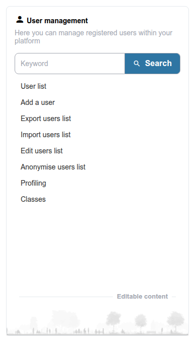

# Gebruikers

Dit gedeelte behandelt hoe u gebruikersaccounts beheert op uw Chamilo-platform — gebruikers aanmaken, rollen toewijzen, gebruikers in groepen organiseren en profielen beheren.

* **[Gebruikersrollen](user-roles.md)** — De verschillende gebruikersrollen en hun rechten begrijpen
* **[Gebruikers beheren](managing-users.md)** — Gebruikersaccounts aanmaken, bewerken, importeren en exporteren
* **[Gebruikersgroepen](user-groups.md)** — Gebruikers organiseren in platformbrede groepen
* **[Gebruikersprofilering](user-profiling.md)** — Extra profielvelden en gebruikersmetagegevens configureren
* **[Academische transcripten](academic-transcripts.md)** — Ondertekende officiële transcripten configureren en uitgeven voor in aanmerking komende cursisten