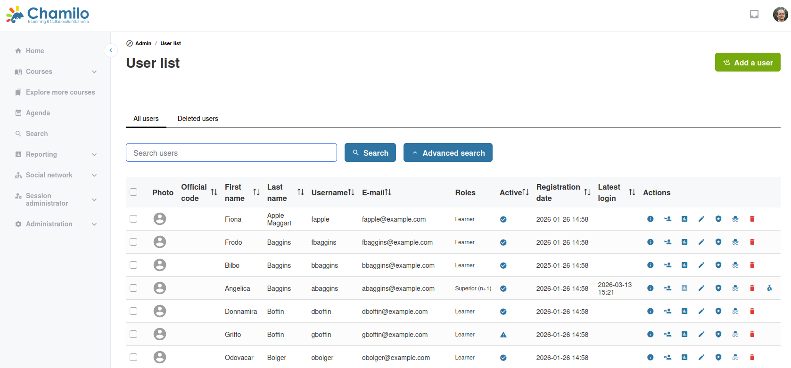
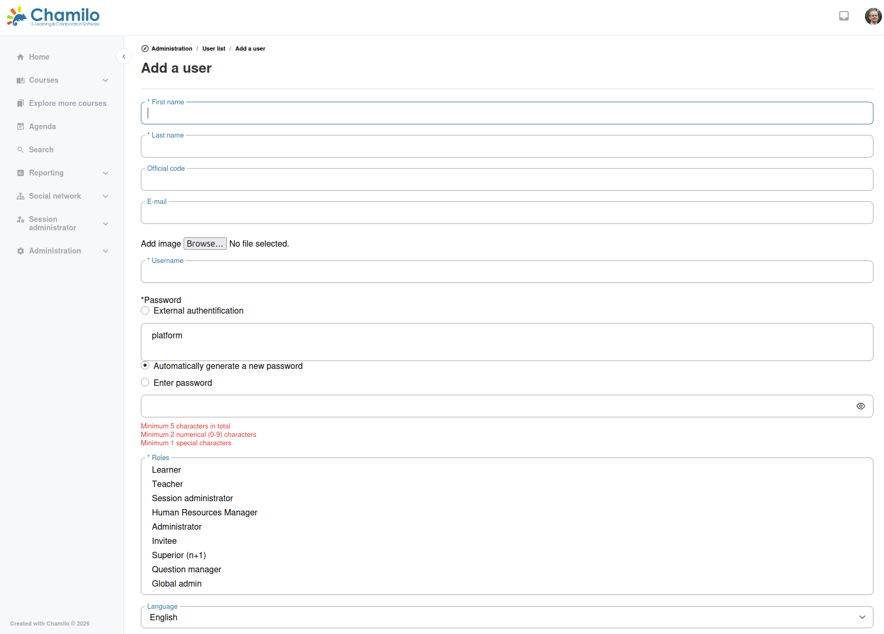
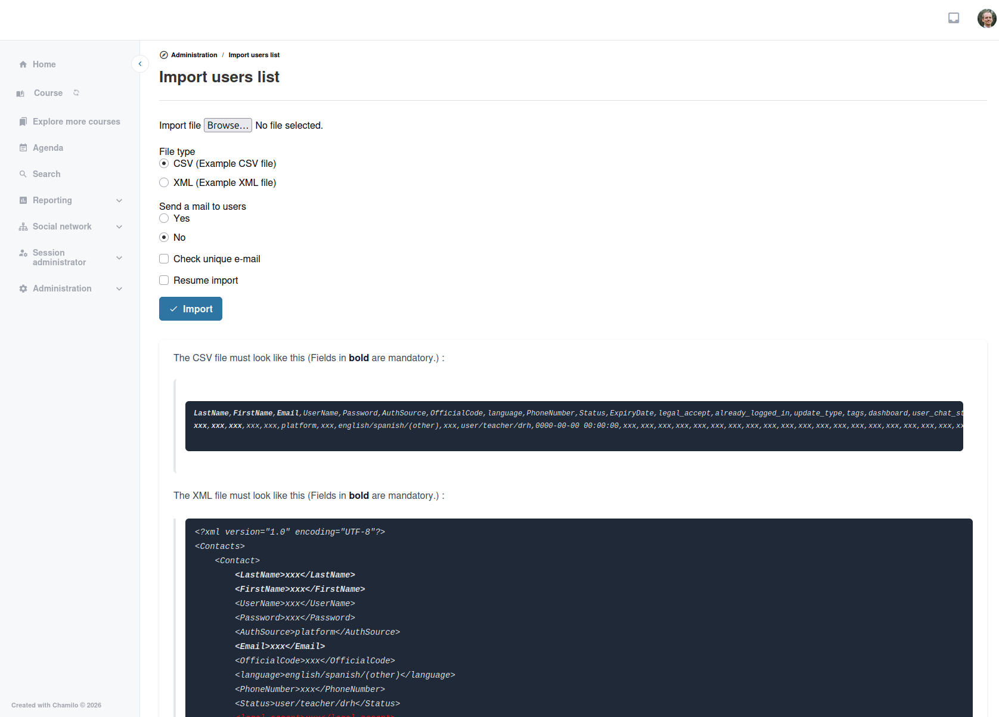

# Gebruikers beheren

Deze pagina behandelt de dagelijkse taken voor het aanmaken, bewerken en beheren van gebruikersaccounts.

## Gebruikerslijst

Klik in het beheerpaneel op **Gebruikerslijst** om alle gebruikers op het platform te zien. De lijst toont:

* Avatar
* Naam
* Gebruikersnaam
* E-mailadres
* Rollen
* Actieve/inactieve status
* Registratiedatum
* Datum van laatste aanmelding

Gebruik het hulpmiddel **Geavanceerd zoeken** om specifieke gebruikers te vinden op naam, e-mail, rol of andere criteria.

## Een gebruiker aanmaken

1. Klik in het beheerpaneel op **Een gebruiker toevoegen**
2. Vul de verplichte velden in:
   * **Voornaam** en **Achternaam**
   * **E-mail** — Moet uniek zijn op het platform
   * **Gebruikersnaam** — De aanmeldnaam (moet uniek zijn)
   * **Wachtwoord** — Stel een initieel wachtwoord in
   * **Rollen** — Selecteer de platformrol(len) van de gebruiker (student, docent, beheerder, enz.)
   * **Taal** — De voorkeurstaal van de interface van de gebruiker
3. Vul optioneel aanvullende velden in:
   * Officiële code (bijv. unieke ID binnen de organisatie)
   * Telefoonnummer
   * Vervaldatum — Het account automatisch deactiveren na een datum
   * Actieve/inactieve status
   * Extra profielvelden (indien geconfigureerd)
4. Opslaan

## Gebruikers importeren

Voor het in bulk aanmaken van gebruikers kunt u gebruikers importeren vanuit een bestand:

1. Klik in het beheerpaneel op **Gebruikers importeren**
2. Upload een **CSV**- of **XML**-bestand met gebruikersgegevens
3. Wijs de bestandskolommen toe aan de gebruikersvelden van Chamilo
4. Kies hoe bestaande gebruikers moeten worden behandeld (bijwerken of overslaan)
5. Importeren

Het importbestand moet ten minste kolommen bevatten voor: voornaam, achternaam, e-mail, gebruikersnaam en wachtwoord.

Opmerking: de kolom **Status** is de oude benaming voor **Rol** en accepteert slechts enkele waarden, zoals 1 voor docent en 5 voor student. Verdere afstemming van de rollen kan later alleen handmatig worden gedaan, door de gebruiker te bewerken.

## Gebruikers exporteren

Klik op **Gebruikers exporteren** om de gebruikerslijst te downloaden als een CSV- of XML-bestand. U kunt filteren welke gebruikers worden geëxporteerd op rol, registratiedatum of andere criteria.

## Een gebruiker bewerken

Klik op de naam van een gebruiker in de gebruikerslijst om het account te bewerken. U kunt het volgende wijzigen:

* Persoonlijke gegevens (naam, e-mail, telefoon)
* Rollen
* Wachtwoord (opnieuw instellen)
* Actieve/inactieve status
* Vervaldatum
* Extra profielvelden

## Een gebruiker verwijderen

Wanneer u gebruikers verwijdert (meestal docenten) die inhoud op het platform hebben aangemaakt, kan het systeem voorkomen dat u de gebruikers permanent verwijdert en een waarschuwing tonen waarin wordt uitgelegd dat de gebruiker nog aan sommige bronnen is gekoppeld. Als u de verwijdering bevestigt, verwijdert het systeem de inhoud zelf niet, maar koppelt het deze aan een neutrale gebruiker (wij noemen dit de "fallbackgebruiker", "Fallback user") omwille van de gegevensconsistentie.

Om dit te vermijden, controleert u de gebruikersgegevens, verwijdert u elk van hun cursussen één voor één en verwijdert u daarna de gebruiker.

## Gebruikersacties

| Actie | Beschrijving |
|--------|-------------|
| **Deactiveren** | Het account van een gebruiker uitschakelen zonder het te verwijderen. De gebruiker kan zich niet aanmelden, maar de gegevens blijven behouden. |
| **Activeren** | Een eerder gedeactiveerd account opnieuw inschakelen. |
| **Aanmelden als** | Aanmelden op het platform als deze gebruiker (impersonatie). Nuttig voor probleemoplossing. |
| **Anonimiseren** | Alle persoonlijke gegevens van het account wissen, zoals gedefinieerd door de AVG (GDPR) van de EU. |
| **Verwijderen** | Het gebruikersaccount voorlopig verwijderen (soft delete). Gebruik het tabblad **Verwijderde gebruikers** om het account en de bijbehorende gegevens permanent te verwijderen. |

> **Aanmelden als** is een krachtige functie. Gebruik deze verantwoord en alleen voor legitieme ondersteuningsdoeleinden.

## Batchbewerkingen

Selecteer meerdere gebruikers in de gebruikerslijst om batchacties uit te voeren:

* Meerdere gebruikers tegelijk activeren of deactiveren
* Meerdere gebruikers verwijderen
* Gebruikers toewijzen aan een cursus of sessie

## Gebruikersaccounts samenvoegen

De actie **Samenvoegen** (Unify) van het rapport over dubbele gebruikers (**Beheer > Rapporten > Dubbele gebruikers**) voegt de andere accounts van een groep duplicaten samen in het account dat u behoudt. De samengevoegde accounts worden voorlopig verwijderd en daarna permanent verwijderd.

### Wie mag samenvoegen

* Alleen beheerders (`ROLE_ADMIN` of `ROLE_GLOBAL_ADMIN`). Sessiebeheerders kunnen geen accounts samenvoegen.
* Zowel het account dat u behoudt als elk account dat erin wordt samengevoegd, moet binnen de toegangs-URL's vallen die u beheert: een globale beheerder die beperkt is tot een subportaalstructuur kan alleen gebruikers van die structuur samenvoegen; een gewone beheerder alleen gebruikers van de URL('s) waarbij hij of zij is geregistreerd. Duplicaten buiten uw bereik worden genegeerd; als er geen binnen uw bereik valt, wordt de actie geweigerd.
* U kunt uw eigen account niet samenvoegen in een ander account.

---
### Wat wordt geweigerd

De hele bewerking wordt geannuleerd (er wordt niets samengevoegd) met een expliciete melding wanneer:

* het samen te voegen account een administratieve rol heeft (beheerder, globale beheerder, sessiebeheerder) die het te behouden account niet heeft: de rollen worden nooit overgedragen, dus de bevoegdheid zou stilzwijgend verdwijnen;
* het samen te voegen account een **docent** is (rol docent of HR-manager) en het te behouden account een **student** is (geen van de rollen docent, HR-manager of beheerder). De omgekeerde richting (student naar docent) en samenvoegingen met dezelfde rol blijven toegestaan.

### Wat wordt samengevoegd

Alles wat bij de cursist hoort, volgt het behouden account: inschrijvingen voor cursussen, sessies, klassen en URL's, voortgang van leerpaden, oefenpogingen en tracking, resultaten en certificaten in het cijferboek, aanwezigheid, forum, blog, wiki, dropbox, opdrachten, enquêtes (uitnodigingen en de antwoorden van niet-anonieme enquêtes), tickets, berichten, vaardigheden, certificaten/transcripten, loopbaan, verantwoordingsdocumenten, gedeelde bronkoppelingen (`resource_link.user_id`), auteurschap (wie een item heeft aangemaakt of voor het laatst heeft bewerkt) en auditlogboeken.

Wanneer beide accounts een rij hebben voor hetzelfde item (dezelfde cursus, hetzelfde leerpad, dezelfde evaluatie, dezelfde cursusstem...) wint de rij van het behouden account en wordt de rij van het samengevoegde account verwijderd (of, wanneer andere gegevens ervan afhangen, op het samengevoegde account gelaten). Antwoorden op een enquête die beide accounts hebben beantwoord, worden niet gecombineerd: alleen die van het behouden account blijven behouden.

### Wat nooit wordt samengevoegd

Inloggegevens en privégegevens blijven op het (verwijderde) samengevoegde account staan, zodat de identiteit van de ene persoon nooit aan een ander account wordt overgedragen: aanmeldmethoden (`user_auth_source`), OAuth-tokens en toestemmingen, verzoeken tot wachtwoordherstel, pushabonnementen en API-sleutels, gesprekken met de AI-tutor en de ondersteuningsbot, dashboardblokken, gebruikerssjablonen, opgeslagen zoekopdrachten en abonnementen op meldingsgebeurtenissen. Anonieme enquêteantwoorden worden nooit aangepast. De gebruikersnaam, het e-mailadres en het wachtwoord van het behouden account worden nooit gewijzigd.

## Tips

* **Gebruik CSV-import voor grote inschrijvingen** — Wanneer u aan het begin van een opleidingsprogramma veel gebruikers onboardt, bereid dan een CSV-bestand voor en importeer in bulk
* **Stel vervaldatums in** — Stel voor tijdelijke gebruikers (workshopdeelnemers, proefgebruikers) een vervaldatum in om hun accounts automatisch te deactiveren
* **Deactiveer in plaats van te verwijderen** — Wanneer een gebruiker vertrekt, deactiveer dan eerst het account. Dit behoudt de opleidingsgegevens. Verwijder alleen als u zeker weet dat de gegevens niet langer nodig zijn.