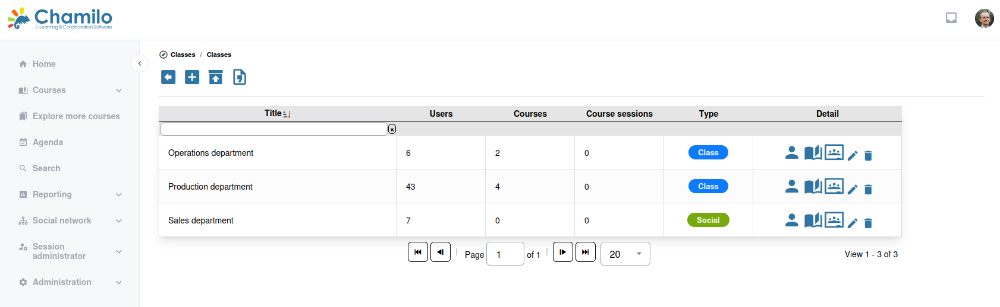

# Klassen / Gebruikersgroepen

Klassen in het beheerpaneel zijn platformbrede groepen die worden gebruikt om gebruikers te organiseren voor beheerdoeleinden. Ze verschillen van groepen op cursusniveau (die door docenten binnen een cursus worden aangemaakt).

> Gebruikersgroepen en [Klassen](../../admin-guide/sessions/classes.md) delen dezelfde interface. Het enige verschil is de instelling **groepstype**: kies "Klas" om een klas aan te maken (gebruikt voor bulkinschrijving in sessies), of "Gebruikersgroep" voor meer sociale groepen die een eigen ruimte kunnen hebben in het interne sociale netwerk. Zie [Klassen](../../admin-guide/sessions/classes.md) voor details over sessie-inschrijving.

## Een groep aanmaken

1. Ga vanuit het beheerpaneel naar **Klassen**
2. Klik op **Klassen toevoegen**
3. Voer een **titel** en optionele **beschrijving** in
4. Vink **Sociale groep** aan als dit een sociale groep wordt. Laat het uitgevinkt als het een klas wordt.
5. Voeg een optionele referentie-URL en afbeelding/logo toe.
6. Kies de **machtigingen** van de groep:
   * **Open** — Elke gebruiker kan deelnemen
   * **Gesloten** — Gebruikers moeten door een beheerder worden toegevoegd
7. Vink aan als u wilt dat leden de klas zelf kunnen verlaten.
8. Opslaan.

## Leden toevoegen

1. Open de lijst met klassen/gebruikersgroepen
2. Klik op het gebruikerspictogram **Gebruikers inschrijven in klas**
3. Zoek gebruikers op naam, gebruikersnaam of e-mail
4. Selecteer de toe te voegen gebruikers met de pijlen aan de rechterkant
5. Klik op de bevestigingsknop om op te slaan

## Toepassingen

* **Afdelingsorganisatie** — Groepeer gebruikers per afdeling of team
* **Bulkinschrijving** — Voeg alle leden van een groep in één keer toe aan een cursus of sessie
* **Gerichte communicatie** — Stuur aankondigingen naar specifieke groepen
* **Rapportage** — Bekijk de voortgang van de training, gefilterd op groep

## Groepen beheren

* **Bewerken** — Wijzig de groepsnaam, beschrijving of zichtbaarheid
* **Leden beheren** — Leden toevoegen of verwijderen
* **Verwijderen** — Verwijder de groep (verwijdert de ledenaccounts niet)

## Sorteervolgorde van de lijsten

De helper die verschillende lijsten sorteerde, paste de gevraagde richting omgekeerd toe: bij het kiezen van "oplopend" in een kolomkop kwam de hoogste waarde eerst, en bij "aflopend" de laagste eerst. De sortering volgt nu de gevraagde richting. Als u gewend was twee keer op een kop te klikken om de gewenste volgorde te krijgen, levert de eerste klik die nu op.

Betrokken lijsten (gesorteerd door op een kolomkop te klikken):

* Lijst **Beheer > Klassen / gebruikersgroepen** (kolommen titel, gebruikers, cursussen, sessies en type)
* De lijst met gebruikersgroepen van het cursustabblad **Klassen**
* Drie lijsten van de cursusstartpagina's (aangeleverd door `course_home.ajax.php`)

Ongewijzigd: de dagcel van de agenda, het blok met de volgende oefening van het gebruikersportaal (expliciet oplopend, zoals voorheen) en het raster **Oefeningen** van de sessie, waarvan de rijen vervolgens opnieuw door het raster zelf worden gesorteerd (initiële volgorde: oudste eerst).