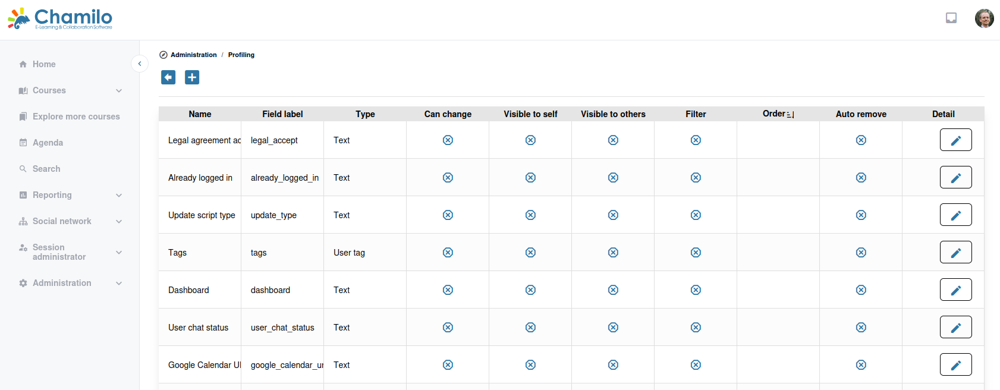

# Gebruikersprofilering

Met Chamilo kunt u aangepaste profielvelden (extra velden) definiëren om aanvullende informatie over gebruikers vast te leggen, naast de standaardgegevens naam, e-mailadres en rol.

## Extra profielvelden

Met extra velden kunt u metadata opslaan die specifiek zijn voor uw organisatie, zoals:

* Personeelsnummer
* Afdeling
* Functietitel
* Locatie/kantoor
* Telefoonnummer
* Aangepaste identificatoren

## Extra velden aanmaken

1. Ga vanuit het beheerpaneel naar **Extra velden** of **Profielvelden**
2. Klik op **Toevoegen**
3. Configureer het veld:
   * **Naam** — De veldtitel die aan gebruikers wordt getoond
   * **Beschrijving** — Optionele beschrijving
   * **Hulptekst** — Wordt onder het veld getoond in elk formulier waarin het voorkomt
   * **Veldtype** — Tekst, keuzelijst, datum, selectievakje, enz.
   * **Veldlabel** — De interne naam van het veld, voor integratie met plugins
   * **Mogelijke waarden** — Als het veld een keuze is tussen die waarden
   * **Standaardwaarde** — Een optionele standaardwaarde
   * **Zichtbaar voor zichzelf** — Of het veld op het gebruikersprofiel zichtbaar is voor de gebruiker zelf
   * **Zichtbaar voor anderen** — Of het veld zichtbaar is voor andere gebruikers van het platform
   * **Kan wijzigen** — Of de gebruiker het eigen veld zelf kan wijzigen (of alleen beheerders dat kunnen)
   * **Filter** — Als dit een veld van het type keuzelijst is, of het als filter moet worden opgenomen op beheerpagina's (bijv. om gebruikers in te schrijven voor cursussen of sessies)
   * **Volgorde** — Als u de weergavevolgorde van de velden wilt beheren, moet u aan elk veld een numerieke volgorde toekennen
   * **Verwijderen bij anonimisering** — Belangrijk voor privacyregels en wetgeving: als de gebruiker wordt geanonimiseerd maar niet verwijderd, moet dit veld dan worden beschouwd als mogelijke drager van persoonsgegevens?
4. Opslaan

## Veldtypen

De engine voor extra velden ondersteunt een breed scala aan invoertypen. Veelvoorkomende typen zijn:

| Type | Beschrijving |
|------|-------------|
| **Tekst** | Een tekstinvoer van één regel |
| **Tekstgebied** | Een tekstinvoer van meerdere regels |
| **Keuzerondje** | Een groep keuzerondjes met één keuze |
| **Keuzelijst / Meervoudige keuzelijst** | Een lijst met vooraf gedefinieerde opties (enkele of meervoudige selectie) |
| **Dubbele selectie** | Twee afhankelijke keuzelijsten (bijv. land → stad) |
| **Selectievakje** | Een ja/nee-schakelaar |
| **Datum / Datum en tijd** | Kiezer voor datum of datum+tijd |
| **Geheel getal** | Een numerieke invoer |
| **Tag** | Meerdere vrije tagwaarden |
| **Bestand** | Veld voor het uploaden van een bestand |
| **Video-URL** | Een URL die naar een video verwijst |
| **Mobiel telefoonnummer** | Een veld voor een opgemaakt telefoonnummer |
| **Tijdzone** | Een tijdzonekiezer |
| **Sociaal profiel** | Een koppeling naar een profiel op een sociaal netwerk |
| **Scheidingslijn** | Een visuele scheiding in het formulier (geen waarde) |

De exacte set bruikbare typen hangt af van de Chamilo-versie; de keuzelijst voor het veldtype op de beheerpagina **Extra velden** is de bron van waarheid.

## Extra velden gebruiken

Extra velden verschijnen:

* In de formulieren voor het aanmaken (indien zichtbaar voor zichzelf) en bewerken van gebruikers
* Op gebruikersprofielpagina's (indien zichtbaar voor zichzelf)
* Bij gebruikersimports (u kunt waarden van extra velden opnemen in CSV-imports)
* In exports en rapporten (filteren of groeperen op waarden van extra velden)

## Tips

* **Plan vóór het aanmaken** — Bepaal welke informatie u nodig hebt voordat u velden aanmaakt, want het wijzigen van veldtypen nadat gegevens zijn ingevoerd kan problematisch zijn
* **Gebruik keuzelijsten voor consistentie** — Wanneer een veld een bekende set mogelijke waarden heeft, gebruik dan een keuzelijst in plaats van vrije tekst om gegevensconsistentie te waarborgen
* **Gebruik voor rapportage** — Extra velden zijn nuttig om rapporten te filteren (bijv. "toon alle gebruikers van afdeling X die training Y hebben voltooid")