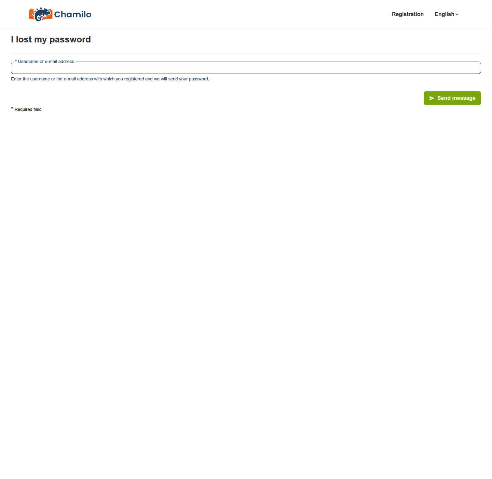
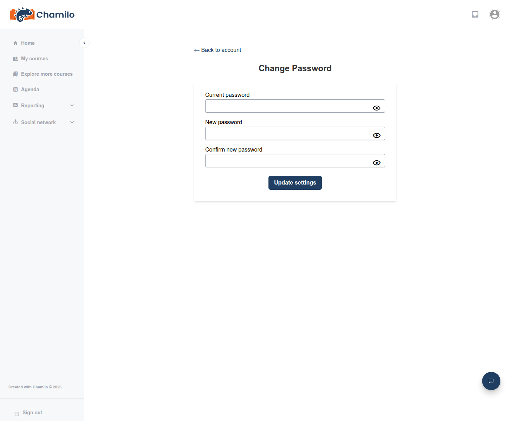

# Uw wachtwoord opnieuw instellen

Als u uw wachtwoord bent vergeten — of het gewoon wilt wijzigen — leest u hier hoe dat werkt, in beide situaties: voordat u bent aangemeld en terwijl u al bent aangemeld.

## Voordat u bent aangemeld

Klik op de aanmeldpagina op **Wachtwoord vergeten?**. Als deze koppeling er niet is, heeft uw beheerder deze functie uitgeschakeld — neem rechtstreeks contact met hen op om weer toegang te krijgen.

1. Voer uw **gebruikersnaam of e-mailadres** in het enige veld van het formulier in.
2. Als er een CAPTCHA-uitdaging verschijnt, los deze dan op (zie [CAPTCHA](captcha.md)).
3. Klik op **Bericht verzenden**.

Wat er daarna gebeurt, hangt af van hoe uw beheerder deze functie heeft geconfigureerd:

* **U ontvangt een koppeling per e-mail.** Klik erop om een formulier voor het opnieuw instellen van het wachtwoord te openen met de velden **Wachtwoord** en **Wachtwoord bevestigen** — kies zelf een nieuw wachtwoord en verzend het. Deze koppeling is eenmalig te gebruiken en verloopt na een beperkte tijd (standaard één uur, hoewel uw beheerder dit kan wijzigen); als de koppeling is verlopen, geeft de pagina voor het opnieuw instellen dat aan en moet u een nieuwe aanvragen.
* **U ontvangt rechtstreeks een nieuw wachtwoord per e-mail.** Op sommige platforms genereert het systeem een wachtwoord voor u en stuurt het dit in de e-mail, in plaats van u zelf een wachtwoord te laten kiezen. Meld u ermee aan en overweeg het daarna te wijzigen in iets dat u gemakkelijk onthoudt (zie hieronder).

Als u externe authenticatie gebruikt (single sign-on via uw instelling), worden het opnieuw instellen van wachtwoorden helemaal niet door Chamilo afgehandeld — gebruik in plaats daarvan de eigen procedure "wachtwoord vergeten" van uw instelling.

## Terwijl u bent aangemeld

U kunt uw wachtwoord op elk moment wijzigen, zonder te wachten tot u het bent vergeten:

1. Open uw **avatarmenu** (rechtsboven) en klik op **Mijn profiel**.
2. Klik op **Wachtwoord wijzigen**.
3. Voer uw huidige wachtwoord in, daarna tweemaal uw nieuwe wachtwoord, en verzend het formulier.

Dit is dezelfde pagina waarop u [tweefactorauthenticatie](two-factor-authentication.md) kunt inschakelen, als uw platform dit ondersteunt — in dat geval ziet u hier ook een selectievakje "Tweefactorauthenticatie inschakelen", dat hierboven niet wordt getoond omdat het niet op elk platform actief is.

## Tips

* **Controleer uw spammap** als een e-mail voor het opnieuw instellen niet binnen enkele minuten aankomt.
* **Handel snel bij koppelingen voor het opnieuw instellen** — ze verlopen, en platforms stellen die vervaltermijn vaak in op slechts één uur.
* **Nog steeds vastgelopen?** Als zelfservice voor het opnieuw instellen niet is ingeschakeld of niet werkt, kan uw platformbeheerder uw account altijd handmatig opnieuw instellen.