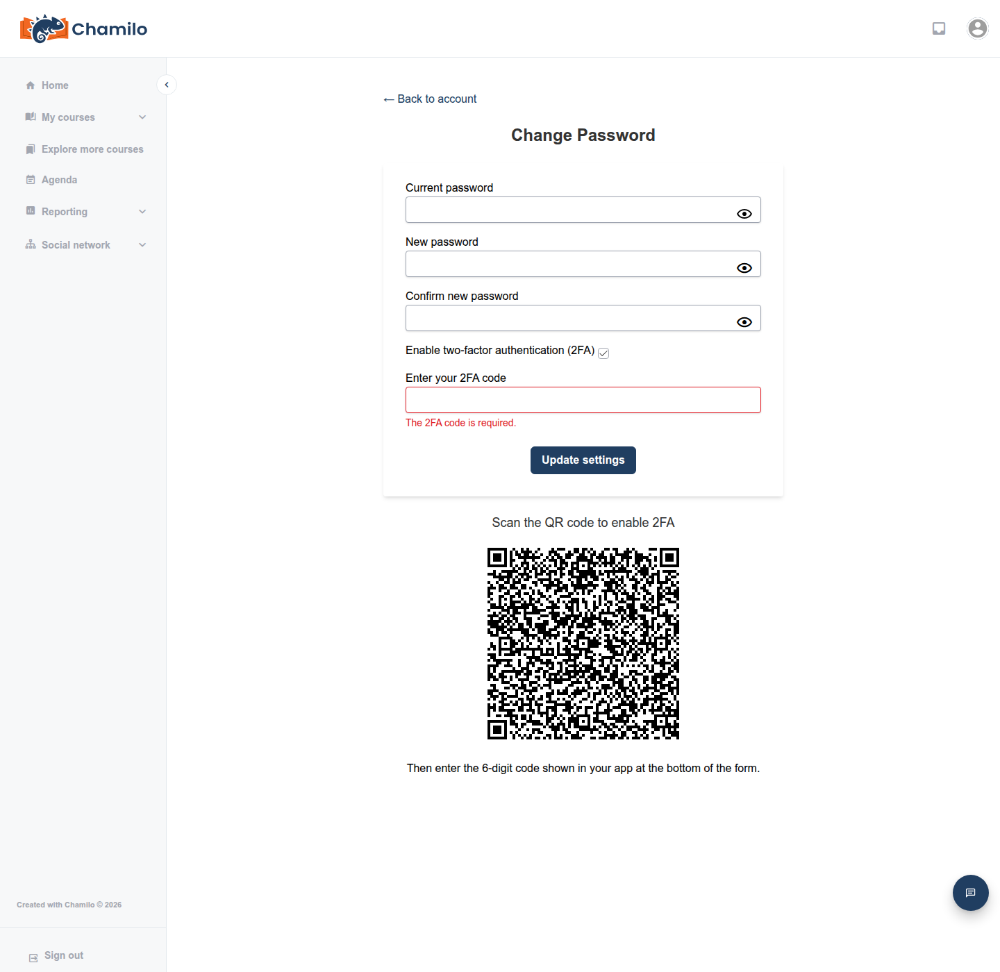

# Tweefactorauthenticatie

Tweefactorauthenticatie (2FA) voegt een tweede stap toe aan het aanmelden — een 6-cijferige code uit een app op uw telefoon, naast uw wachtwoord — zodat alleen het kennen van uw wachtwoord niet volstaat om toegang te krijgen tot uw account.

Deze functie verschijnt alleen als uw beheerder deze platformbreed heeft ingeschakeld. Als u deze niet ziet op uw accountpagina, is deze niet ingeschakeld voor uw platform.

## 2FA inschakelen

1. Open uw **avatarmenu** en klik op **Mijn profiel**.
2. Klik op **Wachtwoord wijzigen**.
3. Voer uw **huidige wachtwoord** in, vink het vakje **Tweefactorauthenticatie (2FA) inschakelen** aan en klik op **Instellingen bijwerken**.
4. De pagina wordt opnieuw geladen met een QR-code en het bericht "Scan de QR-code om 2FA in te schakelen." Scan deze met een authenticator-app op uw telefoon (elke TOTP-compatibele app werkt, zoals Google Authenticator, Microsoft Authenticator of Authy).

5. Voer opnieuw uw huidige wachtwoord in, samen met de 6-cijferige code die uw app nu toont, in het veld **2FA-code**, en klik nogmaals op **Instellingen bijwerken**. U ziet een bevestiging dat 2FA is geactiveerd.

Alleen het vakje aanvinken toont de QR-code niet — u ziet deze pas na die eerste verzending, en uw wachtwoordvelden worden elke keer gewist wanneer de pagina opnieuw wordt geladen, dus u moet uw huidige wachtwoord ook bij deze tweede verzending opnieuw invoeren.

## Aanmelden met 2FA ingeschakeld

Nadat u zoals gebruikelijk uw gebruikersnaam en wachtwoord hebt ingevoerd, toont het aanmeldformulier op hetzelfde scherm een extra veld **2FA-code** — voer de huidige 6-cijferige code uit uw authenticator-app in en verzend (de knop luidt op dat moment **Code verzenden** in plaats van **Aanmelden**).

## Als u geen toegang meer hebt tot uw authenticator-app

Chamilo genereert geen back-up- of herstelcodes voor 2FA. Als u het apparaat met uw authenticator-app kwijtraakt, kunt u zelf geen geldige code meer produceren — neem contact op met uw platformbeheerder, die 2FA op uw account kan uitschakelen zodat u opnieuw kunt aanmelden en, als u dat wilt, de functie op een nieuw apparaat kunt instellen.

## 2FA uitschakelen

Ga terug naar **Wachtwoord wijzigen**, vink **Tweefactorauthenticatie (2FA) inschakelen** uit, voer uw huidige wachtwoord in en verzend.

## Tips

* **Stel het in voordat u het nodig hebt** — 2FA inschakelen duurt een minuut en beschermt uw account aanzienlijk.
* **Houd uw authenticator-app toegankelijk** — als u deze kwijtraakt, bent u afhankelijk van uw beheerder om weer toegang te krijgen, omdat er geen back-upcodes zijn.
* **Deel uw 2FA-codes niet** — iedereen met uw wachtwoord en een geldige code kan zich als u aanmelden.