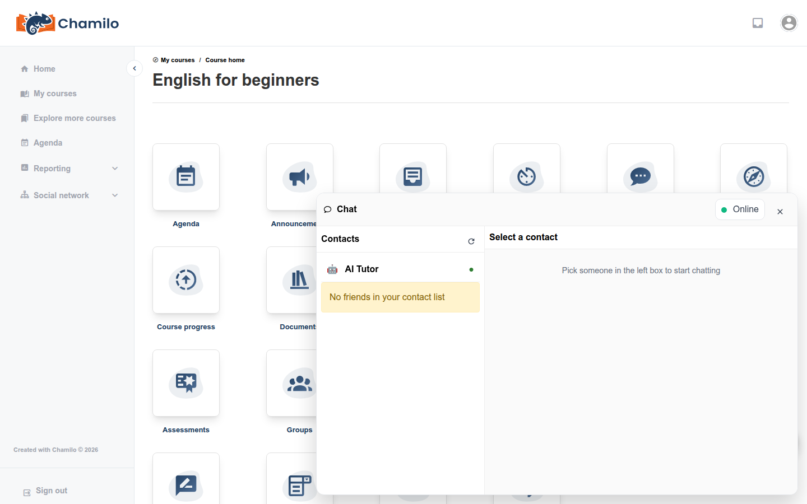
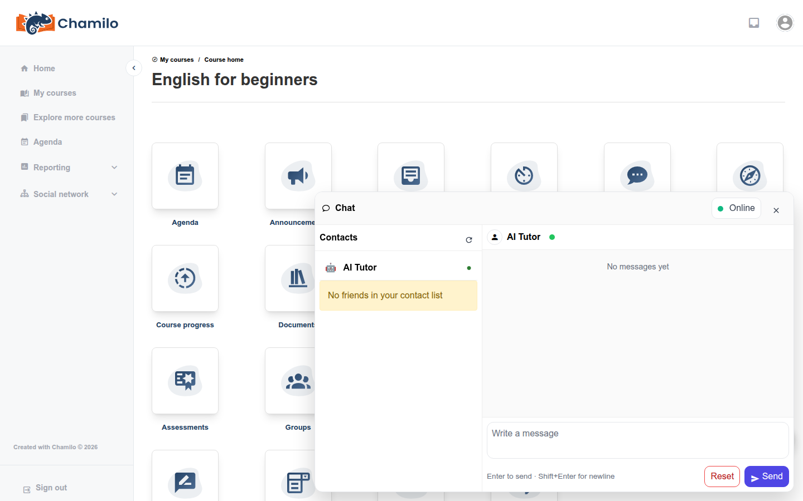

# AI Tutor-chatbot

Als uw platform en uw cursus dit beide hebben ingeschakeld, hebt u toegang tot een **AI Tutor** — een chatassistent aan wie u vragen kunt stellen en van wie u direct contextbewuste antwoorden krijgt, zonder te wachten tot uw docent reageert.

## Of u toegang hebt

De AI Tutor is afhankelijk van configuratie op twee niveaus, beide buiten uw controle:

* **Platformniveau** — Uw beheerder moet AI-helpers inschakelen en een AI-provider configureren.
* **Cursusniveau** — Uw docent moet de AI Tutor inschakelen voor die specifieke cursus.

Zie [AI Tutor](../../teacher-guide/ai-tools/ai-tutor.md) in de Docentenhandleiding voor hoe dit aan de kant van de docent wordt ingesteld. Als u de hieronder beschreven optie nergens ziet, is deze niet voor u ingeschakeld — helemaal niet, of niet voor de cursus waarin u zich momenteel bevindt.

Sommige platforms schakelen de AI Tutor ook **buiten een cursus** in — in dat geval verschuift de focus: in plaats van vragen over een specifieke cursus te beantwoorden, helpt hij met algemene vragen over het gebruik van het platform, zoals hoe u een functie vindt of gebruikt. Deze platformbrede modus is een aparte schakelaar ten opzichte van de modus per cursus, dus de ene kan aan staan zonder de andere.

## De chat openen

Zoek de chatknop (een zwevend spraakbelpictogram) onderaan het scherm. Als u deze opent, ziet u uw contacten plus, indien ingeschakeld, een aparte **AI Tutor**-vermelding met een robotpictogram en een "online"-puntje — klik erop om uw gesprek met de AI te starten of voort te zetten.

Typ uw vraag en druk op **Enter** om deze te verzenden (**Shift+Enter** voegt een regeleinde in in plaats van te verzenden). De AI Tutor formatteert antwoorden met koppen, lijsten, vette tekst en codeblokken waar dat nuttig is, zodat langere uitleg leesbaar blijft.

## Vragen stellen over iets dat u leest

Terwijl u een document, forumbericht, wikipagina, portfolio-item of stap in een leerpad bekijkt, kunt u een stuk tekst op de pagina selecteren voordat u uw vraag stelt. Boven het berichtvak verschijnt een kleine chip "Selectie" — verzend uw bericht en die geselecteerde tekst wordt als context meegestuurd, zodat de AI Tutor specifiek kan antwoorden over de passage die u hebt gemarkeerd. Klik op de **×** van de chip om de selectie te verwijderen als u deze niet wilt meenemen.

## Opnieuw beginnen

Als een gesprek ontspoort, gebruikt u de optie **Reset** in de chatcomposer om het te wissen en opnieuw te beginnen. Dit wist alleen uw gesprek met de AI Tutor — het heeft geen invloed op uw gewone berichten met uw docent of medestudenten.

## Wanneer het niet beschikbaar is

De AI Tutor wordt automatisch uitgeschakeld terwijl u een toets maakt of aan een opdracht werkt, zodat hij niet kan worden gebruikt om antwoorden te krijgen tijdens een beoordeling. Hij verschijnt ook niet als de onderliggende AI-provider tijdelijk niet beschikbaar is — Chamilo probeert automatisch over te schakelen naar een andere geconfigureerde provider, maar als geen enkele bereikbaar is, kan de AI Tutor kortstondig niet beschikbaar zijn.

## Tips

* **Gebruik hem voor snelle verduidelijkingen** — hij is vooral nuttig voor vragen waarop u anders op een antwoord zou moeten wachten.
* **Controleer belangrijke informatie toch** — zoals elk AI-systeem kan hij fouten maken. Controleer alles wat cruciaal is aan de hand van uw cursusmateriaal of bij uw docent.
* **Het is een aanvulling, geen vervanging** — voor alles wat een echt oordeel van uw docent vereist (geschillen over beoordelingen, uitstel, persoonlijke omstandigheden), neemt u rechtstreeks contact met hen op.