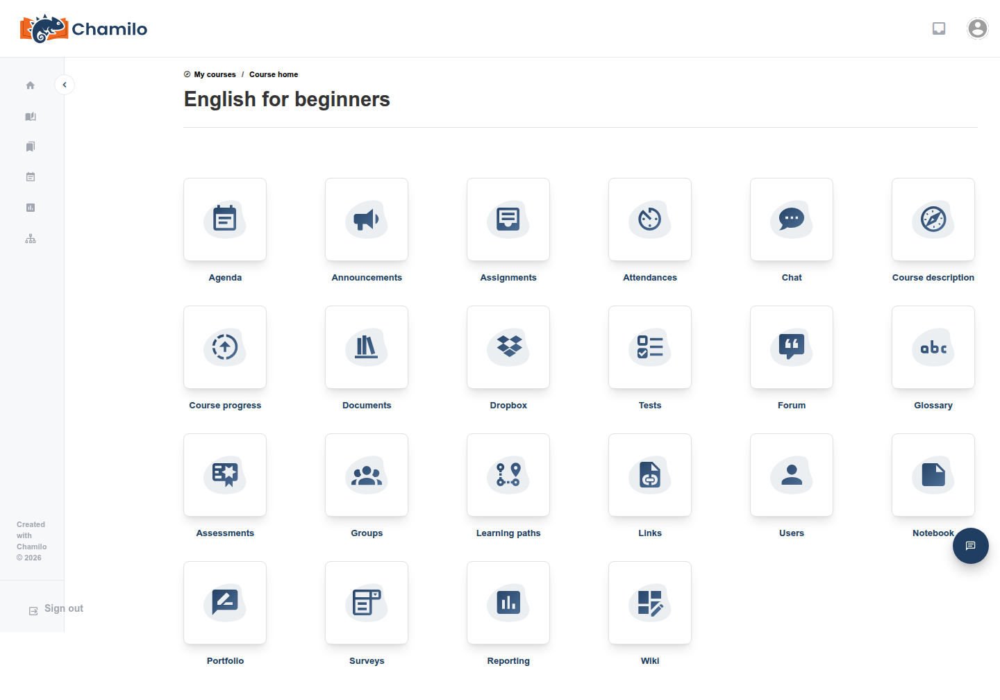
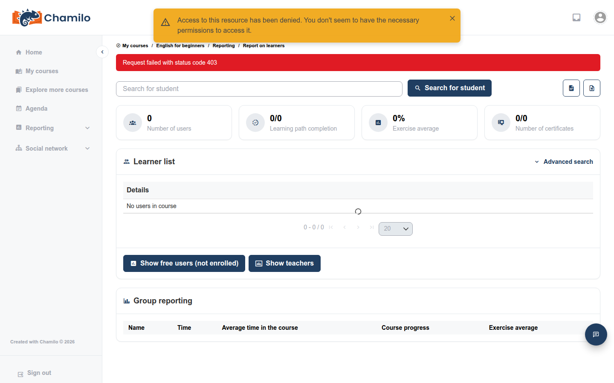

# Je weg vinden in een cursus

Zodra je een cursus opent, zie je de startpagina met een raster van toolpictogrammen. Deze pagina legt uit wat elke tool voor jou als cursist betekent en verwijst naar waar de onderliggende functie uitgebreider wordt beschreven.

Alleen tools die je docent zichtbaar heeft gemaakt voor cursisten, verschijnen in jouw raster — je docent kan extra, verborgen tools zien die niet aan jou worden getoond. Als een tool die je verwacht er niet is, is deze mogelijk gewoon verborgen of uitgeschakeld voor de hele cursus; vraag het je docent.

## Het toolraster

| Tool | Pictogram | Wat het voor jou betekent | Meer informatie |
|------|------|------------------------|------------|
| Documenten |  | Lees en download bestanden die je docent heeft geüpload | [Documenten](../../teacher-guide/adding-content/documents.md) |
| Leerpaden |  | Volg een begeleide reeks activiteiten in volgorde en houd je eigen voortgang bij terwijl je verdergaat | [Leerpaden](../../teacher-guide/adding-content/learning-paths.md) |
| Links |  | Open externe bronnen die je docent heeft samengesteld | [Links](../../teacher-guide/adding-content/links.md) |
| Toetsen (Oefeningen) |  | Maak quizzen en examens; sommige worden automatisch beoordeeld, andere door je docent | [Oefeningen](../../teacher-guide/assessing-learners/exercises.md) |
| Aankondigingen |  | Lees belangrijke updates die je docent heeft geplaatst | [Aankondigingen](../../teacher-guide/adding-content/announcements.md) |
| Beoordelingen (Cijferboek) |  | Bekijk je eigen scores voor de beoordeelde activiteiten van de cursus en eventuele certificaten die je hebt behaald | [Cijferboek](../../teacher-guide/assessing-learners/gradebook.md) |
| Woordenlijst |  | Zoek sleutelbegrippen op die voor de cursus zijn gedefinieerd | [Woordenlijst](../../teacher-guide/adding-content/glossary.md) |
| Aanwezigheden |  | Bekijk je eigen geregistreerde aanwezigheid, als je docent die bijhoudt | [Aanwezigheid](../../teacher-guide/assessing-learners/attendance.md) |
| Cursusvoortgang |  | Bekijk een overzicht van hoe ver je in de cursus bent gevorderd | [Cursusvoortgang](../../teacher-guide/additional-tools/course-progress.md) |
| Agenda |  | Bekijk cursusspecifieke evenementen en deadlines | — |
| Forum |  | Lees en plaats berichten in gestructureerde discussies met je docent en medestudenten | [Forums](../../teacher-guide/collaboration-and-communication/forums.md) |
| Dropbox |  | Wissel privébestanden uit met je docent of medestudenten | [Dropbox](../../teacher-guide/additional-tools/dropbox.md) |
| Gebruikers |  | Bekijk wie er nog meer voor de cursus is ingeschreven | — |
| Groepen |  | Werk in een kleinere groep die je docent heeft toegewezen, met eigen gedeelde tools | [Groepen](../../teacher-guide/collaboration-and-communication/groups.md) |
| Chat |  | Stuur in realtime berichten naar je docent of medestudenten | [Chat](../../teacher-guide/collaboration-and-communication/chat.md) |
| Opdrachten |  | Dien bestanden of tekst in zodat je docent ze kan nakijken en beoordelen | [Opdrachten](../../teacher-guide/assessing-learners/assignments.md) |
| Enquêtes |  | Beantwoord vragenlijsten, soms anoniem | [Enquêtes](../../teacher-guide/assessing-learners/surveys.md) |
| Wiki |  | Schrijf en bewerk gezamenlijk gedeelde pagina's | [Wiki](../../teacher-guide/collaboration-and-communication/wiki.md) |
| Notitieblok |  | Houd je eigen privénotities bij binnen de cursus | [Notitieblok](../../teacher-guide/additional-tools/notebook.md) |
| Portfolio |  | Stel een persoonlijke verzameling werk samen om te presenteren of in te dienen | [Portfolio](../../teacher-guide/additional-tools/portfolio.md) |
| Rapportage |  | Niets, voor jou — zie hieronder | — |

## Hulpmiddelen die je niet ziet — en één die niet werkt

Enkele items bestaan alleen zodat docenten en cursusbeheerders de cursus zelf kunnen configureren — cursusinstellingen, cursusonderhoud (back-up/import/export), de editor van de cursushomepage en (op de meeste platforms) het Blog-hulpmiddel bevinden zich in een menu "Meer acties" dat alleen verschijnt voor personen met bewerkrechten voor de cursus. Als cursist zie je dit menu helemaal niet.

De tegel **Rapportage** is een bijzonder geval: hij verschijnt wel in je raster, maar opent de voortgangsweergave van de hele klas die voor docenten is bedoeld, zodat je bij een klik een melding krijgt dat de toegang is geweigerd in plaats van iets nuttigs:

Maak je geen zorgen — je eigen voortgang is elders beschikbaar: via **Mijn voortgang** in de hoofdzijbalk (zie [De interface begrijpen](../getting-started/understanding-the-interface.md) en [Mijn voortgang](../my-progress.md)), en via de hulpmiddelen **Cursusvoortgang** en **Beoordelingen** hierboven, die beide je eigen gegevens tonen.

Als AI-functies voor je cursus zijn ingeschakeld, merk je mogelijk ook dat de optie "AI-analyzer" van een docent (gebruikt om de AI Tutor vooraf te trainen op de eigen inhoud van de cursus) verschilt van de **AI Tutor**-chat voor cursisten — zie [AI Tutor-chatbot](ai-tutor.md).

## Tips

* **Ontbreekt een hulpmiddel?** Vraag het je docent — het is hoogstwaarschijnlijk verborgen of uitgeschakeld en niet defect.
* **Cursusbeschrijving en aankondigingen** kunnen door je docent volledig worden uitgeschakeld; in dat geval verschijnen ze voor niemand, ook niet voor de docent.
* **Alles hier kan per cursus verschillen** — je docent bepaalt welke hulpmiddelen actief en zichtbaar zijn voor elke cursus afzonderlijk.