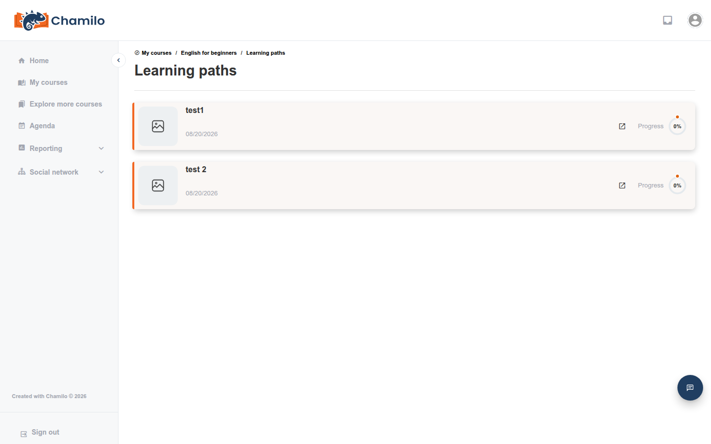

# Een leerpad volgen

Een **leerpad** leidt u door een gestructureerde reeks activiteiten — documenten, toetsen, links en meer — in een volgorde die uw docent heeft bepaald. In veel cursussen is dit het belangrijkste (of enige) hulpmiddel dat u daadwerkelijk hoeft te gebruiken, omdat het al het overige erin kan bundelen.

## Een leerpad openen

Open het hulpmiddel **Leerpaden**  vanaf de startpagina van de cursus en klik op een leerpad om te beginnen. Als uw docent **automatisch starten** heeft ingeschakeld, kan het leerpad automatisch openen zodra u de cursus betreedt.

## Door het pad navigeren

Binnen een leerpad ziet u:

* Een **lijst met items** (stappen) in een paneel, ingedeeld in secties die uw docent mogelijk als hoofdstukken heeft gegroepeerd
* De **inhoud van het huidige item** in het hoofdgebied — een document, een ingesloten toets, een link, enzovoort

Wanneer u items voltooit, worden ze gemarkeerd met een vinkje en toont een **voortgangsbalk** uw totale voltooiingspercentage voor het hele pad. Als u weggaat en later terugkomt, hervat u precies waar u was gebleven — er gaat niets verloren.

## Vergrendelde items en vereisten

Sommige items kunnen **vergrendeld** lijken totdat u voldoet aan een vereiste die uw docent heeft ingesteld — doorgaans het voltooien van een eerder item, of het behalen van een minimumscore op een toets eerder in het pad. Als u een stap niet kunt openen, controleer dan of een eerdere stap nog onvoltooid is.

## Toetsen en certificaten in een pad

Een leerpad kan een toets als een van de stappen bevatten — het afleggen ervan werkt hetzelfde als beschreven in [Toetsen afleggen](taking-tests.md). Sommige paden eindigen met een stap **certificaat**: wanneer u die bereikt (nadat u onderweg aan eventuele scorevereisten hebt voldaan), wordt uw voltooiingscertificaat gegenereerd, als uw docent er een voor de cursus heeft geconfigureerd.

## SCORM en andere geïmporteerde inhoud

Sommige items van een leerpad zijn niet rechtstreeks in Chamilo gemaakt, maar geïmporteerd als een **SCORM**-pakket, een **CMI5/xAPI**-pakket, of gemaakt met de C-Studio-plug-in. Deze zien er over het algemeen uit en gedragen zich als andere interactieve inhoud — Chamilo volgt uw voortgang en score erdoorheen op dezelfde manier, ook al is de inhoud zelf elders gemaakt.

## AI-studiehelper

Als uw beheerder AI-helpers heeft ingeschakeld, kunnen documentstappen in een leerpad een **AI-studiehelper** bieden. Selecteer een passage in het document en er verschijnt een kleine robotactie naast de selectie. Open deze, kies een **Leertechniek** (bijvoorbeeld Feynman-techniek, mindmapping, gespreide herhaling of SQ3R) en klik vervolgens op **Genereren**.

Chamilo stuurt de geselecteerde passage en de techniek naar de geconfigureerde AI-dienst en toont de gegenereerde uitleg in een dialoogvenster. De helper is bedoeld om uw begrip van het materiaal te ondersteunen; hij wijzigt uw antwoorden, score of voortgang in het leerpad niet.

## Tips

* **Gebruik de voortgangsbalk** om in te schatten hoeveel van het pad nog resteert.
* **Maak u geen zorgen dat u uw plaats verliest** — Chamilo onthoudt precies waar u zich in een pad bevindt tussen sessies.
* **Een vergrendelde stap betekent meestal onvoltooid werk eerder in het pad** — ga terug en controleer dit, in plaats van aan te nemen dat de toegang per vergissing is geweigerd.