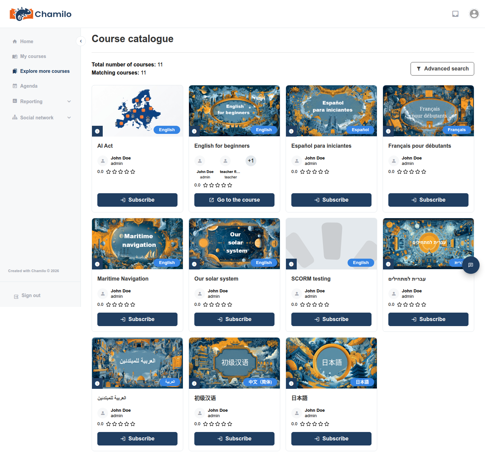

# Inschrijven voor een cursus

Voordat u toegang krijgt tot de inhoud van een cursus, moet u ervoor zijn ingeschreven. Afhankelijk van uw platform kan dit op verschillende manieren gebeuren — de meeste vereisen helemaal geen actie van u.

| Hoe het gebeurt | Wat u moet doen |
|-----------------|----------------------|
| Een beheerder schrijft u in | Niets — de cursus verschijnt in **Mijn cursussen** zodra dit is gebeurd |
| Een docent schrijft u handmatig in | Niets — hetzelfde als hierboven |
| U schrijft uzelf in via de cursuscatalogus | Blader door **Meer cursussen verkennen** en klik vervolgens om deel te nemen |
| U ontvangt een cursusuitnodiging per e-mail | Klik op de link; registreer u als u nog geen account hebt |

## Uw cursussen controleren

Klik op elk moment op **Mijn cursussen** in de zijbalk om alles te zien waarvoor u momenteel bent ingeschreven. Als een cursus die u verwacht niet wordt vermeld, bent u er nog niet voor ingeschreven — gebruik een van de onderstaande methoden of neem contact op met uw docent of beheerder.

## Zelfinschrijving via de cursuscatalogus

Als de zichtbaarheid van een cursus dit toestaat, kunt u uzelf inschrijven zonder op iemand anders te wachten:

1. Klik op **Meer cursussen verkennen** in de zijbalk om de cursuscatalogus te openen.
2. Blader of zoek naar de cursus waaraan u wilt deelnemen.
3. Klik op de cursus om de details te openen en klik vervolgens op de knop om deel te nemen.

Een cursus waarvoor u al bent ingeschreven, toont **Ga naar de cursus** in plaats van een inschrijfknop.

Voor sommige cursussen is een wachtwoord vereist om uzelf in te schrijven — uw docent heeft dit in dat geval apart met u gedeeld. Als een cursus helemaal geen knop om deel te nemen biedt, staat zelfinschrijving er niet voor open; vraag de docent of een beheerder om u in plaats daarvan in te schrijven.

Als uw platform **sessies** gebruikt, geldt hetzelfde idee voor **Mijn sessies** — sommige sessies kunnen via de catalogus openstaan voor zelfinschrijving, hoewel dit vaker wordt beheerd door een beheerder of sessiebegeleider, omdat inschrijving voor een sessie u inschrijft voor elke cursus daarin.

## Een cursusuitnodiging accepteren

In plaats van een vermelding in de catalogus kan een docent u een **cursusuitnodiging** per e-mail sturen — dit is de enige methode waarvoor u nog geen platformaccount hoeft te hebben. Het openen van de link in de e-mail:

* Vult het e-mailveld op het registratieformulier vooraf in en vergrendelt het op uw uitgenodigde adres.
* Laat u registreren, zelfs als algemene zelfregistratie momenteel op het platform is gesloten.
* Schrijft u automatisch in voor de cursus (of de hele sessie, als de cursus daarin wordt geopend) zodra u klaar bent met registreren, en meldt u aan.

De link is eenmalig te gebruiken en verloopt na 7 dagen — als deze niet meer werkt, vraag de docent die u heeft uitgenodigd om een nieuwe te sturen. Zie [Wat de uitgenodigde persoon ziet](../../teacher-guide/assessing-learners/subscribing-users.md#what-the-invited-person-sees) voor meer details over deze procedure, en [Een account aanmaken](../getting-started/creating-an-account.md) voor hoe het registratieformulier er zelf uitziet.

## Tips

* **Controleer "Meer cursussen verkennen" voordat u het vraagt** — veel platforms laten zelfinschrijving voor cursussen open, zodat u mogelijk direct kunt deelnemen zonder op iemand te wachten.
* **Houd uw inbox in de gaten** — zowel cursusuitnodigingen als meldingen over accountgoedkeuring komen per e-mail binnen.
* **Krijgt u nog steeds geen toegang?** Inschrijvingsmethoden kunnen platformbreed worden beperkt of uitgeschakeld, dus als geen van het bovenstaande werkt, kan uw docent of beheerder u altijd rechtstreeks inschrijven.