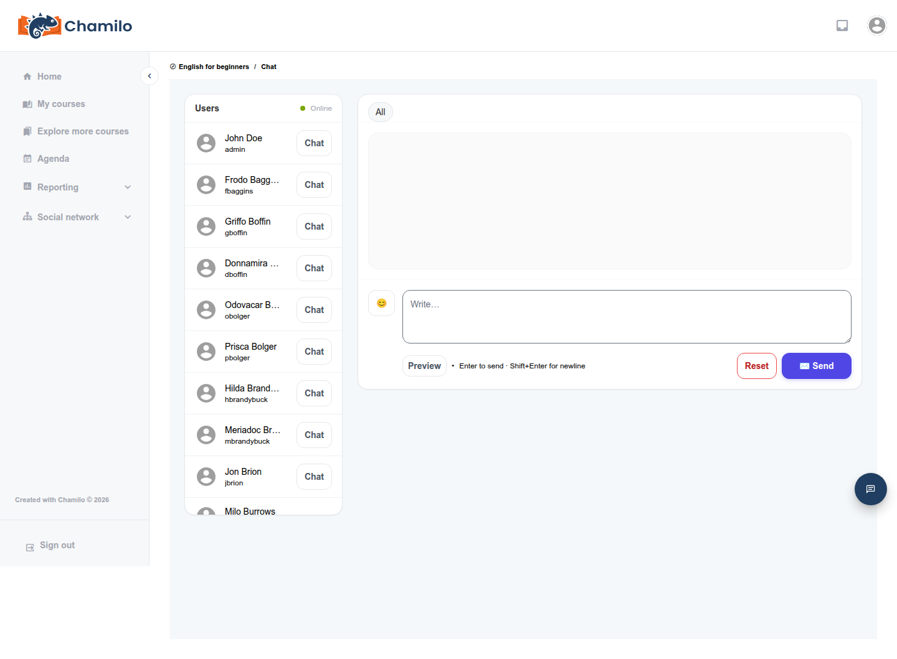

# De chattool gebruiken

Sommige cursussen bevatten een **Chat**-tool: realtime tekstberichten die aan die specifieke cursus zijn gekoppeld, handig voor snelle uitwisselingen of live vragen en antwoorden wanneer een docent aanwezig is.

## Berichten verzenden

Open de **Chat** -tool vanaf de startpagina van de cursus. U ziet een lijst **Gebruikers** van iedereen die momenteel online is in de cursus, elk met een eigen knop **Chat**, plus een tabblad **Alles** voor de hele groep:

Kies een persoon (of **Alles**) en typ uw bericht in het vak onderaan. Druk op **Enter** om het te verzenden, of op **Shift+Enter** om een nieuwe regel te beginnen zonder te verzenden. Met de optie **Voorbeeld** kunt u de opmaak controleren voordat u verzendt, en **Reset** wist wat u hebt getypt.

## Als chat is beperkt tot begeleiders

Uw beheerder kan de cursuschat zo beperken dat alleen uw docent (of andere cursusbegeleiders) berichten kan plaatsen. In dat geval kunnen alle anderen wel lezen, maar niet rechtstreeks deelnemen. Als u geen bericht kunt verzenden in de chat van een cursus, is deze instelling de meest waarschijnlijke oorzaak, en geen fout.

## Niet te verwarren met

Chamilo heeft drie verschillende functies die allemaal met berichten te maken hebben, en die zijn gemakkelijk met elkaar te verwarren:

* **Deze cursus-chattool** — realtime, gekoppeld aan één specifieke cursus, alleen bereikbaar vanaf de startpagina van die cursus.
* **[Postvak IN](../inbox.md)** — privé, asynchrone berichten met iedereen op het platform, los van een specifieke cursus.
* **Het zwevende chatpaneel** (onderaan het scherm, bijna overal beschikbaar) — gebruikt voor directe berichten, [een-op-een-videogesprekken](../video-calls.md) indien ingeschakeld, en de [AI-tutor](ai-tutor.md), onafhankelijk van deze cursustool.

Als u een van de andere twee zoekt, raadpleeg dan de bijbehorende pagina's.

## Tips

* **Gebruik het voor live uitwisselingen op het moment zelf** — voor alles wat u later opnieuw wilt terugvinden, gebruikt u in plaats daarvan het [Forum](using-the-forum.md).
* **Controleer of er een live chatsessie is gepland** — docenten kondigen soms specifieke tijden aan waarop ze beschikbaar zijn in de cursuschat, vaak via de Agenda.
* **Als uw cursus videoconferenties heeft ingesteld**, geeft uw docent daar voor livesessies mogelijk de voorkeur aan boven tekstchat.