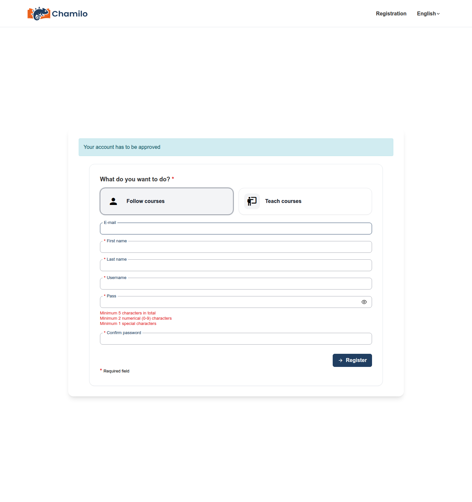

# Een account aanmaken

Of u zelf een account kunt aanmaken, hangt af van hoe uw platform is geconfigureerd. Op deze pagina leest u wat u van het zelfregistratieformulier kunt verwachten en wat er gebeurt als dit voor u niet beschikbaar is.

## Als zelfregistratie niet beschikbaar is

Niet elk Chamilo-platform staat bezoekers toe zichzelf aan te melden — een school of bedrijf geeft er vaak de voorkeur aan accounts voor leden rechtstreeks aan te maken, of beperkt de registratie tot personen die een specifieke uitnodiging hebben ontvangen. Als u op de aanmeldpagina geen koppeling **Aanmelden** (of **Registreren**) ziet, is dit de reden. In dat geval:

* Vraag uw instelling of platformbeheerder om een account voor u aan te maken, of
* Vraag uw docent om een **cursusuitnodiging** — een eenmalige koppeling die naar uw e-mailadres wordt gestuurd en waarmee u zich rechtstreeks kunt registreren, zelfs op een platform waar de algemene registratie is gesloten, en waarmee u direct wordt ingeschreven voor de cursus van die docent zodra u klaar bent. Zie [Wat de uitgenodigde persoon ziet](../../teacher-guide/assessing-learners/subscribing-users.md#what-the-invited-person-sees) voor hoe dit er van uw kant uitziet.

## Het registratieformulier invullen

Als zelfregistratie is ingeschakeld, klikt u op **Aanmelden** op de aanmeldpagina. Het formulier vraagt om een combinatie van het volgende, afhankelijk van wat uw beheerder heeft geconfigureerd:

* E-mailadres en/of gebruikersnaam
* Voor- en achternaam
* Wachtwoord (met een sterkte-indicator terwijl u typt)
* Telefoonnummer, taal, officiële code of geboortedatum
* Aanvullende profielvelden die specifiek zijn voor uw platform

U hoeft zich geen zorgen te maken als uw formulier er anders uitziet dan deze lijst — beheerders kunnen afzonderlijke velden tonen, verbergen of verplicht stellen.

## Dit formulier maakt alleen cursistaccounts aan

Standaard biedt het openbare registratieformulier helemaal geen optie om u als docent te registreren — elk account dat via dit formulier wordt aangemaakt, is een cursistaccount. Er is geen keuzelijst, selectievakje of uitgeschakelde optie die naar een docentrol verwijst; die keuze maakt eenvoudigweg geen deel uit van het formulier.

Sommige platforms schakelen wel een stap **"Wat wilt u doen?"** in met twee kaarten — **Cursussen volgen** en **Cursussen geven** — maar deze verschijnt alleen als uw beheerder registratie als docent specifiek heeft ingeschakeld. Zelfs dan kan de keuze om les te geven betekenen dat uw account moet worden goedgekeurd voordat u docentrechten krijgt.

Als u een docentaccount nodig hebt en deze optie niet ziet, vraag dan uw platformbeheerder om er een voor u aan te maken of uw bestaande account te upgraden.

## Algemene voorwaarden en CAPTCHA

Afhankelijk van de configuratie van uw platform kan het formulier ook het volgende bevatten:

* Een selectievakje **Algemene voorwaarden** onderaan het formulier ("Ik heb de algemene voorwaarden gelezen en ga ermee akkoord"), met de volledige tekst in een scrollbaar vak erboven.
* Een **CAPTCHA**-uitdaging aan het einde van het formulier, waarbij u wordt gevraagd de letters in een afbeelding te typen. Zie [CAPTCHA](../account-and-security/captcha.md) voor de reden hiervan.

Op sommige platforms toont het verzenden van het formulier een bevestigingsstap ("U bevestigt dat u zich echt wilt inschrijven op dit platform.") voordat uw account daadwerkelijk wordt aangemaakt — dit is een beveiliging tegen onbedoelde verzendingen, geen extra goedkeuringsstap.

## Wat er gebeurt nadat u het formulier verzendt

Afhankelijk van hoe uw beheerder de registratie heeft geconfigureerd, gebeurt een van de volgende drie dingen:

* **U wordt direct aangemeld** — de meest voorkomende instelling, vooral voor open platforms.
* **Uw account moet worden goedgekeurd** — uw account wordt aangemaakt maar uitgeschakeld totdat een beheerder het handmatig goedkeurt. U wordt op de hoogte gesteld zodra dat gebeurt.
* **U moet uw e-mailadres bevestigen** — u ontvangt een bevestigingskoppeling per e-mail; uw account blijft uitgeschakeld totdat u erop klikt.

Als u niet zeker weet wat voor u geldt en er na de registratie niets lijkt te gebeuren, controleer dan uw inbox (inclusief spam) op een bericht van het platform, of neem contact op met uw beheerder.

## Tips

* **Gebruik een e-mailadres dat u regelmatig controleert** — zo ontvangt u wachtwoordherstel, cursusuitnodigingen en accountbevestigingen.
* **Kies een sterk wachtwoord** — de sterkte-indicator op het formulier geeft u realtime feedback terwijl u typt.
* **Kunt u zich helemaal niet registreren?** Neem contact op met degene die uw platform beheert — het sluiten van zelfregistratie is op veel institutionele en bedrijfsplatforms een bewuste keuze.