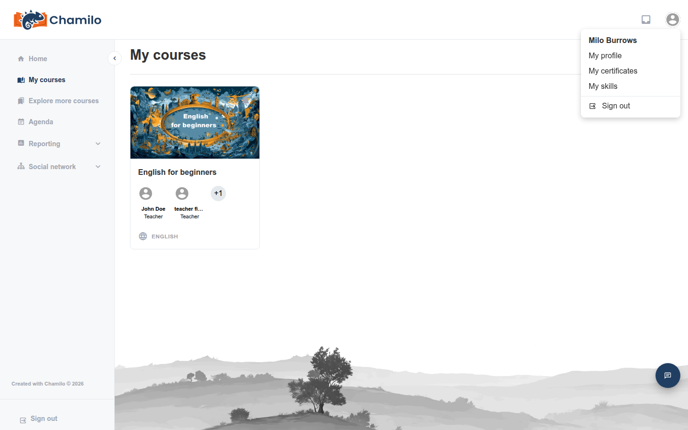
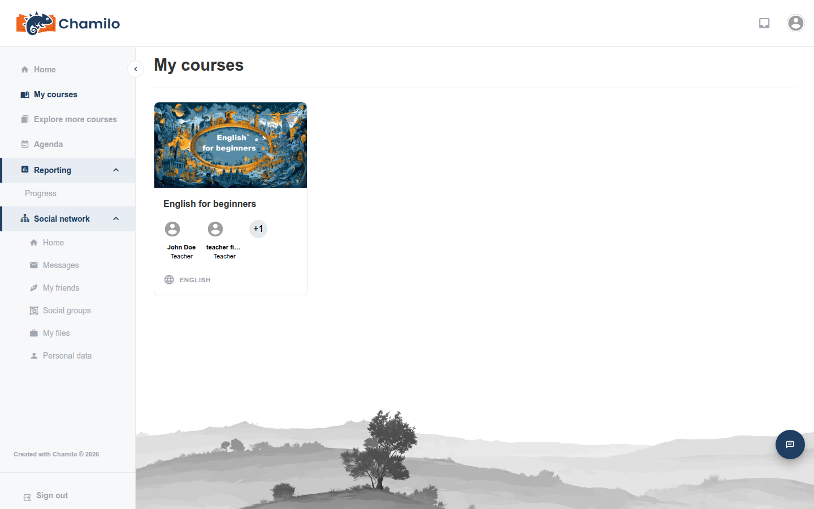

# De interface begrijpen

Chamilo 3.0 heeft een overzichtelijke, moderne interface die is ontworpen om navigatie eenvoudig te houden. Op deze pagina wordt elk onderdeel van de interface uitgelegd vanuit het perspectief van een cursist.

## De bovenbalk

De bovenbalk is altijd zichtbaar bovenaan elke pagina. Deze bevat:

* **Platformlogo** — Klik erop om op elk moment terug te keren naar de startpagina.
* **Postvakpictogram**  — Toont uw berichten. Een rode badge geeft ongelezen berichten aan. Klik om uw [Postvak](../inbox.md) te openen.
* **Pictogram voor supporttickets**  — Als dit door uw beheerder is ingeschakeld, krijgt u hiermee toegang tot het supportticketsysteem. Niet elk platform schakelt dit in, dus u ziet mogelijk alleen het postvakpictogram en uw avatar.
* **Uw avatar** — Een ronde afbeelding in de rechterbovenhoek. Klik erop om een vervolgkeuzemenu te openen:

* **Mijn profiel** — Bewerk uw persoonlijke gegevens, wijzig uw wachtwoord en stel (indien ingeschakeld) tweefactorauthenticatie in
* **Mijn certificaten** — Elk certificaat dat u hebt behaald, in al uw cursussen
* **Mijn transcript** — Als uw platform transcripts gebruikt, het [transcript](../account-and-security/my-transcript.md) van de cursussen die u hebt afgerond
* **Mijn competenties** — Competentiebadges die u zijn toegekend
* **Afmelden**

## De zijbalk

De zijbalk aan de linkerkant is uw belangrijkste navigatie. Deze kan worden ingeklapt om meer ruimte te geven aan het inhoudsgebied. Klik op de schakelpijl aan de rechterrand om de zijbalk uit of in te klappen. Chamilo onthoudt uw voorkeur.

De zijbalk bevat de volgende koppelingen (sommige kunnen verborgen zijn, afhankelijk van de configuratie van uw platform):

| Menu-item | Pictogram | Beschrijving |
|-----------|------|-------------|
| **Start** |  | Keert terug naar het hoofddashboard |
| **Mijn cursussen** |  | Toont alle cursussen waarvoor u bent ingeschreven |
| **Mijn sessies** |  | Toont uw trainingssessies (huidig, verleden, aankomend) |
| **Meer cursussen verkennen** |  | Blader door de cursuscatalogus om nieuwe cursussen te vinden en uzelf in te schrijven |
| **Agenda** |  | Uw persoonlijke agenda en cursusagenda |
| **Rapportage** |  | Vouwt uit naar **Voortgang** — uw eigen overzicht [Mijn voortgang](../my-progress.md) |
| **Sociaal netwerk** |  | Vouwt uit naar het [Sociaal netwerk](../social-network.md) en gerelateerde koppelingen, indien ingeschakeld |
| **Videoconferentie** |  | Toegang tot live videosessies (indien geconfigureerd) |

**Rapportage** en **Sociaal netwerk** zijn geen gewone koppelingen: als u erop klikt, wordt een korte lijst met subitems direct in de zijbalk uitgevouwen:

* Onder **Rapportage**: alleen **Voortgang**, waarmee u naar [Mijn voortgang](../my-progress.md) gaat.
* Onder **Sociaal netwerk**: **Start** (de sociale muur), **Berichten** (een snelkoppeling naar uw [Postvak](../inbox.md)), **Mijn vrienden**, **Sociale groepen** — en, enigszins onverwacht ook hier gegroepeerd, **Mijn bestanden** (uw persoonlijke bestandsopslag) en **Persoonsgegevens** (een export van de persoonsgegevens die het platform over u bewaart). Deze laatste twee zijn niet echt "sociale" functies; ze bevinden zich alleen in dit deel van de zijbalk.

Als uw account extra rollen heeft (bijvoorbeeld als u ook een cursus geeft), ziet u mogelijk extra zijbalkitems — zoals **Beheer** — die een account met alleen de rol van cursist nooit ziet.

Helemaal onderaan de zijbalk vindt u een optie **Afmelden** om snel af te melden wanneer u klaar bent. Deze optie is ook beschikbaar via het vervolgkeuzemenu van uw avatarpictogram in de rechterbovenhoek.
Als het platform wordt beheerd via externe authenticatiemethoden, zijn deze afmeldopties mogelijk niet beschikbaar.

## Het hoofdinhoudsgebied

Het centrale gedeelte van het scherm toont de inhoud van de huidige pagina. Bovenaan ziet u vaak een **broodkruimelpad** dat uw huidige locatie in het platform aangeeft (bijvoorbeeld: Start > Rockmuziek > Documenten). Gebruik de broodkruimels om terug te navigeren naar een bovenliggende pagina.

## De cursushomepage

Wanneer u een cursus opent, ziet u de **cursushomepage**:

* **Cursustitel** — Prominent weergegeven bovenaan
* **Cursusintroductie** — Een optionele rich-textbeschrijving, geschreven door uw docent
* **Toolraster** — Een raster van pictogrammen die de tools vertegenwoordigen die in deze cursus beschikbaar zijn (Documenten, Oefeningen, Forums, enz.)

Alleen de tools die uw docent zichtbaar heeft gemaakt, verschijnen in dit raster — zie [De weg vinden in een cursus](../courses/course-tools-overview.md) voor wat elk ervan doet. Bedieningselementen voor het bewerken van de cursus zelf (voorvertonen als student, tools tonen/verbergen, ze herschikken) verschijnen alleen voor docenten en cursusbeheerders — u ziet ze niet bij een cursus waarvoor u als cursist bent ingeschreven.

## Pictogramkleuren

Dit is nog experimenteel en niet volledig afgerond in Chamilo 3.0, maar we proberen de volgende regels te gebruiken voor alle knoppen en actiepictogrammen in de interface:

* **Groen** voor aanmaakacties. Dit omvat het toevoegen, aanmaken, importeren, opslaan en kopiëren van inhoud.
* **Blauw** voor weergaveacties. Dit omvat exporteren, bekijken, voorvertonen in lijsten of in detailweergaven, zoeken en downloaden.
* **Oranje** voor bewerkingsacties. Dit omvat bewerken, verplaatsen, configureren, in-/uitschakelen, verbergen en tonen.
* **Rood** voor verwijderingsacties. Dit omvat verwijderen, wegnemen en uitschrijven.
* **Grijs** voor annuleringsacties. Gewoon alles bij het oude laten.

## Responsief ontwerp

Chamilo 3.0 past zich aan verschillende schermformaten aan. Op een mobiel apparaat of in een smal browservenster:

* De zijbalk is standaard verborgen en kan worden geopend door op het menupictogram te tikken
* Cursuskaarten worden in één kolom weergegeven in plaats van in een raster
* Tabellen worden horizontaal scrollbaar

Dit betekent dat u uw cursussen kunt openen vanaf een telefoon, tablet of computer, hoewel de interface er afhankelijk van het apparaat iets anders uit kan zien.