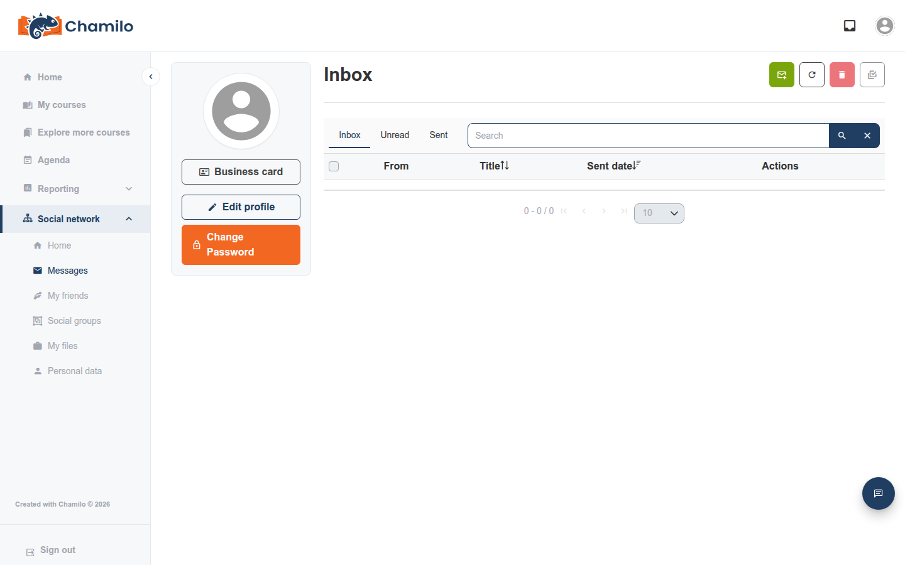

# Inbox

De **Inbox** is het privéberichtensysteem van Chamilo — asynchrone, e-mailachtige berichten tussen u en andere gebruikers op het platform, onafhankelijk van een specifieke cursus.

## Uw Inbox openen

Klik op het pictogram **Inbox**  in de bovenste balk. Een rode badge toont hoeveel ongelezen berichten u hebt. Als dit pictogram helemaal ontbreekt, heeft uw beheerder platformberichten uitgeschakeld.

## Lezen en beantwoorden

Uw inbox toont ontvangen berichten en geeft aan welke ongelezen zijn. Open een bericht om het te lezen en gebruik **Beantwoorden** om te reageren — u kunt meerdere ontvangers tegelijk in een antwoord opnemen, handig om een kleine groep mensen op de hoogte te houden zonder een formele cursus of sociale groep aan te maken.

## Beantwoorden vanuit e-mail

Als uw beheerder e-mailantwoorden voor directe berichten heeft ingeschakeld, heeft de notificatie-e-mail voor een Chamilo-bericht een speciaal antwoordadres. U kunt antwoorden vanuit uw gewone e-mailclient; Chamilo valideert het antwoord en voegt het toe aan hetzelfde gesprek in uw Inbox.

Verstuur het antwoord vanaf hetzelfde e-mailadres dat op uw Chamilo-account is geregistreerd en schrijf uw reactie boven de markering **Reply above this line**. Niet elke platformnotificatie is beantwoordbaar — deze functie geldt voor notificaties van directe berichten wanneer de beheerder inkomende mail heeft geconfigureerd.

## Een nieuw bericht opstellen

Klik op de knop **nieuw bericht** , kies een of meer ontvangers, schrijf een onderwerp en een berichttekst, en verstuur. Net als bij een antwoord kan een nieuw bericht naar meerdere personen tegelijk gaan.

## Een functiegrafiek invoegen

U kunt een grafiek van een wiskundige functie toevoegen aan een nieuw Inbox-bericht of antwoord:

1. Selecteer in de berichteditor **Grafiek** (de actie **Grafiek invoegen**).
2. Voer een functie van `x` in, bijvoorbeeld `x^3`, `sin(x)` of `2*x+1`.
3. Selecteer **Grafiek invoegen**, controleer het resultaat in uw bericht en verstuur het.

De expressie kan `x`, getallen, `pi`, `e`, haakjes, `+`, `-`, `*`, `/`, `^` en de functies `sin`, `cos`, `tan`, `sqrt`, `abs`, `log` en `exp` gebruiken. Gebruik `*` voor vermenigvuldiging en haakjes voor functieargumenten. Expressies zijn beperkt tot 120 tekens. De grafiek toont een vast venster van ongeveer **x = -3 tot 3** en **y = -10 tot 10**, zodat waarden buiten dat venster niet worden weergegeven.

Ontvangers kunnen de weergegeven grafiek in het Inbox-bericht bekijken. Deze functie staat los van het schrijven van [wiskundige formules in LaTeX](../teacher-guide/adding-content/math-formulas.md); ze plot ondersteunde functies in plaats van willekeurige scripts of een volledige grafische-rekenmachinetaal te evalueren. Zie [PR #9439](https://github.com/chamilo/chamilo-lms/pull/9439).

## Tabbladen en acties

Naast uw **Inbox** toont een tabblad alleen uw **Ongelezen** berichten en een ander tabblad **Verzonden** — wat u hebt verstuurd, voor uw eigen referentie. Met een zoekvak kunt u een bericht op trefwoord vinden. Met de knoppen boven de lijst kunt u een nieuw bericht opstellen, vernieuwen, geselecteerde berichten verwijderen en geselecteerde berichten als gelezen markeren.

## Status van e-mailnotificaties

Als uw beheerder het bijhouden van geopende e-mails heeft ingeschakeld, kan de lijst **Verzonden** een datum **E-mailnotificaties** tonen voor berichten waarvan de trackingafbeelding van de notificatie is opgevraagd. Dit is slechts een aanwijzing dat de e-mail mogelijk is geopend; het is geen bewijs dat deze is gelezen.

## Berichttags

Als uw platform berichttags gebruikt, ziet u in uw inbox een taglijst waarop u kunt klikken om berichten op die tag te filteren — handig om gerelateerde gesprekken gemakkelijk terug te vinden naarmate uw inbox groeit.

## Relatie tot andere berichtfuncties

De Inbox staat los van het cursusgereedschap [Chat](courses/using-the-chat-tool.md) en van het zwevende chatpaneel dat wordt gebruikt voor directe berichten en de [AI Tutor](courses/ai-tutor.md) — elk is een werkelijk afzonderlijke functie, ook al gaat het bij alle drie om het uitwisselen van berichten. Het [Sociaal netwerk](social-network.md) gebruikt, indien ingeschakeld, dezezelfde Inbox voor privéberichten in plaats van een eigen systeem.

## Tips

* **Controleer de badge op het Inbox-pictogram** — dat is de snelste manier om nieuwe berichten op te merken zonder de pagina te openen.
* **Gebruik de Inbox voor alles wat niet aan één cursus is gebonden** — cursusspecifieke discussie hoort doorgaans in het Forum of de Chat van die cursus.
* **De koppeling "Berichten" van het Sociaal netwerk leidt naar dezezelfde Inbox** — u mist geen aparte mailbox als u deze via die weg bereikt in plaats van via de bovenste balk.