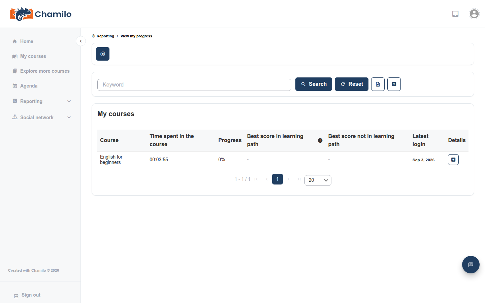
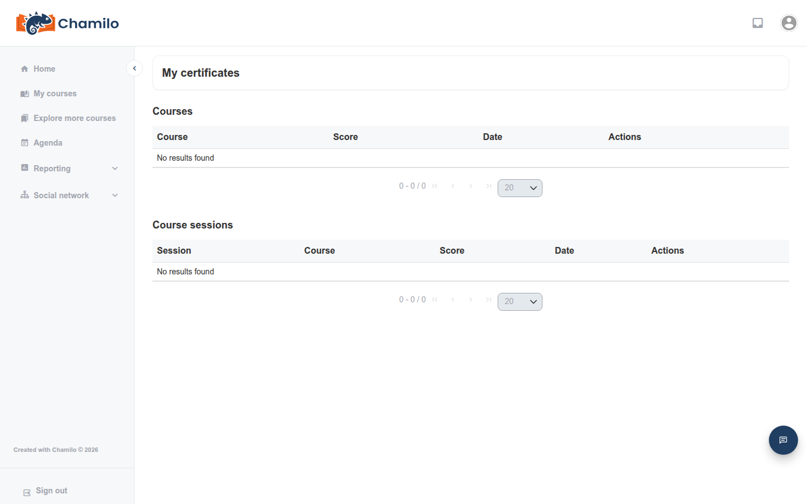

# Mijn voortgang

**Mijn voortgang** geeft u in één oogopslag een overzicht van uw activiteit en resultaten in alle cursussen waarvoor u bent ingeschreven — u hoeft niet elke cursus afzonderlijk te openen om te zien waar u staat.

## Toegang

Klik op **Rapportage**  in de zijbalk om deze uit te klappen en klik vervolgens op **Voortgang**. Dit is uw eigen, persoonlijke weergave — er worden uitsluitend uw eigen gegevens getoond, niet die van uw medestudenten.

## Wat u ziet

Een tabel met alle cursussen waarin u bent ingeschreven, met:

* **Tijd besteed in de cursus**
* **Voortgang** — het voltooiingspercentage van uw leerpad
* **Beste score in leerpad** en **beste score buiten leerpad** — uw hoogste resultaten, uitgesplitst naar of ze afkomstig zijn van een toets die in een leerpad is ingebed of van een zelfstandige toets
* **Laatste aanmelding** — het laatste moment waarop u die cursus hebt geopend

Klik op de knop **Details** naast een cursus om drie subtabellen uit te klappen zonder de pagina te verlaten:

* **Toetsen** — uw pogingen, beste score en rangschikking ten opzichte van medestudenten (als uw docent rangschikkingen toont)
* **Leerpaden** — bestede tijd, voortgang en score voor elk leerpad
* **Verworven competenties** — competentiebadges die u in die cursus hebt behaald

## Uw certificaten

Certificaten maken geen deel uit van deze pagina — u vindt ze onder **Mijn certificaten**, in het avatarmenu rechtsboven in het scherm. Daar staan alle cursussen en sessies waarin u een certificaat hebt behaald, met de score, de datum en knoppen om het te **bekijken** of te **downloaden**.

In uw avatarmenu staat ook een koppeling **Mijn competenties**, met de competentiebadges die u zijn toegekend — los van beide bovenstaande pagina's.

## Elders in een cursus

Enkele verwante cijfers staan in de cursus zelf en niet hier:

* Het hulpmiddel **Beoordelingen** (gradebook) toont uw eigen score voor die cursus, en soms uw rangschikking, de beste score en het klasgemiddelde, als uw docent dat detailniveau heeft ingeschakeld.
* Vanuit uw resultaten in het gradebook kunt u ook een optie **Badges exporteren** vinden voor competenties die u hebt behaald.

## Tips

* **Controleer "Mijn voortgang" vóór een gesprek met een docent** — dit is de snelste manier om in één keer uw positie in al uw cursussen te zien.
* **Bestede tijd en voortgang zijn niet hetzelfde** — u kunt veel tijd besteden met weinig voortgang, of omgekeerd; gebruik beide samen om te beoordelen hoe het gaat.
* **Certificaten staan in een ander menu** — denk eraan de koppeling "Mijn certificaten" van uw avatar te controleren, en niet deze pagina, wanneer u een certificaat zoekt.