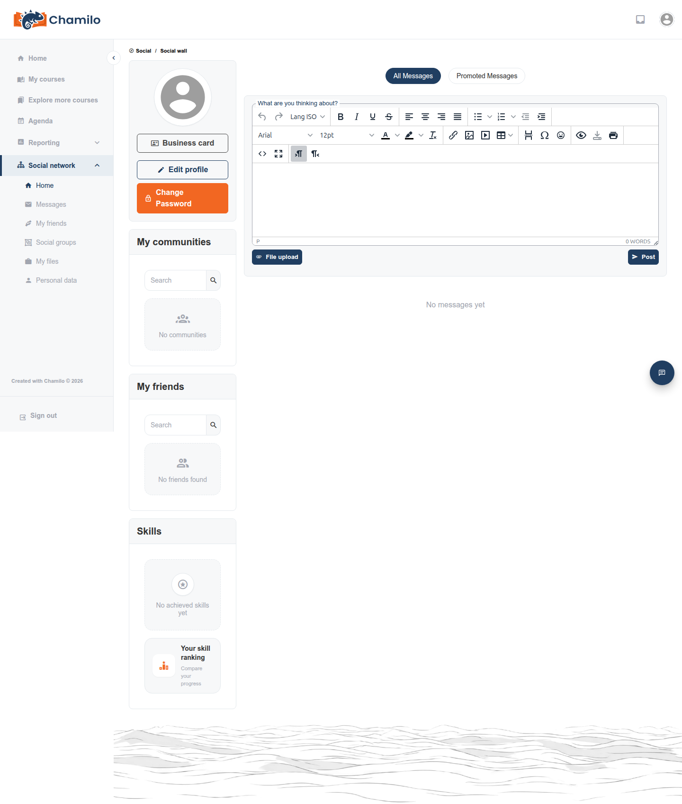

# Sociaal netwerk

Chamilo bevat een ingebouwd sociaal netwerk om in contact te komen met andere gebruikers op het platform — los van een specifieke cursus. Of u er toegang toe hebt, hangt volledig af van uw beheerder: het staat standaard aan, maar kan platformbreed worden uitgeschakeld.

## Of u toegang hebt

Klik op **Sociaal netwerk**  in de zijbalk om het uit te vouwen en klik vervolgens op **Start**. Als deze optie helemaal niet aanwezig is, heeft uw beheerder het voor uw platform uitgeschakeld — er ontbreekt niets aan uw kant.

In hetzelfde uitgevouwen gedeelte staan ook **Berichten**, **Mijn vrienden** en **Sociale groepen** — en, enigszins onverwacht, **Mijn bestanden** (uw persoonlijke bestandsopslag) en **Persoonlijke gegevens** (een export van de persoonlijke gegevens die het platform over u bewaart). Die laatste twee zijn geen sociale functies; ze zijn alleen in dit deel van de zijbalk gegroepeerd.

## Uw sociale muur

Eenmaal binnen toont uw **muur** een feed met activiteit van u en de personen met wie u verbonden bent. U kunt updates plaatsen en — indien ingeschakeld door uw beheerder — berichten van uw connecties leuk of niet leuk vinden en erop reageren.

## Contact leggen met anderen

U kunt naar andere gebruikers zoeken en hen een connectieverzoek sturen. Als **cursist kunt u alleen een connectie maken met andere cursisten** — u kunt geen connectieverzoek naar een docent sturen. Een docent kan daarentegen wel een verzoek naar u sturen. Op sommige platforms configureert uw beheerder docenten zo dat zij automatisch als vrienden verschijnen voor elke cursist, zonder dat een van beide partijen dit hoeft aan te vragen — als u docenten al als connecties ziet zonder dat u daarom hebt gevraagd, is dit de reden.

## Berichten versturen vanuit het sociaal netwerk

Berichten en connecties vormen de sociale kant; het versturen van een privébericht aan iemand verloopt via het afzonderlijke [Postvak IN](inbox.md) van het platform — het sociaal netwerk verwijst daarnaar en heeft geen eigen, afzonderlijk berichtensysteem.

## Zwevende chat en videogesprekken

Het zwevende chatvenster is een afzonderlijke functie voor realtimeberichten, los van het [Postvak IN](inbox.md) en van de eigen Chat-tool van een cursus. Selecteer een online contact om rechtstreeks te chatten.

Als uw beheerder videochat heeft ingeschakeld en uw browser WebRTC ondersteunt, kan een online contact ook **Videogesprek starten** tonen. Gesprekken zijn één-op-één: een inkomend gesprek kan worden **Geaccepteerd** of **Geweigerd**, en tijdens het gesprek kunt u de microfoon dempen, de camera in- of uitschakelen of ophangen. Uw browser kan om toestemming voor camera en microfoon vragen.

Als de videoactie niet wordt getoond, kan de functie door de beheerder zijn uitgeschakeld, kan de andere gebruiker offline zijn, of ondersteunt de browser mogelijk niet de vereiste media-API's.

## Sociale groepen

U kunt deelnemen aan bestaande **sociale groepen** rond gedeelde interesses en — als uw beheerder cursisten toestaat groepen aan te maken — zelf een groep starten. Sociale groepen gelden platformbreed en staan los van de eigen tool **Groepen** van een cursus (zie [Uw weg vinden in een cursus](courses/course-tools-overview.md)); deelnemen aan of berichten plaatsen in een sociale groep heeft geen invloed op een cursus waarvoor u bent ingeschreven.

## Tips

* **Verwacht niet zelf een docent als vriend toe te voegen** — dat werkt alleen de andere kant op, tenzij uw beheerder automatische connecties heeft geconfigureerd.
* **Sociale groepen en cursusgroepen staan los van elkaar** — verwar een projectgroep van een cursus niet met een groep in het sociaal netwerk met dezelfde naam.
* **Ziet u geen likes of dislikes?** Uw beheerder kan die functie platformbreed inschakelen of gedeeltelijk uitschakelen (waarbij alleen „like" behouden blijft).