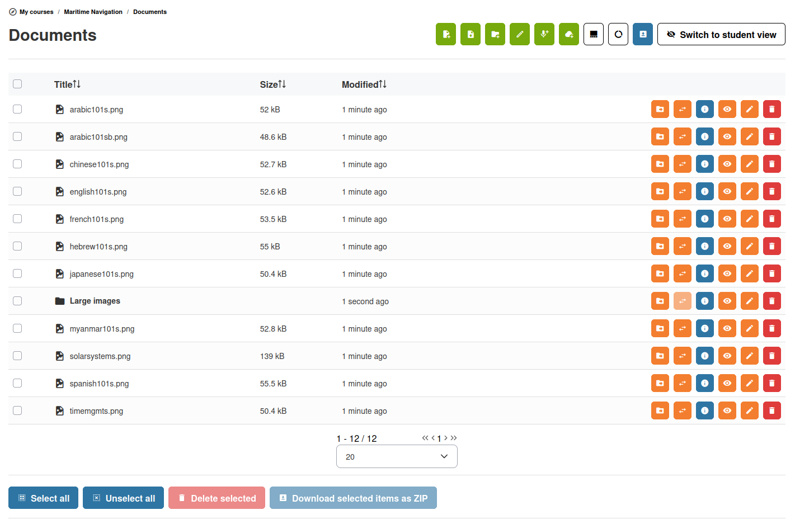

# Documenten

De documententool is de bestandsopslag van uw cursus. U kunt bestanden uploaden, documenten in HTML-formaat aanmaken, inhoud in mappen organiseren en cursisten toegang geven tot alle materialen die zij nodig hebben.

## De documententool openen

Open de tool **Documenten**  vanaf de startpagina van de cursus. U ziet een bestandsbrowser met de hoofdmap van de documentenbibliotheek van uw cursus.

## Bestanden uploaden

1. Klik op de knop **Uploaden** 
2. Selecteer een of meer bestanden op uw computer (u kunt bestanden naar het uploadgebied slepen)
3. De bestanden worden geüpload en verschijnen in de huidige map

Chamilo ondersteunt de meeste gangbare bestandstypen: PDF, kantoordocumenten (.docx, .odt), presentaties (.pptx, .odp), spreadsheets (.xlsx, .ods), afbeeldingen (PNG, JPG, SVG, GIF), audiobestanden, videobestanden (inclusief WEBM), HTML-bestanden en meer.

Sommige indelingen kunnen door de portaalbeheerder worden verboden via een whitelist-/blacklistfilter in het beveiligingsgedeelte van de administratie.

Voor een betere leesbaarheid voor cursisten raden we aan bestanden te uploaden die een browser kan weergeven of openen zonder extra hulpmiddelen. Dit maakt uw cursus draagbaarder en daardoor toegankelijker voor mobiele apparaten en beter leesbaar voor mensen met bijzondere behoeften.

## Inhoud aanmaken

Naast het uploaden van bestanden kunt u inhoud rechtstreeks in Chamilo aanmaken:

### Webpagina's

1. Klik op **Nieuw document**
2. Gebruik de rich-texteditor om uw inhoud te schrijven met opmaak, afbeeldingen, tabellen en koppelingen
3. Voer een **titel** in voor de pagina
4. Opslaan

De rich-texteditor (TinyMCE) biedt functies vergelijkbaar met een tekstverwerker, waaronder:

* Tekstopmaak (vet, cursief, koppen, lijsten)
* Tabellen
* Afbeeldingen (uploaden of koppelen aan bestaande afbeeldingen)
* Ingesloten video's en audio
* Koppelingen naar andere bronnen
* HTML-bronbewerking voor gevorderde gebruikers

### AI-mediageneratie

Wanneer AI-hulpmiddelen op het platform zijn ingeschakeld, kunt u de AI vragen een **afbeelding** of een **korte video** te genereren om een alinea in het document dat u bewerkt te illustreren. Selecteer een alinea, open het dialoogvenster **AI-media genereren** en de AI produceert een media-item dat u kunt bekijken en invoegen. Het dialoogvenster respecteert machtigingen op cursusniveau en verschijnt alleen in cursussen waar AI-mediageneratie is toegestaan.

### Audio-opname

Als uw browser dit ondersteunt, kunt u audio rechtstreeks opnemen in de documententool — handig voor het maken van audio-instructies of inhoud voor taalonderwijs. Hiervoor is een HTTPS-configuratie voor Chamilo vereist, omdat audio-opname technologie gebruikt die de browser alleen toestaat als de verbinding beveiligd is.

## Organiseren met mappen

Houd uw documentenbibliotheek georganiseerd met mappen:

1. Klik op **Nieuwe map** 
2. Voer een mapnaam in
3. Opslaan

U kunt geneste mappen aanmaken om een logische inhoudshiërarchie op te bouwen (bijv. `Module 1 > Week 1 > Readings`).

### Bestanden verplaatsen

* Zoek uw bestand in de lijst
* Klik op **Verplaatsen** 
* Selecteer de doelmap
* Bevestig

## Documenten beheren

Voor elk bestand of elke map kunt u:

| Actie | Pictogram | Beschrijving |
|--------|------|-------------|
| **Bewerken** |  | De naam van het bestand wijzigen of de inhoud bewerken (voor webpagina's) |
| **Verwijderen** |  | Het bestand of de map verwijderen |
| **Downloaden** |  | Het bestand naar uw computer downloaden |
| **Zichtbaarheid** |  | Het bestand voor cursisten verbergen of tonen |
| **Vervangen** |  | Het bestand vervangen door een bijgewerkte versie |
| **Verplaatsen** |  | Naar een andere map verplaatsen |

Het vervangen van een bestand is een belangrijke functie wanneer u documenten gebruikt om leerpaden op te bouwen, omdat het vervangen van het document het document laat vernieuwen zonder dat cursisten de voortgang verliezen die voor dat document is opgeslagen.

### Bulkacties

Selecteer meerdere bestanden met selectievakjes en gebruik vervolgens de werkbalk om alle geselecteerde items in één keer te verwijderen of te downloaden.

#### Meerdere documenten tegelijk verplaatsen

In de documentenlijst selecteert u de bestanden of mappen die verplaatst moeten worden en gebruikt u vervolgens de actie **Verplaatsen** voor de selectie. Kies de doelmap en bevestig. Hiermee worden de geselecteerde documenten samen verplaatst in plaats van de bewerking voor elk item te herhalen.

De bewerking respecteert de bewerkrechten voor documenten en de bestaande beveiligingen bij het verplaatsen van mappen; een item waarvoor u geen bewerkrechten hebt, is geen geldig verplaatsingsdoel. Controleer na bevestiging de bestemming en de resulterende mapinhoud, vooral bij het verplaatsen van een gemengde selectie van bestanden en submappen. Zie [bulkverplaatsing van documenten PR #9349](https://github.com/chamilo/chamilo-lms/pull/9349).

## OnlyOffice-integratie

Als uw beheerder de **OnlyOffice**-plug-in heeft geconfigureerd, kunt u Word-, Excel- en PowerPoint-bestanden (of LibreOffice-bestanden) rechtstreeks in de browser bewerken zonder ze te downloaden. Zoek naar de optie **Bewerken met OnlyOffice**  wanneer u een ondersteund bestand bekijkt.

Documenten worden opgeslagen in Chamilo; OnlyOffice wordt alleen gebruikt om de documenten in de browser te **bekijken** of te bewerken, zonder dat een extra hulpmiddel nodig is.

## Cloudbestanden

Als u cloudopslag (Azure Blob, AWS S3 of Google Cloud) voor uw bestanden gebruikt, worden deze in de cloud opgeslagen, maar kunt u ze vanaf hier koppelen. Dit is transparant voor u en uw cursisten — het documenthulpmiddel werkt op dezelfde manier, ongeacht de opslagbackend.

## Tips

* **Organiseer vroeg** — Maak uw mappenstructuur aan voordat u inhoud uploadt, zodat u later niet hoeft te reorganiseren. Als u andere cursussen met de juiste structuur hebt gemaakt, kunt u die cursussen later als sjabloon gebruiken
* **Gebruik beschrijvende bestandsnamen** — Help cursisten te vinden wat ze nodig hebben met duidelijke, betekenisvolle namen
* **Verberg werk in uitvoering** — Gebruik de zichtbaarheidsschakelaar om documenten te verbergen die u nog aan het voorbereiden bent
* **Koppel vanuit leerpaden** — Verwijs naar documenten binnen uw leerpaden om begeleide leerreeksen te maken
* **Controleer het schijfquotum** — Als uw cursus een opslaglimiet heeft, verwijder dan verouderde bestanden om ruimte vrij te maken