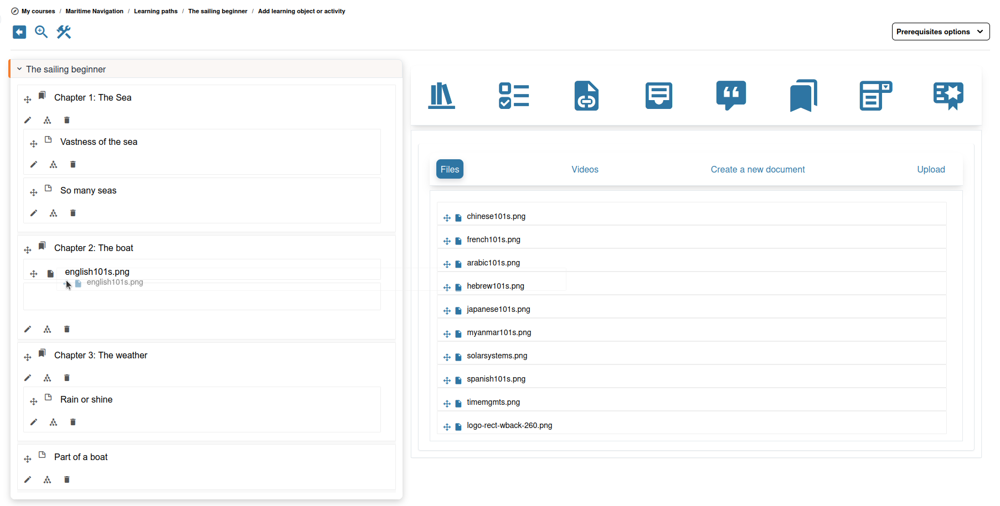
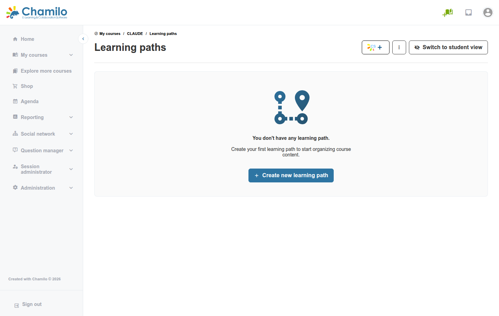
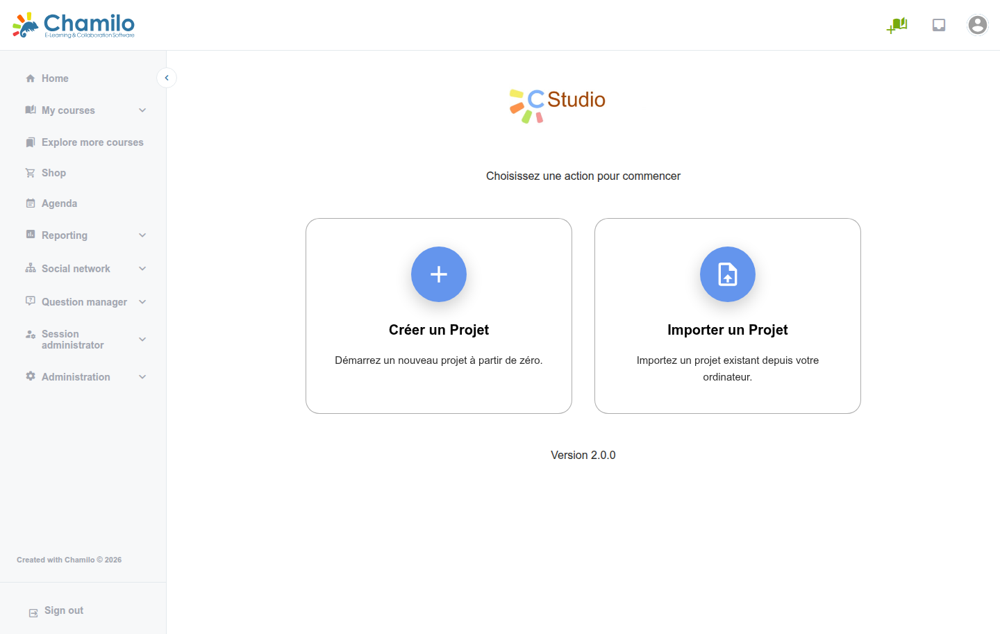
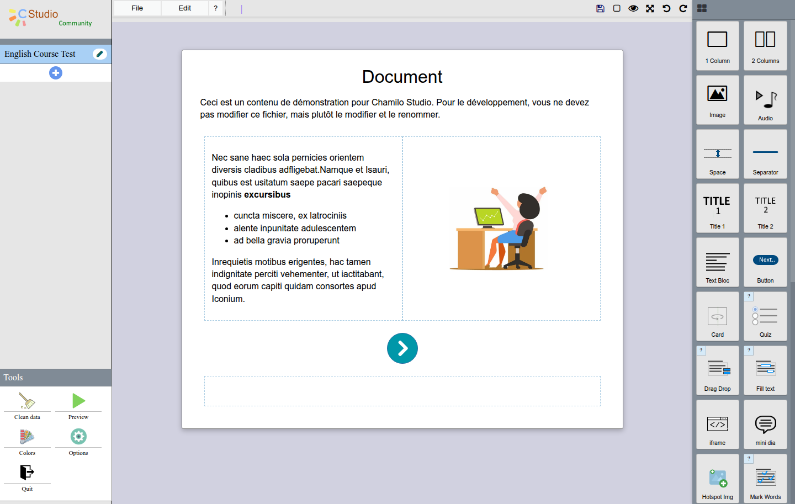
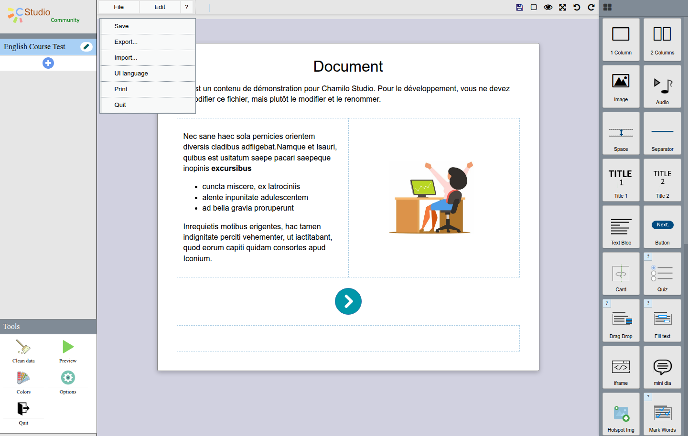

# Leerpaden

Met leerpaden maakt u gestructureerde reeksen van leeractiviteiten. Een leerpad leidt uw cursisten in een specifieke volgorde door documenten, oefeningen, links en andere bronnen, met optionele voorwaarden en voortgangsregistratie.

Dit is wellicht het meest gebruikte cursusgereedschap, omdat het fungeert als een samensteller voor veel andere gereedschappen en heel goed het ***enige*** gereedschap kan zijn waarmee cursisten te maken krijgen.

## Waarom leerpaden gebruiken?

Leerpaden zijn nuttig wanneer u het volgende wilt:

* **De volgorde bepalen** waarin inhoud wordt doorgenomen — zorg ervoor dat cursisten basismateriaal afronden voordat ze verdergaan
* **Voortgang volgen** — zie precies waar elke cursist zich in de reeks bevindt
* **Voorwaarden instellen** — vereis dat cursisten een oefening halen voordat ze toegang krijgen tot het volgende onderdeel
* **Afronding belonen** — koppel de afronding van een leerpad aan het cijferboek en aan certificaten
* **Inhoud verpakken** — maak zelfstandige leermodules die cursisten in hun eigen tempo kunnen doorlopen

## Een leerpad maken

1. Open het gereedschap **Leerpaden**  vanaf de startpagina van de cursus
2. Klik op **Een leerpad maken**
3. Voer een **titel** en een optionele beschrijving in
4. Sla op — u wordt naar de leerpadeditor geleid

## De leerpadeditor

De editor heeft twee hoofdgebieden:

* **Linkerpaneel** — De lijst met items (stappen) in het leerpad, weergegeven als een boomstructuur
* **Rechterpaneel** — De inhoud van het geselecteerde item

### Items toevoegen

Klik op **Een item toevoegen** en kies wat u wilt toevoegen:

| Itemtype | Beschrijving |
|-----------|-------------|
| **Sectie** | Een kop die gerelateerde items groepeert (zoals een hoofdstuktitel). Secties bevatten zelf geen inhoud. |
| **Document** | Een bestand of webpagina uit het gereedschap Documenten van uw cursus |
| **Oefening** | Een quiz of toets uit het gereedschap Oefeningen |
| **Link** | Een externe URL |
| **Opdracht** | Een studentpublicatie uit het gereedschap Opdrachten |
| **Forum** | Een link naar een cursusforum |
| **Enquête** | Een link naar een enquête |
| **Certificaat** | Een speciale pagina om het genereren van een afrondingscertificaat of het toekennen van vaardigheden te activeren |

### Items ordenen

* **Sleep** items om ze opnieuw te ordenen
* **Nest items** onder secties door ze naar rechts te slepen
* **Verwijder** items die u niet meer nodig hebt

### Voorwaarden instellen

Voorwaarden zorgen ervoor dat cursisten bepaalde stappen afronden voordat ze toegang krijgen tot andere:

1. Selecteer een item in het leerpad
2. Open de instellingen voor de **voorwaarden**
3. Kies welk(e) voorafgaand(e) item(s) eerst moet(en) worden afgerond
4. Bij oefeningen kunt u een **minimumscore** vereisen (bijv. "Moet minstens 70% scoren op Quiz 1 voordat Module 2 toegankelijk is")

### Bestaande items en oudere links bewerken

Gebruik de **Leerpadeditor** (de Vue-bouwer) om een stap te bewerken, de voorwaarden ervan aan te passen, deze in de boom te verplaatsen of te verwijderen. Selecteer een item en gebruik **Bewerken** om het formulier te openen (bij gekoppelde toetsitems kan bewerken het gereedschap Oefeningen openen); gebruik **Voorwaarden** om de toegangsvereisten te wijzigen, sleep items om de volgorde te wijzigen en gebruik de verwijderactie (met bevestiging) om een item te verwijderen. Voor deze wijzigingen is toestemming nodig om het leerpad in de bijbehorende cursus te bewerken.

Oudere bladwijzers of integraties kunnen nog verwijzen naar `public/main/lp/lp_controller.php` met een itemactie zoals `edit_item`, `edit_item_prereq`, `move_item`, `delete_item` of `deleteitem`. Deze acties **leiden nu door naar de Vue-bouwer in plaats van het item te wijzigen**. Een geldige itemlink kan het item selecteren en het bewerkings- of voorwaardenpaneel openen; een vroegere verplaats- of verwijderlink opent alleen de bouwer, zodat de docent die actie daar moet voltooien. Als een link het bedoelde item niet opent, navigeer dan naar het leerpad vanuit de huidige cursus en selecteer het handmatig.

## Ervaring van de cursist

Wanneer een cursist een leerpad opent:

* Ziet hij of zij de lijst met items in het linkerpaneel
* Zijn voltooide items gemarkeerd met een vinkje
* Zijn items waarvan niet aan de voorwaarden is voldaan vergrendeld
* Wordt de voortgang automatisch bijgehouden — als een cursist weggaat en terugkomt, gaat hij of zij verder waar hij of zij was gebleven
* Toont een voortgangsbalk het totale afrondingspercentage

### Externe links die niet kunnen worden ingesloten

Een externe **Link**-stap wordt normaal gesproken binnen het leerpad geopend wanneer de bestemmingswebsite insluiten toestaat. Sommige sites voorkomen dat ze in een iframe worden weergegeven met `X-Frame-Options` of een Content Security Policy (`frame-ancestors`); een HTTPS-pagina van Chamilo kan in deze flow ook geen onbeveiligde HTTP-pagina insluiten.

Wanneer Chamilo detecteert dat een externe link niet kan worden ingesloten, toont de speler **Deze link kan niet binnen het leerpad worden weergegeven** met een link **Openen in een nieuw tabblad**. De cursist kan die link gebruiken om de pagina afzonderlijk te bekijken en daarna terug te keren naar het leerpad. Probeer niet de insluitbeperkingen van een andere site te omzeilen.

Of een externe pagina kan worden ingesloten, hangt af van de eigen antwoordheaders en de netwerkbeschikbaarheid. Deze terugval is toegevoegd in [PR #9164](https://github.com/chamilo/chamilo-lms/pull/9164).

### Forumstappen en navigatie in discussies

Wanneer een leerpad een **Forum**-discussie bevat, lezen cursisten de reacties met de nieuwste berichten eerst, terwijl ze in de context van het leerpad blijven. Forums-specifieke terugknoppen zijn in die weergave verborgen; gebruik daarom de bedieningselementen van het leerpad om naar de volgende stap te gaan. Buiten het leerpad behoudt dezelfde discussie de standaardnavigatie van Forums en de chronologische weergave. Zie [Forums](../collaboration-and-communication/forums.md#forum-discussions-inside-a-learning-path) ([PR #9163](https://github.com/chamilo/chamilo-lms/pull/9163)).

## SCORM-inhoud

Het leerpadhulpmiddel van Chamilo kan **SCORM 1.2**-pakketten importeren — de meest gebruikte e-learningstandaard — en, met gedeeltelijke ondersteuning, **SCORM 2004**-pakketten. Upload een SCORM-ZIP-bestand en Chamilo maakt er een leerpad van, waarbij voortgang en scores worden bijgehouden volgens de SCORM-specificatie.


**Ondersteuning voor SCORM 2004 is gedeeltelijk.** Inhoud, voortgang en scoretracking werken, maar de *sequencing- en navigatieregels* van SCORM 2004 (die bepalen in welke volgorde een cursist de inhoud mag bezoeken) worden niet toegepast. Cursisten kunnen vrij door het leerpad navigeren, net als in elk ander leerpad. Gebruik de eigen [voorwaarden](#setting-prerequisites) van Chamilo als u een volgorde wilt afdwingen.


Een SCORM-pakket importeren:

1. Klik in het hulpmiddel **Leerpaden** op de knop **⋮** (meer acties) rechtsboven op de pagina en klik vervolgens op **Importeren**

   

2. Klik op **Bestand kiezen** en selecteer het SCORM-bestand `.zip`. Pak het niet eerst uit — Chamilo verwacht het pakket precies zoals het door uw auteurstool is geëxporteerd.
3. Pas desgewenst de instellingen aan (zie hieronder) en klik vervolgens op **Importeren**

   

4. Chamilo pakt het pakket uit en maakt het leerpad automatisch aan. Het verschijnt in de lijst met leerpaden, waar u de titel, zichtbaarheid en andere instellingen kunt bewerken, net als bij elk ander leerpad.

| Instelling | Effect |
| --- | --- |
| **Standaard maximale score van 100 gebruiken** | Standaard ingeschakeld. Laat dit ingeschakeld, tenzij u een specifieke reden hebt om te wijzigen hoe de maximale score van het pakket wordt verwerkt. |
| **Inhoud** (geavanceerd) | **Lokaal** is de standaard en betekent dat het pakket op uw Chamilo-server wordt opgeslagen. Laat dit ongewijzigd voor een normale upload. |
| **Authoring** (geavanceerd) | Een label dat vastlegt met welke tool het pakket is gemaakt. De standaard (`Scorm`) is voor de meeste pakketten geschikt. |

### CMI5- / xAPI-pakketten

CMI5-pakketten (de moderne, op xAPI gebaseerde opvolger van SCORM) worden ondersteund via de plug-in **XApi**. Zodra de plug-in door uw beheerder is ingeschakeld, kunt u een CMI5-pakket importeren en kunnen cursisten het vanuit de cursus starten; hun statements worden doorgestuurd naar de geconfigureerde Learning Record Store.

## Inhoud ontwerpen met C-Studio

*Beschikbaar als uw beheerder de C-Studio-plug-in heeft ingeschakeld.*

C-Studio voegt een ingebouwde visuele editor met slepen en neerzetten toe om interactieve inhoud rechtstreeks in een leerpad te maken — een alternatief voor het importeren van een SCORM-pakket wanneer u geen aparte auteurstool zoals Articulate of iSpring hebt (of niet wilt leren). U bouwt de inhoud pagina voor pagina rechtstreeks in Chamilo, en deze wordt opgeslagen en bijgehouden zoals elk ander leerpaditem.

### Een C-Studio-project starten

Wanneer de plugin actief is, toont de lijst met leerpaden een extra knop naast het gebruikelijke actiemenu, gemarkeerd met een "+" en een tooltip "Studio Tools":

Klik erop om te starten. U wordt gevraagd een nieuw project vanaf nul te maken of een bestaand project te importeren:

Dit specifieke scherm is momenteel alleen beschikbaar in het Frans, ongeacht de taal van uw platform of cursus — een bekende beperking van de gebruikte pluginversie. Geef uw project een titel en het opent direct in de editor.

### De editor

De editor is een visuele bouwer per pagina:

* **Linkerpaneel** — de pagina's van uw project, met een "+" om er meer toe te voegen, en onderaan een sectie **Tools** (Clean data, Preview, Colors, Options, Quit)
* **Middelste canvas** — de pagina die u bouwt; klik op een element om het ter plaatse te bewerken
* **Rechterpaneel** — het componentenpalet, dat naar het canvas wordt gesleept

Het palet omvat basisbouwstenen (kolommen, afbeeldingen, audio, titels, tekst, knoppen, kaarten) en verschillende interactieve oefeningstypen: **Drag Drop**, **Fill text**, **Hotspot Img**, **Mark Words**, **Find Words** en **Sort paragraphs**, plus een **iframe**-blok voor het insluiten van externe inhoud en een **Quiz**-blok.

### Taal

De eigen interface van C-Studio kan de eerste keer dat u deze opent standaard op Frans staan, onafhankelijk van de interfacetaal van Chamilo of de taal van de cursus. Ga in dat geval naar **File > UI language** en kies uw taal — de editor wordt onmiddellijk opnieuw geladen en onthoudt daarna uw keuze.

### Opslaan en exporteren

Gebruik **File > Save** terwijl u werkt. **File > Export...** verpakt uw project als een SCORM-bestand dat u kunt downloaden, als back-up kunt bewaren of elders opnieuw kunt gebruiken via **Import...**. **File > Quit** brengt u terug naar de lijst met leerpaden, waar uw C-Studio-project nu als een gewoon item verschijnt.

## Instellingen van het leerpad

Configureer hoe het leerpad zich gedraagt:

| Instelling | Beschrijving |
|---------|-------------|
| **Zichtbaarheid** | Het leerpad voor cursisten verbergen of tonen |
| **Vereisten** | Vereisen dat andere leerpaden zijn voltooid voordat dit leerpad kan worden gevolgd |
| **Automatisch starten** | Dit leerpad automatisch openen wanneer cursisten de cursus openen |
| **Gecumuleerde SCORM-tijd** | Of de tijd over meerdere sessies wordt gecumuleerd |

## Koppelen aan het cijferboek

U kunt de voltooiing van een leerpad opnemen als beoordeelde activiteit in het cijferboek. Hierdoor kan de voortgang in het leerpad meetellen voor het totale cursuscijfer van de cursist en voor de geschiktheid voor een certificaat.

## AI gebruiken

Als de beheerder het genereren van leerpaden met AI-ondersteuning heeft ingeschakeld, vindt u een optie voor een AI-generator in het vervolgkeuzemenu met acties. Geef de AI een zo precieze context als u voor uw leerpad wenst, vraag een aantal pagina's en een geschat aantal woorden per pagina, geef vervolgens aan of u het leerpad wilt vullen met toetsen en start de generatie. Enkele minuten later kijkt u naar een volledig, tekstgebaseerd leerpad.

Bewerk de documenten om illustraties te genereren met aanvullende AI; daarna hoeft u alleen nog een controle uit te voeren voordat u het leerpad met uw cursisten kunt delen.

### AI-studiehulp voor cursisten

Wanneer de globale instelling `ai_helpers.enable_ai_helpers` is ingeschakeld, kunnen cursisten een **AI-studiehulp** gebruiken terwijl zij een documentitem lezen in de gewone leerpadspeler. Zij selecteren een tekstpassage, openen de kleine AI-hulpactie die naast de selectie verschijnt, kiezen een **leertechniek** en klikken op **Generate**.

De beschikbare technieken zijn onder meer mindmapping, de Feynman-techniek, elaboratieve ondervraging, gespreide herhaling, SQ3R, analogieën en metaforen, dubbele codering, storytelling, thematische verbanden, afgewisseld leren en geheugenpaleizen. De gegenereerde uitleg is gebaseerd op de geselecteerde passage en gebruikt de taalcontext van de cursus en de gebruiker.

De hulp is alleen beschikbaar voor documentitems in de gewone runtime; zij wordt niet getoond in de rapportage of in de Impress-modus.

## Tips

* **Begin met een overzicht** — Plan uw secties en items voordat u het leerpad opbouwt
* **Gebruik secties als hoofdstukken** — Groepeer gerelateerde items onder sectiekoppen voor duidelijkheid
* **Stel voorwaarden in voor beoordelingen** — Verplicht cursisten de inhoud te bestuderen voordat ze een toets afleggen
* **Combineer inhoudstypen** — Combineer leesmateriaal, video's, interactieve oefeningen en externe bronnen voor een boeiende leerervaring
* **Controleer de cursistenweergave** — Gebruik de functie Studentweergave om het leerpad te ervaren zoals een cursist dat zou doen
* **Gebruik SCORM voor interactiviteit** — Als u toegang hebt tot SCORM-auteurstools (zoals Articulate, iSpring of vergelijkbaar), maak dan rijke interactieve inhoud en importeer deze in Chamilo. Als uw beheerder de C-Studio-plug-in heeft ingeschakeld, kunt u in plaats daarvan vergelijkbare interactieve inhoud rechtstreeks in Chamilo bouwen — zie [Inhoud ontwerpen met C-Studio](#content-authoring-with-c-studio) hierboven