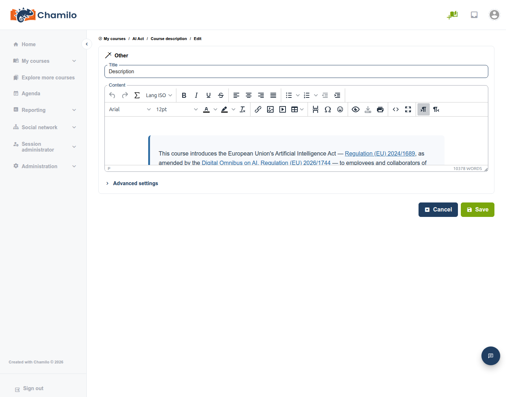
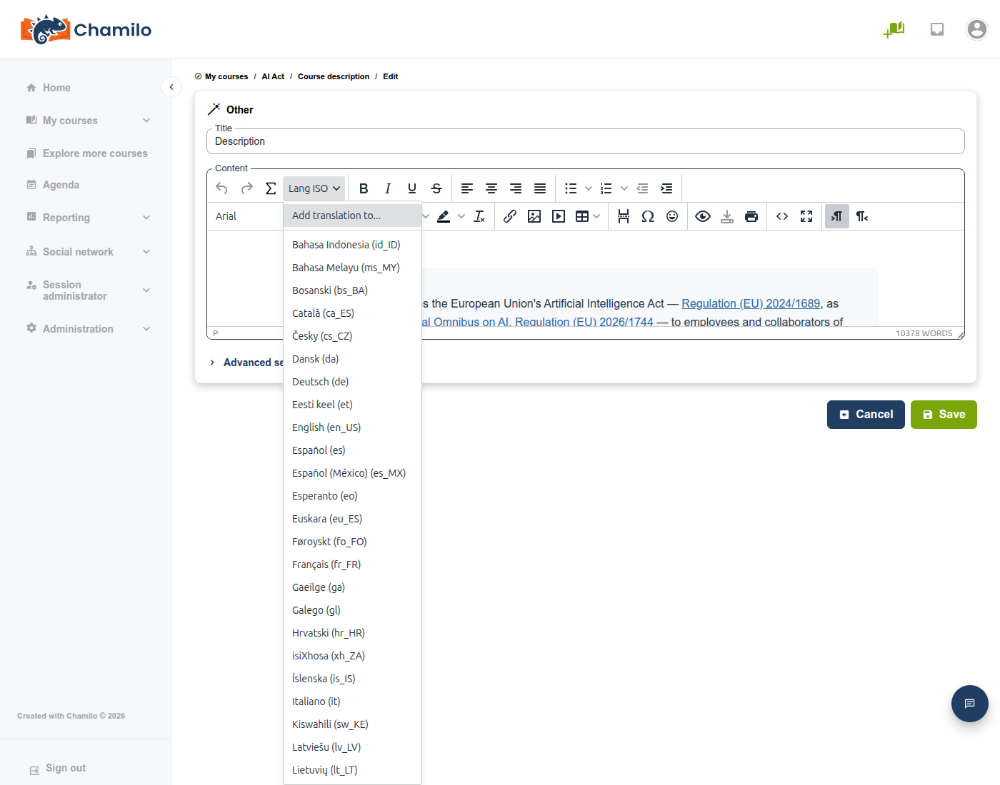
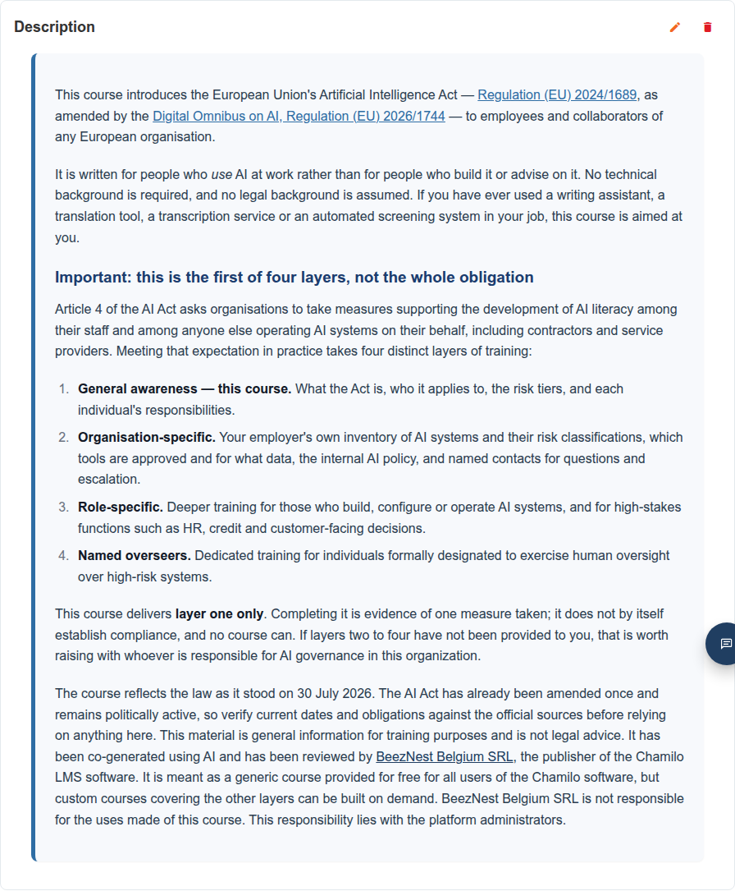
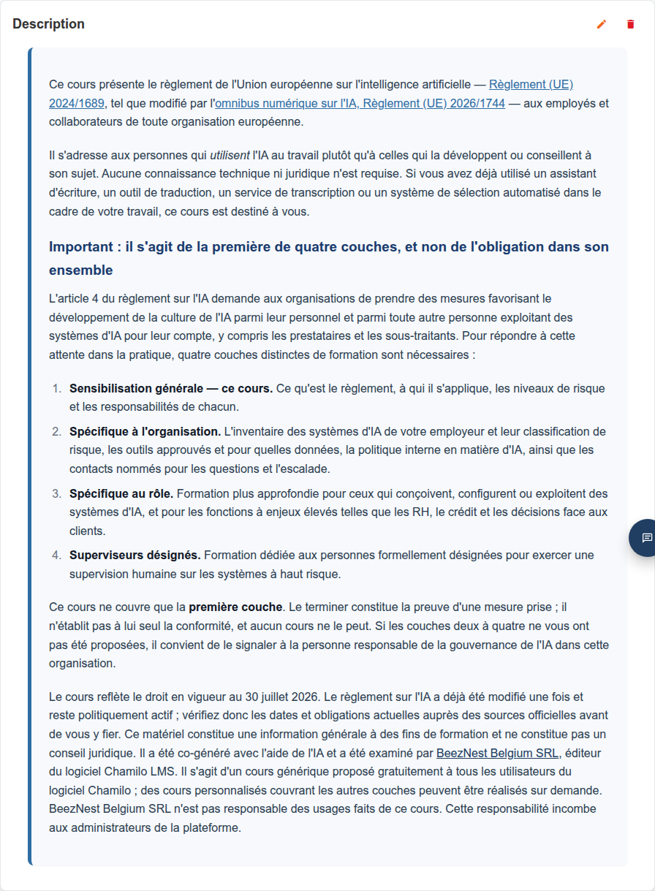
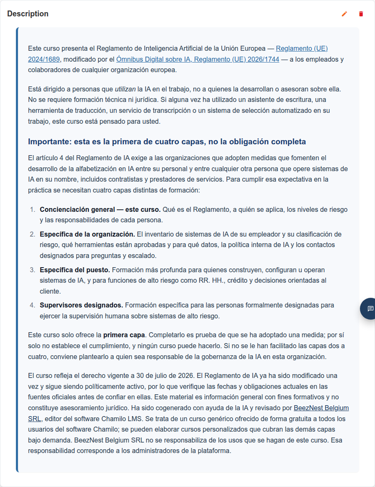
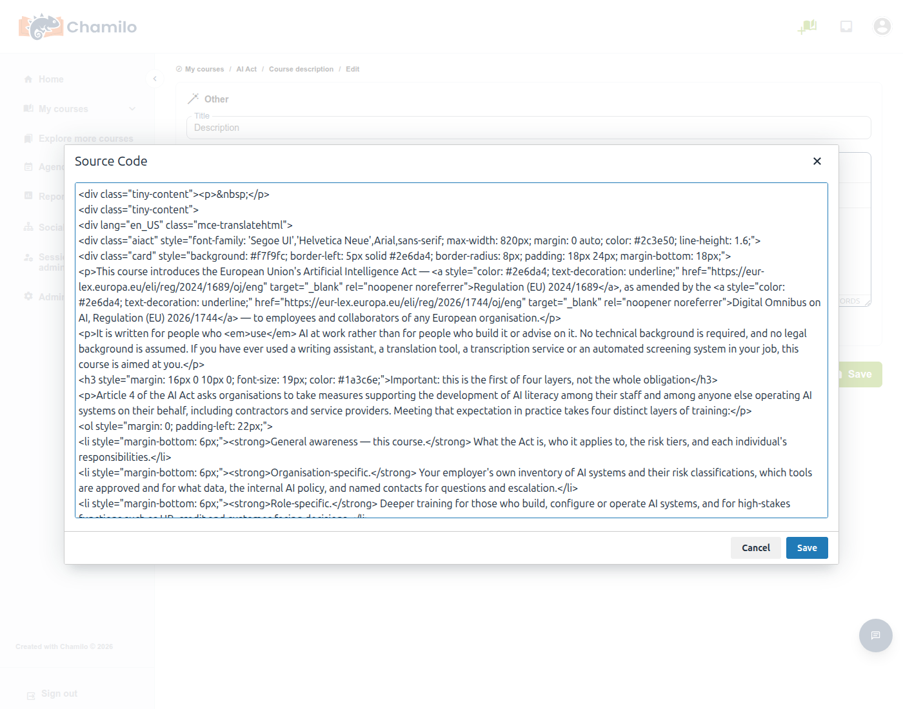

# Meertalige inhoud

Chamilo laat u **meerdere taalversies van hetzelfde stuk inhoud in één veld** schrijven — een sectie van de cursusbeschrijving, een document, een toetsvraag, een enquête — zodat elke cursist automatisch alleen de versie in de eigen taal ziet. Dit is de functie **translate_html**, genoemd naar de platforminstelling die deze functie aanstuurt.

Hierbij zijn drie verschillende personen betrokken, die elk een andere kant ervan zien:

* **Uw beheerder** moet de functie platformbreed inschakelen voordat iemand deze kan gebruiken.
* **U (de docent)** schrijft de verschillende taalversies met een knop in de rich-texteditor.
* **De cursist** profiteert ervan zonder ooit te weten dat de functie bestaat — die ziet de inhoud eenvoudigweg in de eigen taal, zonder een instelling te hoeven zoeken of om te schakelen.

## De functie inschakelen

Dit is een taak voor de beheerder, niet voor de docent. Onder **Beheer > Configuratie-instellingen > Editor** moet de instelling **Ondersteuning voor meertalige HTML-inhoud** (`translate_html`) zijn ingeschakeld. Als u de knop **Lang ISO** die hieronder wordt beschreven niet in de werkbalk van uw editor ziet, is dit vrijwel zeker de reden — vraag het uw beheerder. Zie [Editorinstellingen](../../admin-guide/platform-settings/editor-settings.md) voor het volledige overzicht van instellingen. Vanaf v3.0.0 is deze instelling standaard ingeschakeld (dat was vóór deze versie niet het geval), tenzij u een upgrade hebt uitgevoerd vanaf een eerdere versie waarin de instelling was uitgeschakeld.

Als u deze instelling weer uitschakelt, wordt inhoud die al op deze manier is geschreven niet verwijderd of beschadigd — zie [Wat cursisten zien](#what-learners-see) hieronder.

## Meertalige inhoud schrijven

De functie is overal beschikbaar waar u de volledige rich-texteditor hebt: secties van de [cursusbeschrijving](../creating-your-course/course-description.md), [documenten](documents.md), toets- en enquêtevragen, en meer.

1. Schrijf (of plak) de inhoud in uw standaardtaal, zoals gebruikelijk.
2. Selecteer die tekst en klik vervolgens op de knop **Lang ISO** in de werkbalk van de editor.

3. Kies in het menu de taal waarin u zojuist hebt geschreven — de lijst bevat elke taal die op uw platform actief is. Als de gewenste taal niet in de lijst staat, gebruikt u onderaan **Custom Chamilo ISO code...** en typt u deze in (bijv. `en_US`, `fr_FR`, `es`).

4. Chamilo omsluit uw selectie met die taaltag. Schrijf (of plak) nu de versie in de volgende taal direct erna, selecteer die en herhaal dit met een andere taal.

Ga zo door voor zoveel talen als u wilt ondersteunen. Ze staan allemaal in hetzelfde veld — tijdens het bewerken ziet u elke taalversie onder elkaar; pas wanneer iemand de pagina daadwerkelijk *bekijkt*, verbergt Chamilo alles behalve de ene taal die voor die persoon geldt (zie hieronder).

### AI-ondersteunde vertaling

Als uw beheerder een AI-tekstprovider heeft geconfigureerd, biedt hetzelfde menu **Lang ISO** bovenaan ook **Add translation to...**. Hiermee wordt uw bestaande inhoud naar het geconfigureerde AI-model gestuurd en wordt een nieuw, automatisch vertaald blok ingevoegd in de taal die u kiest (of in alle resterende talen tegelijk, als uw platform dat toestaat) — u hoeft het niet zelf te schrijven. Bestaande taalblokken blijven ongewijzigd en talen die al aanwezig zijn, worden uit de lijst weggelaten, zodat herhaald gebruik geen duplicaten oplevert.

Zoals bij alle door AI gegenereerde inhoud moet u het resultaat nalezen — het is een snelle manier om een degelijke eerste versie te krijgen in een taal die u zelf misschien niet spreekt, geen vervanging voor controle.

## Wat cursisten zien

Elke cursist ziet precies één taalversie: Chamilo probeert eerst de eigen profieltaal van de cursist; als geen van uw blokken daarmee overeenkomt, valt het terug op de taal van de cursus en daarna op de standaardtaal van het platform; als ook die niet overeenkomen, toont het de taal die u toevallig als eerste hebt geschreven, in plaats van de inhoud leeg te laten. Dit gebeurt allemaal automatisch — de cursist hoeft niets te configureren en u hoeft ook niets per cursist te configureren.

Hier is dezelfde sectie van de cursusbeschrijving, zoals gezien door drie cursisten met verschillende interfacetalen — verder is er aan de cursus niets veranderd tussen deze drie schermafbeeldingen, alleen de eigen taal van de kijker:

---
### Onder de motorkap

Als u ooit de weergave **Broncode** van een meertalig veld opent (de knop `<>` in de werkbalk van de editor), ziet u elke taalversie als volgt omhuld:

Elke versie is omhuld door een `
` (of ``, voor een korte inline-frase in plaats van een heel blok) — dat `lang`-attribuut is wat Chamilo vergelijkt met de taal van de kijker om te bepalen wat er wordt getoond. Het is de moeite waard deze specifieke klassenaam te herkennen als u ooit de paginabron inspecteert of inhoud onderzoekt die er verkeerd uitziet: **`mce-translatehtml`** is de markering waarnaar u moet zoeken.

Dit verklaart ook waarom het uitschakelen van `translate_html` in de platforminstellingen niets verbreekt dat al is geschreven: de instelling bepaalt alleen of de *auteurs*-knop **Lang ISO** in de editor verschijnt. De hierboven beschreven filtering aan de *weergavezijde* wordt onvoorwaardelijk uitgevoerd, zodat eerder geschreven meertalige inhoud correct gefilterd blijft voor elke kijker, zelfs op een platform waar een beheerder de auteursknop inmiddels heeft uitgeschakeld.

## Titels werken niet op deze manier

De titel van een cursus, de titel van een document, de titel van een toets — dit zijn platte-tekstvelden, geen opgemaakte tekst, dus ze kunnen de hierboven beschreven markup met `lang`-tags niet bevatten. Ze blijven één neutrale waarde, ongeacht wie ernaar kijkt, hoeveel taalversies u ook in de onderliggende inhoud hebt geschreven.

De enige uitzondering: als uw beheerder **Titels opslaan als HTML** (`save_titles_as_html`, eveneens onder **Beheer > Configuratie-instellingen > Editor**) heeft ingeschakeld voor het specifieke titelveld waarmee u werkt, wordt dat veld ook een echt HTML-veld, en kan dezelfde hierboven beschreven techniek **Lang ISO** erop worden toegepast. Dit komt weinig voor en wordt vooral gebruikt voor toetsvragen — de meeste titels op het platform blijven platte tekst.

## Tips

* **Houd de brontaal eerst** — plaats de meest voorkomende taal van uw platform als eerste in het veld; dat is de meest natuurlijke terugval als u later vergeet een zeldzamere taal te taggen.
* **Nest geen taalblokken** — schrijf elke versie als een afzonderlijk, opeenvolgend blok; het omhullen van het ene blok binnen het andere wordt niet ondersteund en de editor haalt geneste markeringen actief uit elkaar wanneer u een nieuwe invoegt.
* **Een sectie die in één taal leeg lijkt** betekent meestal dat er nooit een blok voor is getagd (of voor de uitgebreide terugval naar de standaardtaal van de cursus/het platform) — controleer de weergave Broncode op de talen die daadwerkelijk aanwezig zijn.