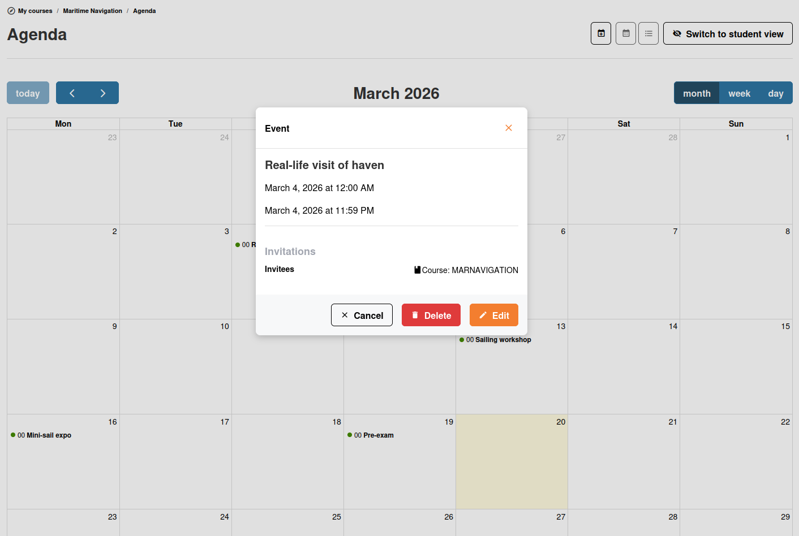
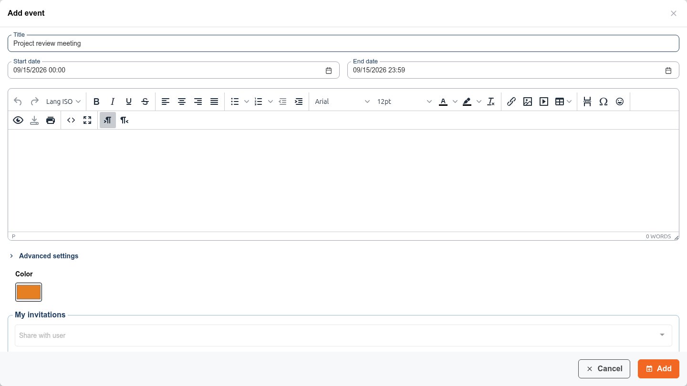
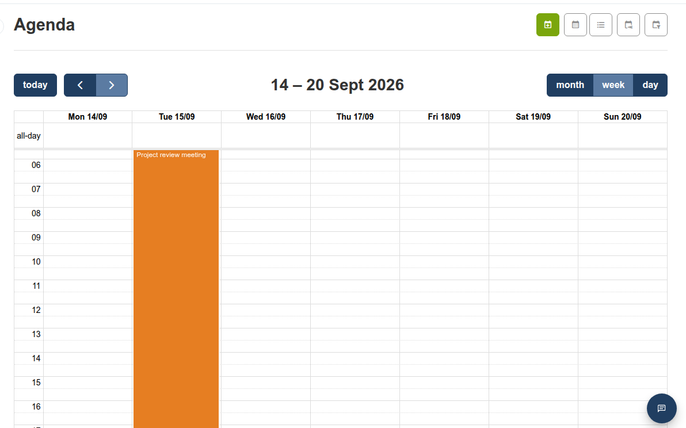

# Agenda

Met de agendatool plant u gebeurtenissen en deadlines binnen uw cursus. Gebeurtenissen verschijnen op een kalender die uw cursisten kunnen bekijken.

## De agenda bekijken

Open de tool **Agenda**  vanaf de startpagina van de cursus. U kunt gebeurtenissen op drie manieren bekijken:

* **Kalenderweergave** — Een visuele maand-/week-/dagkalender
* **Lijstweergave** — Gebeurtenissen weergegeven als chronologische lijst
* **Persoonlijke gebeurtenissen** — Filter om alleen gebeurtenissen te zien die voor u relevant zijn

## Een gebeurtenis aanmaken

1. Klik op **Gebeurtenis toevoegen** 
2. Vul de details van de gebeurtenis in:
   * **Titel** — Een korte naam voor de gebeurtenis
   * **Startdatum en -tijd**
   * **Einddatum en -tijd**
   * **Beschrijving** — Aanvullende details (ondersteunt opgemaakte tekst)
   * **Bijlagen** — Klik op **Bijlage toevoegen** om een of meer bestanden toe te voegen en beschrijf ze optioneel in **Bestandscommentaar**. Cursisten zien de bestanden in de details van de gebeurtenis en kunnen ze downloaden als de gebeurtenis naar hen is verzonden. Om een bestand te verwijderen, bewerkt u de gebeurtenis en klikt u op het verwijderpictogram naast het bestand. Bijlagen zijn alleen beschikbaar voor cursusgebeurtenissen
   * **Opmerking** — Een korte notitie in platte tekst, bijvoorbeeld wat cursisten moeten meenemen. Deze is alleen beschikbaar voor cursusgebeurtenissen en cursisten zien deze onder de beschrijving, in de details van de gebeurtenis en in de lijstweergave
3. Kies het **publiek** in het veld **Verzenden naar**:
   * Laat het leeg om de gebeurtenis naar **iedereen** in de cursus te verzenden (of in de cursus van de huidige sessie)
   * Selecteer een of meer **gebruikers** en/of **groepen** van de cursus om de gebeurtenis alleen naar hen te verzenden. Een cursist ziet de gebeurtenis dan alleen als deze naar die cursist of naar een van diens groepen is verzonden; docenten zien altijd elke gebeurtenis van de cursus.

   U kunt de ontvangers later wijzigen door de gebeurtenis te bewerken. Het veld **Verzenden naar** wordt alleen aan docenten getoond, in de agenda van een cursus; binnen de agenda van een groep behoren nieuwe gebeurtenissen altijd tot die groep.
4. Stel optioneel een **herinnering**  in om e-mailmeldingen te verzenden vóór de gebeurtenis (*cron*-configuratie voor het portaal vereist door een beheerder)
5. Vink optioneel **Een aankondiging toevoegen (E-mail verzenden)** aan om de gebeurtenis ook als cursusaankondiging te publiceren, per e-mail verzonden naar dezelfde ontvangers. De aankondiging neemt de titel en de beschrijving van de gebeurtenis over. Deze optie wordt alleen aan docenten getoond wanneer zij een cursusgebeurtenis aanmaken
6. Kies een **kleur** voor de gebeurtenis door op het kleurstaal te klikken. Deze kleur wordt gebruikt om de gebeurtenis in de hele kalender te markeren (maand-, week- en dagweergave), zodat gebeurtenissen in één oogopslag van elkaar te onderscheiden zijn — bijvoorbeeld om deadlines te onderscheiden van gewone sessies, of gebeurtenissen van verschillende cursussen in uw persoonlijke agenda.

   
7. Opslaan

De gekozen kleur wordt vervolgens overal weergegeven waar de gebeurtenis in de kalender verschijnt:

Standaard krijgen nieuwe gebeurtenissen een kleur op basis van hun context (cursus, sessie, persoonlijk of globaal), maar u kunt deze overschrijven met elke gewenste kleur.

## Gebeurtenissen beheren

* **Bewerken**  — Klik op een gebeurtenis om de details te wijzigen
* **Verwijderen**  — Verwijder een gebeurtenis uit de kalender
* **Slepen en neerzetten** — Sleep gebeurtenissen in de kalenderweergave om ze opnieuw in te plannen

## Een gebeurtenis herhalen

Wanneer u een cursusgebeurtenis aanmaakt, vinkt u **Gebeurtenis herhalen** aan en kiest u vervolgens:

* **Herhalingstype** — **Dagelijks**, **Wekelijks**, **Maandelijks, op datum** of **Jaarlijks**
* **Einddatum van de herhaling** — De laatste dag waarop een herhaling kan beginnen

De agenda maakt vervolgens bij elke herhaling een kopie van de gebeurtenis, met dezelfde details en dezelfde ontvangers. Elke kopie is een afzonderlijke gebeurtenis: u kunt deze zelfstandig bewerken of verwijderen. Om de hele reeks in één keer te verwijderen, klikt u op een willekeurige gebeurtenis van de reeks en klikt u op **Alle items verwijderen**.

De herhaalopties zijn alleen beschikbaar wanneer u een cursusgebeurtenis aanmaakt; u kunt geen herhaling toevoegen aan een bestaande gebeurtenis.

## Filteren op ontvanger

Als docent gebruikt u de selector **Filter** boven de cursusagenda om alleen de gebeurtenissen weer te geven die naar één gebruiker of naar één groep zijn verzonden. Kies **Alles** (of wis de selector) om alle gebeurtenissen opnieuw te zien. Het filter geldt voor zowel de kalenderweergave als de lijstweergave en blijft behouden wanneer u tussen beide schakelt.

## Persoonlijke agenda

U beschikt ook over een **persoonlijke agenda** die toegankelijk is via de zijbalk. De persoonlijke agenda bundelt gebeurtenissen uit al uw cursussen in één overzicht. Hier zien cursisten hun gecombineerde rooster van alle cursussen waarvoor zij zijn ingeschreven.

## Tips

* **Stel deadlines in** — Maak gebeurtenissen aan voor inleverdata van opdrachten en deadlines van oefeningen, zodat cursisten deze in hun agenda kunnen zien
* **Gebruik herinneringen** — Schakel e-mailherinneringen in voor belangrijke gebeurtenissen om cursisten op koers te houden
* **Stem af met sessies** — Als u in meerdere sessies lesgeeft, heeft elke sessie eigen gebeurtenissen, die alleen zichtbaar zijn voor de cursisten van die sessie. Docenten beschikken over een functie om de gebeurtenissen (huiswerk, excursies, enz.) van andere cursussen in hun sessies te bekijken, om overbelasting van studenten te voorkomen.