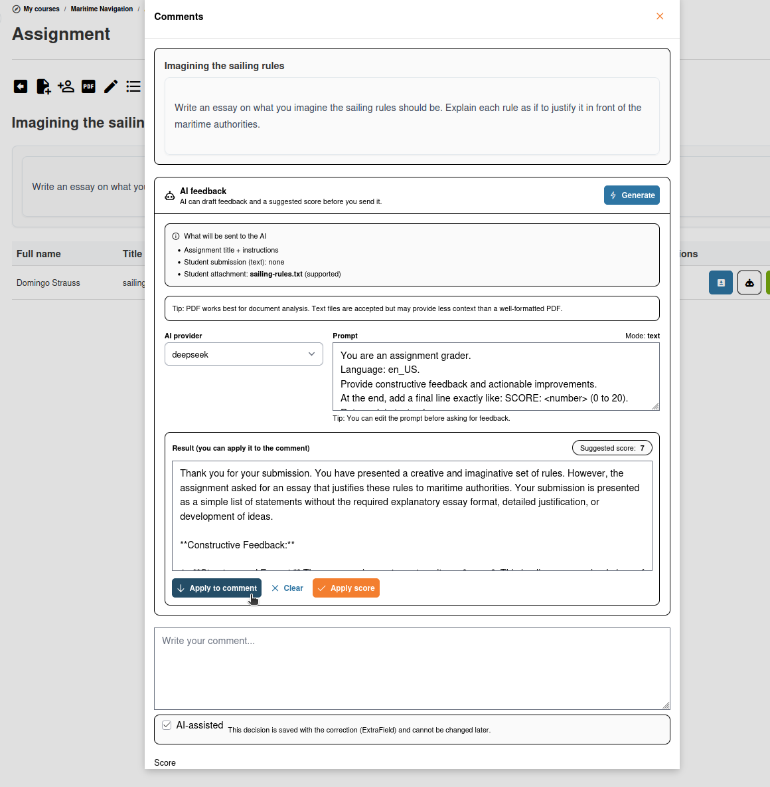

# AI-beoordeling

AI-beoordeling helpt u open antwoorden van studenten te evalueren — essays, schriftelijke antwoorden en geüploade opdrachten — door AI-gegenereerde scorevoorstellen en feedback te bieden.

## Waar AI-beoordeling verschijnt

AI-beoordeling is beschikbaar in twee contexten:

* **Open vragen in oefeningen** — Wanneer u open vragen in een oefening handmatig beoordeelt
* **Inzendingen van opdrachten** — Wanneer u publicaties van studenten in de tool Opdrachten bekijkt en beoordeelt

Zoek naar de knop **AI-beoordeling** (aangeduid met een robotpictogram ) in de beoordelingsinterface.

## Hoe het werkt

1. Open een inzending of antwoord dat beoordeeld moet worden
2. Klik op de knop **AI-beoordeling**
3. De AI analyseert het antwoord van de student en produceert:
   * Een **voorgestelde score** op basis van de kwaliteit en relevantie van het antwoord
   * **Feedbackopmerkingen** die de sterke en zwakke punten van het antwoord toelichten
4. Bekijk de suggesties van de AI
5. **Accepteer, wijzig of verwerp** de score en de feedback
6. Sla uw definitieve beoordeling op

## Belangrijke opmerkingen

* **AI-beoordeling is een suggestie** — U hebt altijd het laatste woord. De AI biedt een startpunt dat u kunt aanpassen op basis van uw professionele oordeel.
* **Controle is essentieel** — De AI kan de context verkeerd interpreteren, nuances missen of onjuist scoren. Controleer altijd de voorgestelde beoordeling voordat u deze bevestigt.
* **Werkt het best met duidelijke criteria** — Hoe specifieker uw opdrachtinstructies en beoordelingsrubriek, hoe beter de suggesties van de AI zullen zijn.

## Vermelding van door AI gegenereerde inhoud

Opmerkingen die door AI zijn gegenereerd, worden voorzien van een vermelding die aangeeft dat ze met behulp van kunstmatige intelligentie zijn gemaakt. Deze transparantie helpt cursisten de herkomst van de beoordeling te begrijpen.

## Tips

* **Gebruik bij grote groepen** — AI-beoordeling is het meest waardevol wanneer u veel inzendingen moet beoordelen, omdat het de eerste evaluatie versnelt
* **Geef gedetailleerde opdrachtbeschrijvingen** — Duidelijke instructies helpen de AI te begrijpen hoe een goed antwoord eruitziet
* **Kalibreer uw verwachtingen** — Beoordeel eerst enkele inzendingen handmatig om uw normen vast te stellen en gebruik daarna AI-beoordeling voor de rest
* **Gebruik de feedback** — Door AI gegenereerde feedback kan een nuttig startpunt zijn voor uw opmerkingen, ook als u de score aanpast