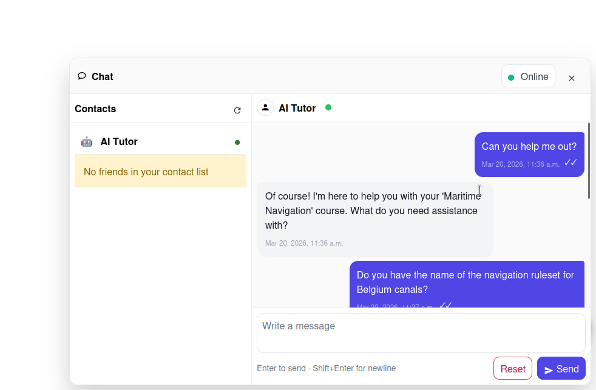

# AI Tutor

De AI Tutor is een chatbot die in Chamilo is geïntegreerd en waarmee cursisten kunnen communiceren om directe, door AI gegenereerde antwoorden te krijgen. Hij werkt in twee contexten, elk met een andere focus:

* **Binnen een cursus** — de AI Tutor is gericht op die cursus: het beantwoorden van vragen over de inhoud, het uitleggen van concepten die erin aan bod komen en het begeleiden van cursisten door het materiaal.
* **Buiten een cursus** (op het algemene platform) — de AI Tutor behandelt in plaats daarvan algemene vragen over het gebruik van het platform, zoals hoe u iets vindt of een functie gebruikt, en niet de cursusinhoud.

## Hoe het werkt

Wanneer de AI Tutor voor een cursus is ingeschakeld, zien cursisten een chatinterface waarin ze:

* **Vragen kunnen stellen** over de cursusinhoud
* **Uitleg kunnen krijgen** over concepten die in de cursus aan bod komen
* **Begeleiding kunnen ontvangen** zonder te wachten tot de docent reageert

Binnen een cursus gebruikt de AI Tutor de context van die cursus om relevante antwoorden te geven. Hij is bedoeld als aanvulling op uw onderwijs, niet als vervanging.

## De AI Tutor inschakelen

De AI Tutor vereist twee configuratieniveaus:

1. **Platformniveau** — De beheerder moet AI-helpers inschakelen en ten minste één AI-provider configureren (zie [AI-configuratie](../../admin-guide/integrations/ai-configuration.md))
2. **Cursusniveau** — De AI Tutor moet worden ingeschakeld in de cursusinstellingen (een eenvoudige aan/uit-schakelaar). De provider die voor de chat wordt gebruikt, is de provider die door de beheerder is geconfigureerd.

## De chatinterface

De AI Tutor verschijnt als een **vastgezet chatpaneel** binnen de cursus. Cursisten kunnen:

* Berichten typen en door AI gegenereerde antwoorden ontvangen
* Hun gespreksgeschiedenis bekijken
* Het gesprek resetten om opnieuw te beginnen

De chatinterface toont de uitwisseling tussen de cursist en de AI in een vertrouwd berichtenformaat.

## Belangrijk gedrag

* **Beperkt tot waar het wordt geopend** — Binnen een cursus beantwoordt de AI Tutor alleen vragen over die cursus; geopend buiten een cursus schakelt hij over naar algemene vragen over het platformgebruik. De platformbrede modus (buiten de cursus) is een afzonderlijke schakelaar die uw beheerder onafhankelijk van de schakelaar per cursus beheert.
* **Uitgeschakeld tijdens examens** — De AI Tutor wordt automatisch uitgeschakeld wanneer een cursist een oefening maakt, om fraude te voorkomen
* **Gesprek per cursist** — Elke cursist heeft een eigen privégesprek met de AI Tutor, en de promptcontext bevat alleen de meest recente berichten
* **Providerfailover** — Als de geconfigureerde provider uitvalt, valt Chamilo terug op een andere beschikbare provider zodat de chat blijft werken

## Als docent

U moet zich ervan bewust zijn dat:

* De AI Tutor niet altijd perfecte antwoorden geeft — moedig cursisten aan om belangrijke informatie te verifiëren
* U het gebruik van de AI Tutor kunt bekijken via de tracking van het platform
* De AI Tutor een aanvulling is op uw onderwijs, geen vervanging. Gebruik hem naast forums, aankondigingen en directe berichten voor uitgebreide ondersteuning van cursisten.

## Tips

* **Verwachtingen scheppen** — Vertel cursisten aan het begin van de cursus dat er een AI Tutor beschikbaar is en leg uit hoe ze deze op de juiste manier kunnen gebruiken
* **Kritisch denken stimuleren** — Herinner cursisten eraan om kritisch na te denken over door AI gegenereerde antwoorden
* **Gebruiken voor veelgestelde vragen** — De AI Tutor is bijzonder nuttig voor het afhandelen van veelvoorkomende vragen die u anders herhaaldelijk zou beantwoorden