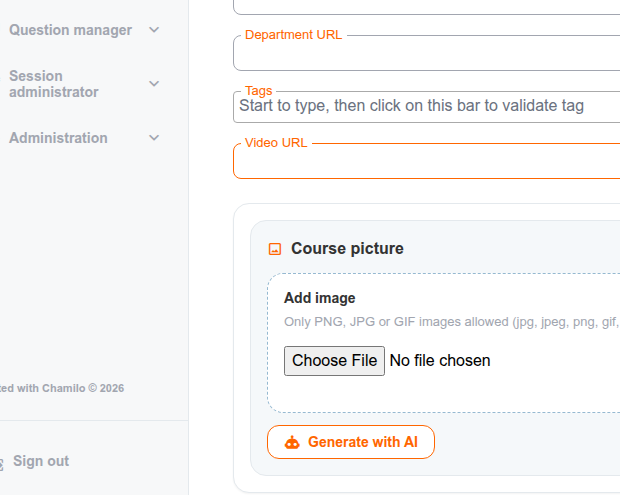
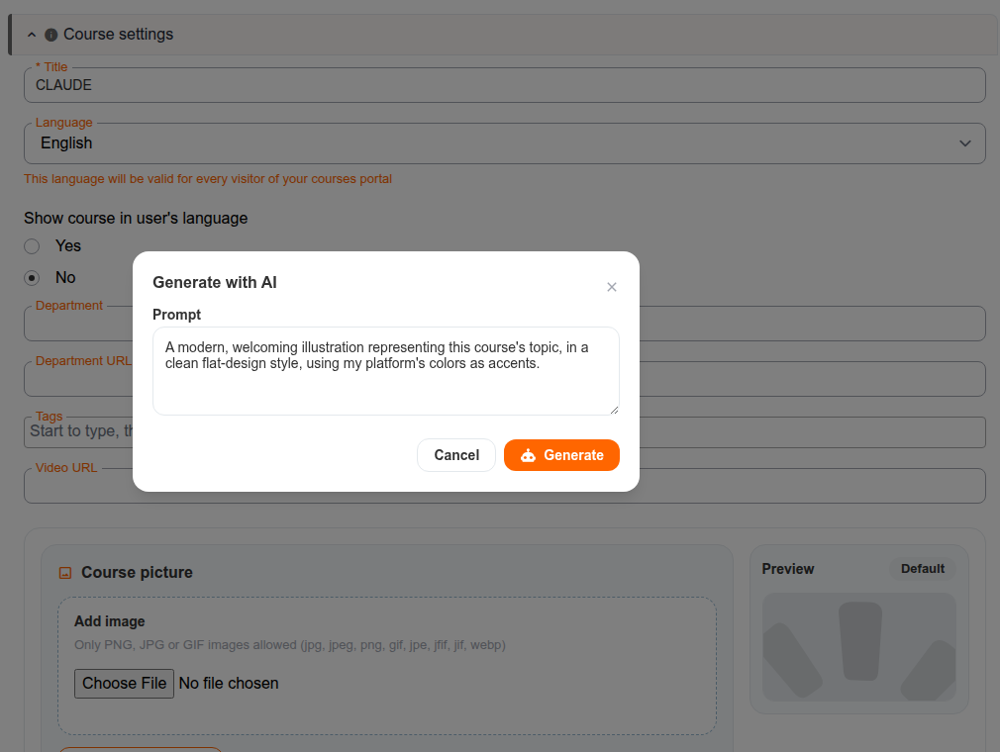

# Generator voor cursusafbeeldingen

Met de AI-generator voor cursusafbeeldingen maakt u rechtstreeks vanuit het scherm met cursusinstellingen een miniatuurafbeelding voor uw cursus, in plaats van er zelf een te zoeken of te ontwerpen. Dit is de afbeelding die voor uw cursus wordt getoond in overzichten en in de [cursuscatalogus](../assessing-learners/subscribing-users.md#self-enrollment-via-the-course-catalog).

## De generator openen

De knop **Genereren met AI**  is beschikbaar naast het veld **Cursusafbeelding**, mits:

1. AI-hulpmiddelen op platformniveau zijn ingeschakeld
2. Ten minste één AI-provider die op uw platform is geconfigureerd, het genereren van afbeeldingen ondersteunt
3. De functie in uw cursus is toegestaan (zie **Instellingen voor AI-hulpmiddelen** in [Cursusinstellingen](../creating-your-course/course-settings.md))

Open de **Instellingen**  van uw cursus en scrol naar het veld **Cursusafbeelding**:

## Een afbeelding genereren

1. Klik op **Genereren met AI**
2. Er opent een dialoogvenster met een veld **Prompt** dat vooraf is ingevuld met een standaardbeschrijving; pas deze aan om de gewenste illustratie te beschrijven, of laat de standaardtekst ongewijzigd

3. Klik op **Genereren** en wacht — het genereren van de afbeelding kan enkele seconden duren
4. De gegenereerde afbeelding wordt automatisch in het veld **Cursusafbeelding** geplaatst en vervangt alles wat u daar had geselecteerd
5. Bekijk een voorbeeld in het paneel **Voorbeeld** en klik vervolgens op de knop **Opslaan** van het formulier om de afbeelding daadwerkelijk op uw cursus toe te passen — het genereren van de afbeelding slaat deze niet vanzelf op

Als het resultaat u niet bevalt, kunt u zo vaak als u wilt opnieuw genereren met een andere prompt voordat u opslaat.

## Wat er in de prompt terechtkomt

Naast wat u typt, voegt Chamilo automatisch context toe om de AI te helpen een relevante, bij de huisstijl passende afbeelding te produceren:

* De titel van uw cursus
* Het eerste gedeelte van de [Cursusbeschrijving](../creating-your-course/course-description.md) van uw cursus, als u die hebt ingevuld — zodat de AI een idee krijgt van het werkelijke onderwerp
* Het kleurenthema van uw platform (primair, secundair, tertiair), zodat de illustratie kleuren gebruikt die consistent zijn met uw portaal

De afbeelding wordt gegenereerd in een vlakke, breedbeeld (16:9) illustratiestijl, zonder leesbare tekst, logo's of fotorealistische personen — passend bij het formaat dat voor een cursusminiatuur wordt verwacht.

## Tips

* **Vul eerst een cursusbeschrijving in** — omdat deze de prompt voedt, krijgt een cursus met een echte beschrijving doorgaans een relevantere illustratie dan een cursus zonder beschrijving
* **Wees specifiek over de stijl, niet over de inhoud** — de cursustitel en -beschrijving verankeren het onderwerp al; gebruik uw prompt voor stijlaanwijzingen (kleursfeer, metafoor, compositie) in plaats van het onderwerp opnieuw te beschrijven
* **Genereer opnieuw in plaats van genoegen te nemen** — elke klik levert een nieuwe poging op zonder extra stap; probeer een paar varianten voordat u er een kiest
* **Vergeet niet op te slaan** — de knop vult alleen het afbeeldingsveld in; als u weggaat zonder op te slaan, gaat de gegenereerde afbeelding verloren
* **Als het genereren mislukt, vraag het uw beheerder** — een uitgeschakelde functie, een niet-geconfigureerde afbeeldingsprovider of een uitgeput maandelijks AI-gebruiksquotum leveren hier allemaal een foutmelding op; uw beheerder kan de [AI-configuratie](../../admin-guide/integrations/ai-configuration.md) controleren