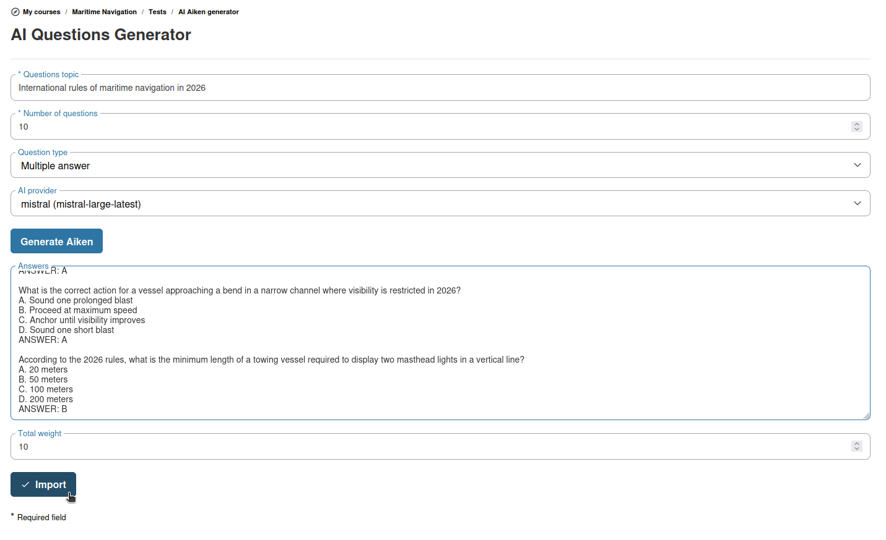
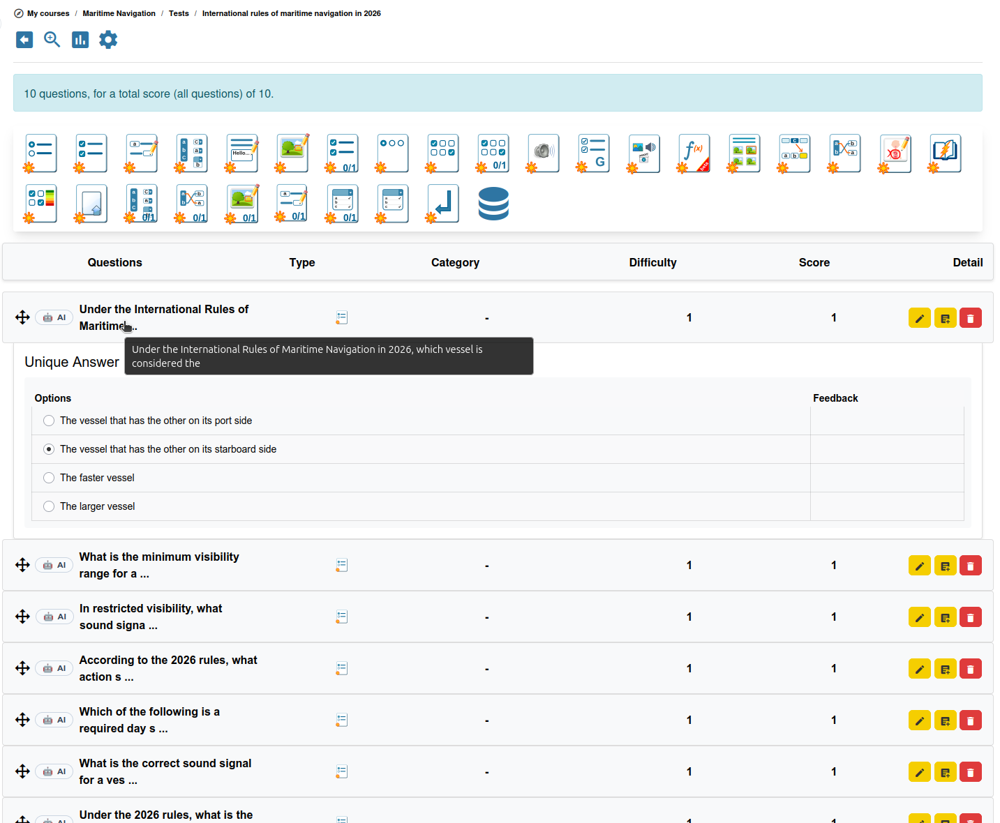

# Oefeningengenerator

De AI-oefeningengenerator helpt u quizvragen automatisch te maken met behulp van kunstmatige intelligentie. U geeft een onderwerp of inhoud op, en de AI genereert vragen die u kunt beoordelen, bewerken en aan uw oefeningen toevoegen.

## De oefeningengenerator openen

De oefeningengenerator is beschikbaar bij het aanmaken of bewerken van een oefening, mits:

1. AI-hulpmiddelen op platformniveau zijn ingeschakeld
2. Ten minste één AI-tekstprovider is geconfigureerd

Zoek naar de knop of sectie **AI Generator** in de interface voor het aanmaken van oefeningen.

## Vragen genereren

De generator biedt twee modi, beschikbaar als tabbladen:

* **Test from topic** — Genereer vragen op basis van een tekstuele onderwerpbeschrijving
* **Test from document** — Genereer vragen op basis van een cursusdocument (alleen beschikbaar wanneer een provider met documentondersteuning is geconfigureerd). Wanneer deze modus wordt gebruikt, wordt het onderwerpveld optioneel en behandeld als een extra hint.

1. Open het formulier van de AI Generator binnen een oefening en kies de modus
2. Configureer de generatieparameters:
   * **Quiz title** — De titel van de resulterende oefening
   * **Questions topic** — Beschrijf waarover de vragen moeten gaan (of, in documentmodus, een optionele hint)
   * **Number of questions** — Hoeveel vragen er moeten worden gegenereerd (begrensd op 100)
   * **Question type** — Momenteel wordt alleen **Multiple answer** aangeboden
   * **AI provider** — Selecteer welke AI-provider u wilt gebruiken (alleen zichtbaar wanneer er meer dan één is geconfigureerd)
3. Klik op **Generate**
4. De AI produceert een reeks vragen met antwoordopties en gemarkeerde juiste antwoorden. Wanneer AI-vermelding is ingeschakeld, krijgen gegenereerde vragen het voorvoegsel **\[AI-assisted\]**.

## Beoordelen en bewerken

Gegenereerde vragen worden gepresenteerd als **suggesties**. U moet:

* **Elke vraag beoordelen** op juistheid en relevantie
* **De formulering bewerken** indien nodig — pas vragen, antwoordopties en feedback aan
* **Juiste antwoorden verifiëren** — controleer of de AI de juiste antwoorden heeft geïdentificeerd
* **Ongeschikte vragen verwijderen** — verwijder vragen die niet aan uw normen voldoen
* **De scoring aanpassen** — stel passende puntwaarden in voor elke vraag

Zodra u tevreden bent, voegt u de vragen toe aan uw oefening.

Houd er rekening mee dat sommige modellen, ondanks onze specifieke formaatverzoeken, vraagtitels teruggeven die met een nummer beginnen. We raden af dat nummer te laten staan, omdat dit het mengen van vragen in toetsen met willekeurig geselecteerde vragen belemmert. Soms krijgt u ook niet zoveel vragen als u hebt gevraagd; controleer dit dus en genereer eventueel meer vragen, of wissel van model als u die mogelijkheid hebt.

## Vermelding van door AI gegenereerde inhoud

Inhoud die door AI is gegenereerd, wordt voorzien van een vermelding die aangeeft dat deze is gemaakt met behulp van kunstmatige intelligentie. Deze transparantie helpt lerenden de herkomst van het materiaal te begrijpen.

## Tips

* **Geef specifieke onderwerpen op** — Hoe specifieker uw onderwerpbeschrijving, hoe relevanter de gegenereerde vragen zullen zijn.
* **Beoordeel altijd** — Door AI gegenereerde inhoud kan fouten bevatten. Publiceer nooit vragen zonder ze eerst te beoordelen.
* **Gebruik als startpunt** — Gegenereerde vragen besparen tijd, maar zijn geen eindproduct. Bewerk ze zodat ze aansluiten bij uw onderwijsstijl en cursusinhoud.
* **Combineer met handmatige vragen** — Combineer door AI gegenereerde vragen met handmatig gemaakte vragen voor het beste resultaat.
* **Probeer verschillende providers** — Als er meerdere AI-providers beschikbaar zijn, probeer dan verschillende om te zien welke de beste vragen oplevert voor uw vakgebied.