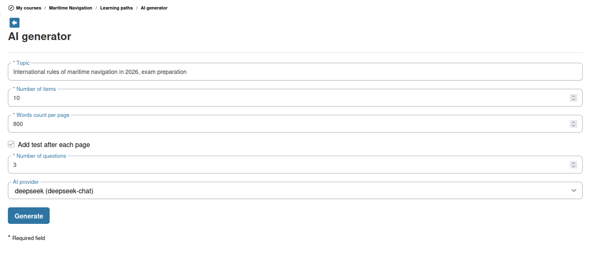

# Leerpadgenerator

De AI-leerpadgenerator helpt u automatisch gestructureerde leerreeksen te maken. U geeft een onderwerp en leerdoelen op, en de AI genereert een leerpadschets met secties en inhoudsitems die u kunt bekijken en aanpassen.

## De leerpadgenerator openen

De leerpadgenerator is beschikbaar bij het aanmaken van een nieuw leerpad, mits:

1. AI-helpers zijn ingeschakeld op platformniveau
2. De leerpadgenerator is ingeschakeld in de cursusinstellingen
3. Er ten minste één AI-tekstprovider is geconfigureerd

Zoek naar de sectie **AI-generator** in de interface voor het aanmaken van leerpaden.

## Een leerpad genereren

1. Open het formulier van de AI-generator
2. Configureer de parameters:
   * **Onderwerp** — Het onderwerp van het leerpad
   * **Aantal items** — Hoeveel inhoudspagina's het pad moet bevatten
   * **Aantal woorden per pagina** — Ongeveer hoe lang elke pagina moet zijn
   * **Toets toevoegen na elke pagina** — Indien aangevinkt, maakt de AI ook een korte meerkeuzetoets na elke pagina (standaard 2 vragen, maximaal 5)
3. Klik op **Genereren**
4. De AI maakt een leerpad met één documentitem per pagina en, optioneel, een toetsitem na elk documentitem

## Controleren en aanpassen

Het gegenereerde leerpad is een **uitgangspunt**. U moet:

* **Controleer de structuur** — Controleer of de secties in een logische volgorde staan
* **Bewerk de inhoud** — Pas de gegenereerde tekst aan, voeg uw eigen materiaal toe en verwijder irrelevante secties
* **Voeg bronnen toe** — Voeg uw eigen documenten, oefeningen, links en andere inhoud in
* **Stel voorwaarden in** — Configureer welke secties moeten zijn voltooid voordat andere kunnen worden geopend
* **Voeg beoordelingen toe** — Voeg oefeningen toe op geschikte momenten om het begrip te controleren

## Vermelding van door AI gegenereerde inhoud

Door AI gegenereerde inhoud wordt voorzien van een vermelding die aangeeft dat deze is gemaakt met behulp van kunstmatige intelligentie. Deze transparantie helpt cursisten de herkomst van het materiaal te begrijpen.

## Tips

* **Begin breed en verfijn daarna** — Genereer eerst een structuur op hoofdlijnen en voeg daarna handmatig details en specifieke bronnen toe
* **Gebruik het voor cursusplanning** — Zelfs als u de gegenereerde inhoud niet rechtstreeks gebruikt, kan de door de AI voorgestelde structuur een nuttig planningsinstrument zijn
* **Combineer met het genereren van oefeningen** — Gebruik na het genereren van een leerpad de oefeningengenerator om beoordelingen voor elke sectie te maken