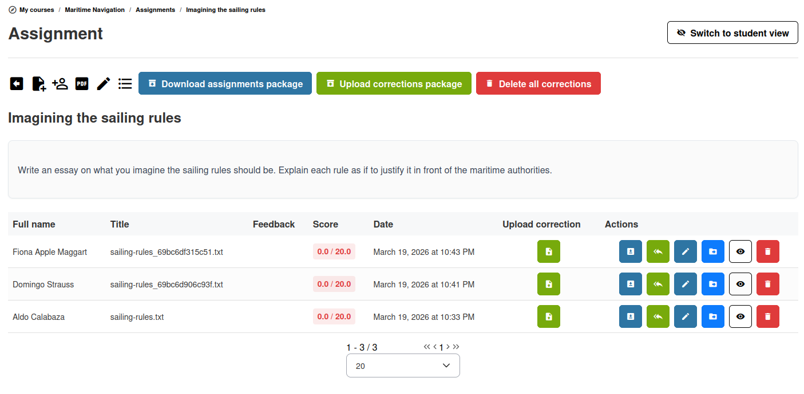
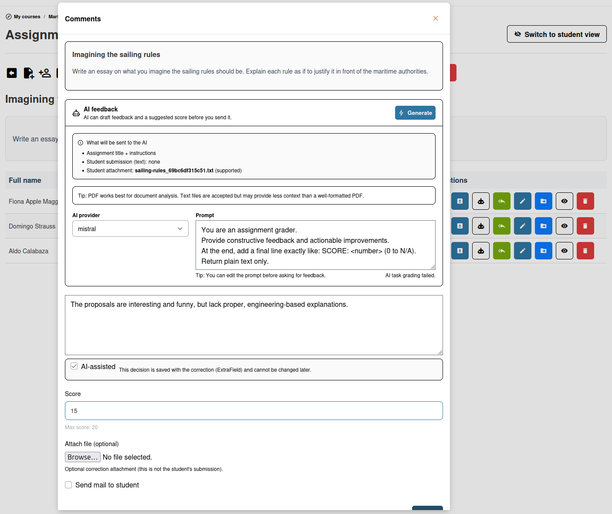

# Opdrachten

Met de opdrachtentool (ook wel "studentenpublicaties" genoemd) kunt u werk van cursisten verzamelen — essays, projecten, rapporten of elke andere bestandsgebaseerde inzending — en dit beoordelen.

## Een opdracht aanmaken

1. Open de tool **Opdrachten**  vanaf de startpagina van de cursus
2. Klik op **Een opdracht aanmaken**
3. Vul de gegevens in:
   * **Opdrachtnaam** — De naam van de opdracht (bijv. "Eindrapport project")
   * **Beschrijving** — Instructies voor cursisten, inclusief wat moet worden ingeleverd en hoe het wordt beoordeeld (ondersteunt opgemaakte tekst)
   * **Maximumscore** — Op welk totaal de opdracht wordt beoordeeld
   * **Toevoegen aan cijferlijst** — Toevoegen als beoordeeld item in de beoordelingstool (cijferlijst), zodat het kan bijdragen aan het behalen van de cursusdoelen
   * **Deadline** — De officiële (gepubliceerde) datum en tijd waarna inzendingen als te laat worden gemarkeerd (uploads worden nog steeds geaccepteerd)
   * **Eindigt op (volledig gesloten)** — De harde sluitingsdatum en -tijd waarna uploaden niet meer mogelijk is
   * **Toevoegen aan agenda** — Een gebeurtenis aanmaken die verwijst naar de inleverdatum van deze opdracht
   * **Type inzending** — Kies tussen **Alleen tekst toestaan**, **Alleen bestanden toestaan** of **Bestanden of online tekst toestaan**
4. Opslaan

Nadat u een opdracht hebt aangemaakt, kunt u ook:
* Sjabloondocumenten uploaden vanuit de detailpagina van de opdracht
* De opdracht toewijzen aan specifieke gebruikers (in plaats van aan alle gebruikers van de cursus)

En zodra cursisten hun opdrachten hebben ingeleverd, kunt u:
* Een PDF-lijst van inzendingen exporteren
* Een lijst tonen van alleen de cursisten die hun opdracht niet hebben ingeleverd
* Alle opdrachten downloaden in één groot ZIP-bestand
* Alle correcties uploaden in één groot ZIP-bestand
* Alle door u ingediende correcties verwijderen (dit verwijdert niet de inzendingen van de cursisten)

## Opdrachten voor groepen

Wanneer de cursus groepen heeft, kan het opdrachtformulier **Dit is een opdracht per groep** tonen. Schakel dit in om één opdracht te maken die wordt gedeeld door de groepen in de geselecteerde **Groepscategorie**. Als groepscategorieën zijn uitgeschakeld, kan Chamilo de opdracht toepassen op alle groepen.

Configureer de gedeelde opdracht vanuit de normale tool Opdrachten, niet vanuit één specifieke groep. Cursisten openen dezelfde opdracht vanuit hun eigen groepscontext, zodat de opdracht niet per groep hoeft te worden gedupliceerd.

Als er meerdere groepscategorieën bestaan, selecteert u de categorie waarvan de groepen de opdracht moeten ontvangen. De optie wordt niet aangeboden wanneer u zich al in een specifieke groepscontext bevindt.

## Hoe cursisten inleveren

Cursisten openen de opdracht en:

1. Klikken op **Bestand uploaden** of de inleverknop
2. Selecteren een bestand van hun computer (of schrijven rechtstreeks tekst, afhankelijk van de configuratie)
3. Voegen een optionele opmerking toe
4. Indienen

Cursisten kunnen zien of ze al hebben ingeleverd en, indien toegestaan, hun inzending bijwerken.

### Inzendingen met opgemaakte tekst (HTML)

Wanneer u **Alleen tekst toestaan** of **Bestanden of online tekst toestaan** configureert, kunnen cursisten een opgemaakt antwoord schrijven in de online-editor in plaats van een apart document te uploaden. Chamilo zuivert de ingediende HTML en slaat deze op als een inzendingbestand `.html`. Het blijft onderworpen aan de bestaande toegangs- en deadlineregels van de opdracht.

In de inzendingslijst van de docent gebruikt u **Voorbeeld** om een beschikbare HTML-inzending te openen, of **Corrigeren en beoordelen** om de inhoud te zien in het beoordelingsvenster voordat u feedback en een score toevoegt. De HTML wordt veilig weergegeven en niet uitgevoerd als een door de cursist aangeleverd script. Zie [PR #9410](https://github.com/chamilo/chamilo-lms/pull/9410).

## Inzendingen beoordelen

Als docent opent u een opdracht om de lijst van alle inzendingen te zien:

* **Studentnaam** — Wie heeft ingeleverd
* **Inleverdatum** — Wanneer het werk is ingeleverd
* **Bestand** — Het ingeleverde bestand downloaden
* **Status** — Of de inzending is beoordeeld
* **Opmerkingen** — Eventuele opmerkingen van de cursist of van u

---
### Een opdracht volgen

Docenten en bevoegde sessiebegeleiders kunnen ervoor kiezen een individuele opdracht te volgen en meldingen te ontvangen wanneer een cursist een opmerking plaatst bij een van de inzendingen.

1. Open de detailpagina van de opdracht vanuit de tool **Opdrachten**.
2. Selecteer **Volgen** (belpictogram). De knop verandert in **Volgend**.
3. Selecteer opnieuw **Volgend** om die opdracht niet meer te volgen.

De docent die een nieuwe opdracht aanmaakt, volgt deze automatisch en kan deze later ontvolgen. Volgen is persoonlijk voor elke docent of begeleider; het abonneert niet de hele cursus. Cursisten hebben deze mogelijkheid niet. Meldingen gaan alleen naar actieve volgers die nog de juiste cursus- of sessierol hebben; de auteur van de opmerking ontvangt geen melding voor de eigen opmerking.

**Belangrijk:** Meldingen worden alleen verzonden wanneer de cursusinstelling `email_to_teachers_on_new_work_feedback` is ingeschakeld (waarde `1`, **Ja**). Het volgen van een opdracht op zich heft een uitgeschakelde cursusinstelling niet op. Dit betreft opmerkingen van cursisten bij inzendingen, niet elke bewerking van een opdracht of bestandsupload. De aflevering hangt ook af van de bericht-/e-mailconfiguratie van het portaal.

### Een inzending beoordelen

1. Klik op een inzending om deze te openen
2. Bekijk het ingediende bestand
3. Voer een **score** in
4. Schrijf **feedbackopmerkingen** voor de cursist
5. Upload optioneel een **gecorrigeerd bestand** als bijlage
6. Opslaan

### Beoordeling met AI-ondersteuning

Als AI-tools op uw platform zijn geconfigureerd, ziet u mogelijk een optie **AI-beoordeling** bij het beoordelen van inzendingen. Deze gebruikt een AI-model om een score en feedback voor te stellen voor open opdrachten. Zie [AI-beoordeling](../ai-tools/ai-grading.md) voor details.

## Inzendingen beheren

Groepsacties:
* **Opdrachtenpakket downloaden** — Download alle inzendingen als één ZIP-bestand voor offline beoordeling
* **Correctiepakket uploaden** — Als u alle inzendingen in één ZIP-bestand hebt gedownload, de bestanden ter plaatse op uw computer hebt bewerkt en ze opnieuw hebt gezipt, kunt u de zip als correctiepakket verzenden. Wijzig de bestandsnamen niet, anders werkt het niet.
* **Te late inzendingen** — Inzendingen na de deadline worden gemarkeerd, maar kunnen afhankelijk van uw instellingen nog worden geaccepteerd

Acties voor individuele inzendingen:
* **Correctie uploaden** — Upload een correctie voor één cursist 
* **Downloaden** — Download de inzending van één cursist
* **Corrigeren en beoordelen** — Voeg een correctie en een cijfer toe aan de inzending van de cursist 
* **Bewerken** — Bewerk de documenttitel of de eerdere feedback bij de inzending
* **Verplaatsen** — Verplaats een inzending tussen opdrachtmappen (bijv. als de student in de verkeerde opdracht heeft ingediend)
* **Zichtbaarheid** — Bepaal of cursisten elkaars inzendingen kunnen zien

## Koppelen aan het cijferboek

Opdrachtscores kunnen worden opgenomen in het cijferboek van de cursus (tool "Beoordelingen"). Hierdoor kunnen opdrachtcijfers bijdragen aan het totale cursuscijfer van de cursist en aan de geschiktheid voor een certificaat. Zie [Cijferboek](gradebook.md) voor details.

## Inzendingen per cursist bekijken

Voor docenten groepeert het opdrachtdetail nu inzendingen per student. De eerste tabel toont elke cursist en het **Aantal ingediend**; open de rij van een cursist om de inzendingen te bekijken en de gebruikelijke feedback- en beoordelingsacties te gebruiken. Dit voorkomt dat de identiteit van een cursist in de lijst op het hoogste niveau wordt herhaald wanneer meerdere inzendingen zijn toegestaan.

De groepering is een presentatiewijziging, geen wijziging van inzendrechten, deadlines of beoordeling. Zie [PR #9424 over gegroepeerde inzendingen](https://github.com/chamilo/chamilo-lms/pull/9424).

## Herinneringen alleen naar geselecteerde cursisten sturen

Open **Gebruikers zonder inzending** vanuit het opdrachtdetail om cursisten te bekijken die nog niet hebben ingediend. Selecteer de specifieke gebruikers die u wilt contacteren en kies **Alle geselecteerde gebruikers herinneren**; bevestig voordat u verzendt. **E-mail naar iedereen verzenden** blijft beschikbaar wanneer elke cursist zonder inzending een herinnering moet ontvangen.

Voor de selectieve actie is een selectie vereist. Controleer de ontvangerslijst voordat u bevestigt; het verzenden van een herinnering is een daadwerkelijke e-mailbewerking, niet alleen een voorbeeld. Zie [PR #9386 over selectieve herinneringen](https://github.com/chamilo/chamilo-lms/pull/9386).

## Tips

* **Wees specifiek in de instructies** — Beschrijf duidelijk wat cursisten moeten indienen, het verwachte formaat en de beoordelingscriteria
* **Stel realistische deadlines** — Gebruik de tool Agenda om deadlines zichtbaar te maken in de cursuskalender
* **Gebruik de functie voor gecorrigeerde bestanden** — Upload geannoteerde versies van het werk van studenten zodat zij uw specifieke correcties kunnen zien
* **Schakel zichtbaarheid voor medecursisten zorgvuldig in** — Cursisten elkaars werk laten zien kan het leren stimuleren, maar is mogelijk niet voor alle opdrachten geschikt