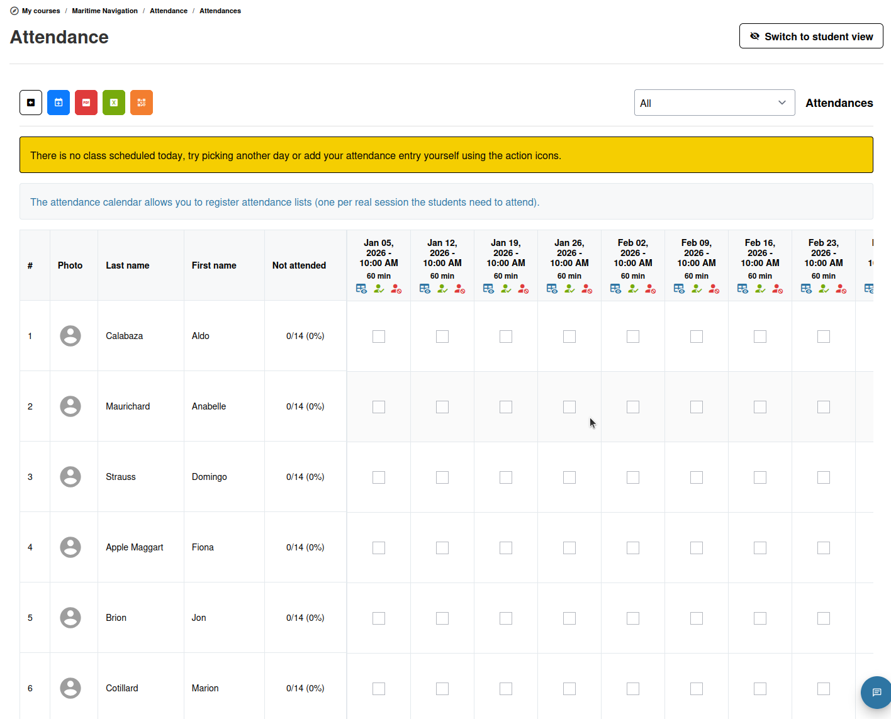

# Aanwezigheid

Met de aanwezigheidstool kunt u de aanwezigheid van cursisten bij geplande lesmomenten bijhouden, zowel fysiek als online.

## Een aanwezigheidslijst maken

1. Open de tool **Aanwezigheid** vanaf de startpagina van de cursus
2. Klik op **Aanwezigheid toevoegen** om een aanwezigheidslijst te maken
3. Voer een **Titel** in voor de aanwezigheidslijst (bijv. "Week 1 - Inleiding")
4. Voer een **Beschrijving** in (deze is vooral voor uw eigen gebruik; cursisten zien de beschrijving niet)
5. Opslaan

### Geavanceerde instellingen

1. **Unieke aanwezigheid vereisen** maakt het mogelijk een cursist als volledig aanwezig te beschouwen als hij/zij aan slechts één datum van de aanwezigheidslijst heeft deelgenomen
2. **Cijferboekopties** laat u beslissen of u de aanwezigheidslijst wilt beoordelen in de beoordelingstool (gradebook).

## Datums toevoegen

Elke aanwezigheidslijst bevat een of meer datums (sessies) waarop u de aanwezigheid registreert:

1. Open een aanwezigheidslijst of ga verder met het aanmaakproces
2. Klik op **Een datum toevoegen** 
3. Selecteer de datum en tijd
4. Vink optioneel **Datum herhalen** aan om een herhalingslogica te kiezen
5. Geef een **Duur** in minuten op voor het evenement (standaard 60 minuten)
6. Selecteer optioneel een **Groep** als deze aanwezigheidsdatum alleen geldt voor één groep cursisten
7. Opslaan

U kunt meerdere datums aan dezelfde aanwezigheidslijst toevoegen (bijv. alle sessies van een maand).

## Aanwezigheid registreren

Markeer voor elke datum elke cursist als:

* **Aanwezig** — De cursist was aanwezig (standaardwaarde voor alle cursisten)
* **Afwezig** — De cursist was niet aanwezig

Klik op de statuscel naast de naam van elke cursist om te schakelen tussen aanwezig en afwezig.

Standaard worden alle cursisten als aanwezig gemarkeerd, omdat we ervan uitgaan dat er doorgaans meer mensen aanwezig dan afwezig zijn.

Opmerking: beheerders kunnen de portaalconfiguratie aanpassen zodat u uitgebreidere aanwezigheidstypen kunt kiezen (te laat, afwezig met rechtvaardiging, enz.), die beter aansluiten bij uw procedures. In dat geval schakelt een klik op het aanwezigheidsveld tussen alle aanwezigheidstypen.

## Aanwezigheidsrapporten bekijken

De aanwezigheidstool toont:

* Een overzichtstabel met alle cursisten en alle datums
* Het aanwezigheidspercentage van elke cursist (aanwezige sessies / totaal aantal sessies)
* Kleurgecodeerde indicatoren voor een snel overzicht

## Extra

Aanwezigheidslijsten hebben enkele uitgebreide functies die niet meteen zichtbaar zijn:
* **Handtekeningen** kunnen worden ingeschakeld zodat cursisten hun aanwezigheid in de klas kunnen ondertekenen via een tablet die door de docent wordt bediend
* **Opmerkingen** kunnen door de docent worden toegevoegd bij de aanwezigheid van elke student
* **PDF-rapporten** kunnen worden geëxporteerd om aan regelgeving te voldoen

## Tips

* **Koppelen aan cursusvoortgang** — Gebruik aanwezigheidsgegevens samen met de tool Cursusvoortgang om aanwezigheid te correleren met behandelde onderwerpen
* **Gegevens exporteren** — Exporteer de aanwezigheidslijst voor administratieve dossiers
* **Verwachtingen stellen** — Als aanwezigheid verplicht is, communiceer het beleid duidelijk in uw cursusintroductie of aankondigingen