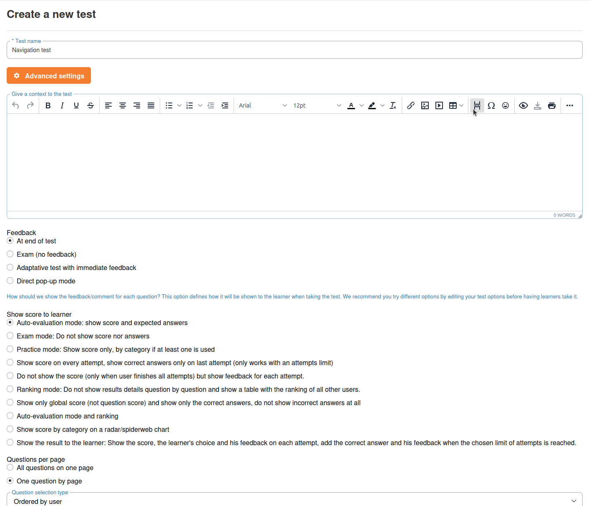
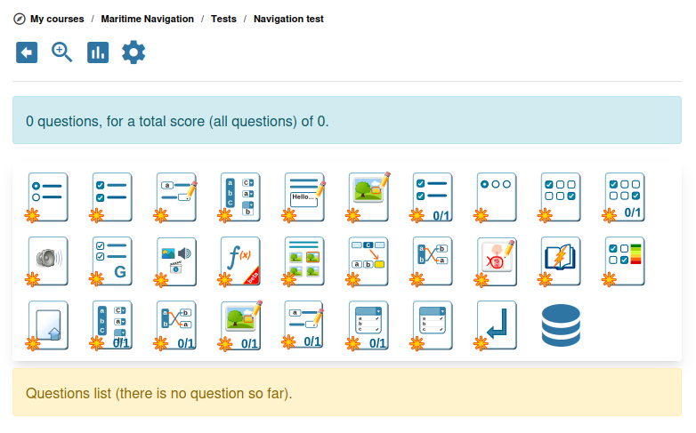

# Oefeningen

Met het hulpmiddel Oefeningen (ook wel "toetsen" genoemd) kunt u quizzen en examens aanmaken met automatische beoordeling. Chamilo ondersteunt een breed scala aan vraagtypen, van eenvoudige meerkeuzevragen tot interactieve hotspotvragen.

## Een oefening aanmaken

1. Open het hulpmiddel **Oefeningen**  vanaf de startpagina van de cursus
2. Klik op **Nieuwe oefening**
3. Voer een **titel** en een optionele **beschrijving** in
4. Configureer de oefeningsinstellingen (zie hieronder)
5. Sla op en voeg vervolgens vragen toe

## Oefeningsinstellingen

### Weergave en navigatie

| Instelling | Opties | Beschrijving |
|---------|---------|-------------|
| **Vraagindeling** | Alles op één pagina / Eén per pagina | Alle vragen tegelijk tonen of één voor één |
| **Vraagtitels verbergen** | Ja / Nee | Of vraagtitels aan cursisten worden getoond |
| **Vorige-knop tonen** | Ja / Nee | Cursisten toestaan terug te gaan naar eerdere vragen |
| **Terugnavigatie voorkomen** | Ja / Nee | Cursisten verplichten de vragen op volgorde te beantwoorden, zonder terug te gaan |

### Tijd en beschikbaarheid

| Instelling | Beschrijving |
|---------|-------------|
| **Tijdslimiet** | Maximale tijd (in minuten) om de oefening te voltooien. Aan de cursist wordt een afteltimer getoond |
| **Startdatum** | Wanneer de oefening beschikbaar wordt voor cursisten |
| **Einddatum** | Wanneer de oefening niet langer beschikbaar is |

### Toegangsvoorwaarden

Wanneer de beheerder **Toegangsvoorwaarden vóór een toets** (`allow_final_exam_access_rule`) inschakelt, toont het onderdeel **Pogingen en timing** van de geavanceerde instellingen een blok **Toegangsvoorwaarden**. Gebruik dit om een toets, doorgaans een eindexamen, gesloten te houden totdat de cursist er klaar voor is:

| Instelling | Beschrijving |
|---------|-------------|
| **Minimale tijd in de cursus voordat de toets wordt gestart (in minuten)** | De cursist kan de toets pas starten nadat hij of zij deze tijd in de cursus heeft doorgebracht, zoals de cursusrapporten die tellen (dezelfde tijd als de klok van de in de cursus doorgebrachte tijd). 0 stelt geen minimum in |
| **Profielveld vereist voordat de toets wordt gestart** | Een veld van het profiel van de cursist, zoals een studentnummer, dat eerst moet worden ingevuld. Alleen de tekstvelden die cursisten zelf op hun eigen profiel kunnen wijzigen, worden aangeboden |
| **De cursist kan ervoor kiezen dit veld niet in te vullen** | Stelt de cursist eerst een vraag (**Vraag gesteld voordat het veld wordt ingevuld**). Als hij of zij Nee antwoordt, wordt het veld als geweigerd gemarkeerd en kan de toets starten |

Totdat aan de voorwaarden is voldaan, verbergt de startpagina van de toets de knop **Toets starten** en geeft deze aan de cursist aan hoeveel tijd hij of zij nog in de cursus moet doorbrengen en welk profielveld moet worden ingevuld. De cursist vult het veld rechtstreeks op die pagina in: het accepteert alleen cijfers (minimaal 3). Docenten vallen niet onder de voorwaarden.

Onder de velden toont **Toegangsvoorwaarden in JSON**, alleen-lezen, de regel zoals die wordt opgeslagen. Vink **De JSON bewerken** aan om deze zelf te schrijven: de bovenstaande velden worden dan bevroren en de JSON wordt opgeslagen zoals geschreven, inclusief sleutels die de velden niet bewerken (zoals de `source` van regels die zijn geïmporteerd vanuit een ouder platform). De JSON moet een object zijn met ten minste `minimum_minutes_before_exam` (een geheel aantal minuten) en `user_identifier_field_variable` (het profielveld, of een lege tekenreeks); `allow_user_identifier_opt_out` (true of false) en `user_identifier_opt_out_prompt` zijn optioneel. Een lege JSON verwijdert de voorwaarden. Als u **De JSON bewerken** uitvinkt, worden de velden gevuld vanuit een geldige JSON.

### Pogingen en scoring

| Instelling | Beschrijving |
|---------|-------------|
| **Maximumaantal pogingen** | Hoe vaak een cursist de oefening mag maken (0 = onbeperkt) |
| **Slagingspercentage** | De minimumscore om te slagen (bijv. 70%). Cursisten die deze drempel niet halen, zien een bericht dat zij niet geslaagd zijn |
| **Negatieve scoring doorberekenen** | Of negatieve punten op afzonderlijke vragen de totaalscore onder nul brengen |

### Feedback

| Instelling | Opties |
|---------|---------|
| **Aan het einde** | Resultaten en juiste antwoorden tonen nadat de cursist heeft ingediend |
| **Onmiddellijk** | Feedback tonen na elke vraag (nuttig voor leeroefeningen) |
| **Examenmodus** | Geen feedback of resultaten tonen |

### Probleemmeldingen van cursisten over vragen

Schakel **Cursisten toestaan problemen in vragen te melden** in wanneer u wilt dat cursisten onduidelijke, onjuiste of defecte vragen tijdens een actieve poging markeren. De meldingsoptie wordt alleen aan cursisten getoond en alleen voor gewone vraagitems.

Een cursist voert een opmerking in bij **Een probleem met deze vraag melden**. De melding wordt aan die vraag en poging gekoppeld; deze wijzigt het antwoord of de score van de cursist niet.

### Resultatenweergave

Bepaal wat cursisten zien na het voltooien van de oefening:

* Toon score en verwachte antwoorden
* Toon alleen de score
* Toon score met uitsplitsing per categorie
* Toon rangschikking ten opzichte van andere cursisten
* Toon alleen bij de laatste poging
* Toon visualisatie als radardiagram

### Afrondingsberichten

* **Succesbericht** — Aangepaste tekst die wordt getoond wanneer de cursist slaagt
* **Foutbericht** — Aangepaste tekst die wordt getoond wanneer de cursist het slagingspercentage niet haalt

### Vraagrandomisatie

| Instelling | Beschrijving |
|---------|-------------|
| **Willekeurige vraagvolgorde** | Schud de volgorde van de vragen bij elke poging |
| **Willekeurige antwoorden** | Schud de antwoordopties binnen elke vraag |
| **Willekeurig per categorie** | Selecteer willekeurige vragen uit elke vraagcategorie |

U kunt ook geavanceerde selectiestrategieën configureren die categorieën en randomisatie combineren.

## Vraagtypen

Chamilo biedt een uitgebreide reeks vraagtypen, georganiseerd in verschillende categorieën:

### Enkele keuze

* **Meerkeuze (één antwoord)** — De cursist selecteert één correct antwoord uit een lijst met opties
* **Enkel antwoord met afbeeldingen** — Hetzelfde als hierboven, maar de antwoordopties worden als afbeeldingen weergegeven

### Meerkeuze

* **Meerdere antwoorden** — De cursist selecteert een of meer correcte antwoorden
* **Meerdere antwoorden (keuzelijst)** — Antwoordopties worden weergegeven als keuzelijsten
* **Waar/onwaar** — Een reeks stellingen die de cursist als waar of onwaar markeert
* **Waar/onwaar met mate van zekerheid** — Waar/onwaar met een extra vertrouwensniveau, waardoor genuanceerdere scoring mogelijk is

### Gaten invullen

* **Gaten invullen** — De cursist vult ontbrekende woorden in een tekst aan. U definieert de gaten en de geaccepteerde antwoorden bij het aanmaken van de vraag.

### Koppelen

* **Koppelen** — De cursist verbindt items uit twee kolommen
* **Koppelen (versleepbaar)** — Hetzelfde concept, maar met een interface voor slepen en neerzetten
* **Versleepbaar** — Sleep items naar de juiste posities

### Open vragen

* **Vrij antwoord (essay)** — De cursist schrijft een tekstantwoord. Vereist handmatige beoordeling (of AI-ondersteunde beoordeling indien geconfigureerd)
* **Mondelinge expressie** — De cursist neemt een audioantwoord op met de microfoon
* **Antwoord uploaden** — De cursist uploadt een bestand als antwoord

### Hotspot

* **Hotspot** — De cursist klikt op specifieke gebieden van een afbeelding om te antwoorden
* **Hotspotafbakening** — De cursist tekent grenzen rond gebieden op een afbeelding

### Berekend

* **Berekend antwoord** — Numerieke vragen met een formule en een tolerantiebereik. Nuttig voor wiskunde- en natuurwetenschappelijke cursussen.

### Speciaal

* **Begrijpend lezen** — Toetsen op basis van het lezen van een passage
* **Annotatie** — De docent uploadt een afbeelding en de cursist annoteert deze
* **Antwoord in Office-document** — Wanneer de OnlyOffice-plugin is ingeschakeld, beantwoordt de cursist de vraag door een ingesloten Office-document te bewerken (Word, Excel, PowerPoint). Het antwoord wordt opgeslagen als een afzonderlijk bestand bij de oefening, zodat het samen met de rest van de poging kan worden beoordeeld.

## Vragen toevoegen aan een oefening

1. Open de oefening en klik op **Een vraag toevoegen**
2. Selecteer het vraagtype
3. Voer de **vraagtekst** in (ondersteunt opgemaakte tekst met afbeeldingen en opmaak)
4. Definieer de **antwoorden** en hun scoring:
   * Geef voor elke antwoordoptie aan of deze correct is en hoeveel punten deze waard is
   * U kunt negatieve punten toekennen aan foute antwoorden om gokken te ontmoedigen
5. Voeg optioneel **feedback** toe — toelichtingen die aan de cursist worden getoond na het beantwoorden
6. Stel het **moeilijkheidsniveau** en de **categorie** in (nuttig voor willekeurige selectie en rapportage)
7. Opslaan

## Open vragen corrigeren

Open vragen (open vraag, mondelinge expressie, bestandsupload, annotatie en antwoorden in Office-documenten) worden handmatig gecorrigeerd. Open de poging van de cursist vanuit de resultaten van de oefening in correctiemodus: onder elk van deze antwoorden stelt het vak **Correctie door docent** de score in en een **Opmerking van de docent**.

Wanneer **Audiofeedback bij ingediende antwoorden** (`exercise.allow_teacher_comment_audio`) is ingeschakeld in de platforminstellingen, biedt het vak ook een **Audio-opmerking**: klik op **Opname starten**, spreek en klik vervolgens op **Opname stoppen**, en beluister het resultaat voordat u opslaat. De opname wordt samen met de correctie opgeslagen, via **Opslaan als concept** of **Correctie opslaan**. Een nieuwe opname vervangt de vorige. De cursist hoort deze naast de schriftelijke opmerking wanneer de oefening feedback toont.

## Cursistenrapporten bekijken

Open een vraag in de vraageditor en vouw **Cursistenrapporten** uit. Elk rapport toont de cursist, het tijdstip, de oefening indien beschikbaar, en de ingediende opmerking. Wanneer Chamilo het rapport aan de poging kan koppelen, gebruikt u **Poging bekijken** om de omringende antwoorden te inspecteren voordat u de vraag corrigeert.

## Geschiedenis van antwoordwijzigingen (technisch)

Chamilo 3.1 kan wijzigingen vastleggen die tijdens een oefenpoging aan antwoorden worden aangebracht, inclusief de moderne Vue-speler en toepasselijke oudere stromen voor het opslaan van antwoorden. Het logboek wordt afzonderlijk opgeslagen in `track_e_attempt_log`, waarbij eerdere antwoordtoestanden behouden blijven zonder de definitieve antwoorden of scores te wijzigen.

Dit is een intern auditrecord, **geen** extra vraagscores en geen algemene antwoordgeschiedenisviewer in de docenteninterface. De implementatie van deze functie vereist de bijbehorende Chamilo-databasemigratie. Zie [Exercise answer history #9277](https://github.com/chamilo/chamilo-lms/pull/9277).

## Vraagcategorieën

U kunt vragen indelen in categorieën (bijv. "Module 1", "Woordenschat", "Gevorderd"). Categorieën zijn nuttig voor:

* Het organiseren van grote vragenbanken
* Het mogelijk maken van willekeurige selectie per categorie (bijv. "5 vragen uit Module 1, 3 uit Module 2")
* Het bekijken van scores uitgesplitst per categorie in rapporten

## Hergebruik van vragen

Vragen kunnen worden hergebruikt in oefeningen binnen dezelfde cursus. Bij het toevoegen van een vraag kunt u ervoor kiezen een nieuwe te maken of een bestaande vraag uit de vragenbank te selecteren.

## Oefeningen importeren

Chamilo ondersteunt het importeren van oefeningen uit externe formaten:

* **IMS QTI / Common Cartridge** — Het standaardformaat voor e-learningtoetsen
* **Moodle-formaat** — Toetsen importeren uit Moodle-exports

Om te importeren, zoekt u de optie **Importeren** in het oefeningengereedschap en uploadt u uw bestand.

### IMS QTI 2-interoperabiliteit

Chamilo 3.1 ondersteunt een gedefinieerde subset van IMS QTI 2-vraagtypen. Recente verbeteringen betreffen **Matching** (`matchInteraction`), inclusief correcte associaties, en **Invullen van de lege plekken**, inclusief getypte lege plekken (`textEntryInteraction`), keuzelijst-lege plekken (`inlineChoiceInteraction`) en hun scoring per lege plek wanneer die in het geïmporteerde pakket is vastgelegd.

De QTI 2-exporteur ondersteunt enkelvoudige keuze, meervoudige keuze, exacte combinatie, vrij antwoord, matching (inclusief sleepbare matching), volgorde en invullen van de lege plekken. Meerkeuzevragen gebruiken QTI `choiceInteraction` met `maxChoices="0"`, zodat cursisten meer dan één optie kunnen selecteren. Exacte-combinatievragen kennen de volledige score alleen toe wanneer precies de juiste keuzes zijn geselecteerd, en worden bij import weer als exacte-combinatievragen geïmporteerd.

**Uniek antwoord met onbekend (type 10)** gebruikt een QTI 2.1 `choiceInteraction` met één antwoord. Chamilo bevat de vaste keuze **Weet ik niet** met nul punten en een optioneel `assessmentItem`-label `chamilo:unique-answer-unknown`. Wanneer een door Chamilo geproduceerd pakket opnieuw in Chamilo wordt geïmporteerd, herstelt dit label type 10 en het vaste antwoord. Ongemarkeerde enkelvoudige-keuzevragen worden geïmporteerd als gewone Uniek antwoord (type 1), ook wanneer één keuze "Weet ik niet" zegt. Andere QTI-tools kunnen het label negeren of verwijderen; controleer daarom na overdrachten het vraagtype en de scoring.

Matching en sleepbare matching gebruiken beide QTI `matchInteraction`. Voor sleepbare matching voegt Chamilo het optionele `assessmentItem`-label `chamilo:matching-draggable` toe. **Chamilo-naar-Chamilo QTI 2.1-rondgangen behouden sleepbare matching (type 19)** wanneer dit label aanwezig is; gewone of ongemarkeerde matchingitems worden geïmporteerd als standaard Matching (type 4). Andere QTI-tools kunnen het optionele label negeren of verwijderen, zodat de sleepbare presentatie niet gegarandeerd is bij overdracht via een andere tool.

**Volgorde (type 18)** wordt geëxporteerd en geïmporteerd met QTI 2.1 `orderInteraction` en een geordend antwoord. Een Chamilo-naar-Chamilo-rondgang behoudt de juiste volgorde, horizontale of verticale oriëntatie en deelpunten per positie. QTI-tools kunnen andere scoringsregels gebruiken of deze positionele scoring weglaten; controleer daarom de geïmporteerde gewichten en de totaalscore voordat u een beoordeling gebruikt.

Niet-ondersteunde vraagtypen kunnen tijdens export of import worden overgeslagen; vergelijk daarom na elke overdracht het aantal vragen en de scoring.

Voor kritieke beoordelingen test u het geëxporteerde archief door het te importeren in een niet-productiecursus en de vragen en antwoorden te controleren voordat u het met cursisten gebruikt. Dit is **geen** garantie voor volledige QTI 2-dekking van alle vraagtypen of pakketten.

## De maximale score van elke vraag tonen of verbergen

Open de configuratie van een oefening en zoek **Maximale score per vraag tonen tijdens de toets**. Schakel dit in wanneer cursisten tijdens het maken van een oefening het maximale aantal beschikbare punten per vraag moeten zien; schakel het uit wanneer deze informatie tijdens de poging verborgen moet blijven.

Dit bepaalt de presentatie in de oefeningenspeler, niet hoe vragen worden beoordeeld. De geconfigureerde waarde blijft behouden wanneer de oefening wordt gedupliceerd en geldt zowel voor de moderne speler als voor de ondersteunde oudere oefeningenstroom. Zie [question maximum score PR #9362](https://github.com/chamilo/chamilo-lms/pull/9362).

---
## Een gekoppelde kopie van een oefening maken

Gebruik in de oefeningenlijst **Gekoppelde oefening maken** bij een oefening waar die actie beschikbaar is, en bevestig vervolgens. Hiermee maakt u een andere oefening die is gekoppeld aan de oorspronkelijke vragenset, in plaats van een volledig onafhankelijke kopie. Gebruik een normale onafhankelijke kopie wanneer de vragen moeten worden bewerkt zonder gerelateerde oefeningen te beïnvloeden.

Controleer voordat u gekoppelde vragen bewerkt welke andere oefeningen ze hergebruiken, zodat een gedeelde wijziging niet onbedoeld een andere beoordeling wijzigt. De actie voor een gekoppelde kopie wordt alleen getoond voor in aanmerking komende oefeningen. Zie [gekoppelde oefeningkopie PR #9350](https://github.com/chamilo/chamilo-lms/pull/9350).

## Tips

* **Varieer vraagtypen** — Combineer meerkeuzevragen, invulvragen en open vragen voor een uitgebreide beoordeling
* **Gebruik categorieën** — Organiseer vragen per onderwerp om gerichte willekeurige selectie mogelijk te maken
* **Stel een slaagpercentage in** — Geef cursisten een duidelijk doel en koppel dit aan het genereren van certificaten via het Cijferboek
* **Gebruik directe feedback voor oefening** — Maak onbeoordeelde oefenoefeningen met directe feedback zodat cursisten van hun fouten kunnen leren
* **Willekeurige volgorde voor integriteit** — Schakel een willekeurige vraagvolgorde en willekeurige antwoorden in om de kans op overnemen te verkleinen