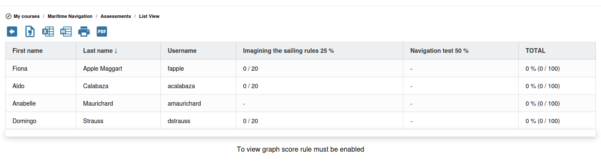
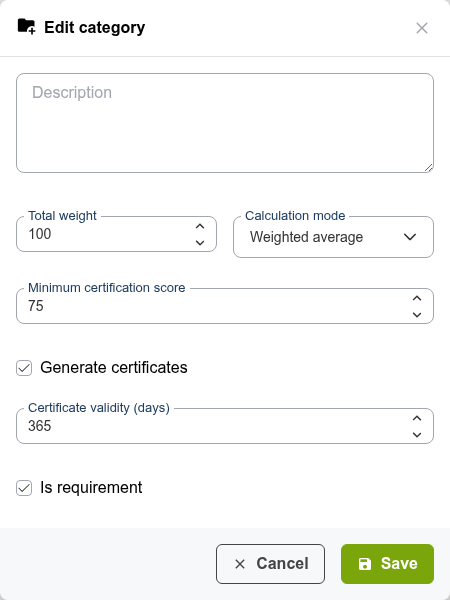

# Beoordelingen

De beoordelingen (voorheen *gradebook*) bundelen scores van oefeningen, opdrachten en andere beoordeelde activiteiten in één overzicht van de prestaties van elke cursist. Ze regelen ook het genereren van certificaten.

## Hoe de beoordelingen werken

De beoordelingen zijn gewogen scoresystemen. U bepaalt:

1. **Welke activiteiten** meetellen voor het cijfer (oefeningen, opdrachten, aanwezigheid, enz.)
2. **De weging** van elke activiteit (hoeveel deze meetelt voor het eindcijfer)
3. **De minimale certificeringsscore** (de drempel voor het behalen van een certificaat)
4. **Een minimumscore per activiteit** — Elke activiteit in de gradebook kan een eigen **Minimumscore** hebben. Cursisten die op een belangrijke activiteit onder die minimumscore blijven, kunnen worden uitgesloten van het behalen van de doelstellingen en het certificaat, ook als hun totale gewogen score anders hoog genoeg zou zijn.

Activiteiten kunnen van 2 typen zijn:
* **Klassikale activiteit** (of activiteit ter plaatse), waarbij cijfers uit een andere bron moeten worden geïmporteerd
* **Onlineactiviteit** die uit de cursus wordt gekozen, waarbij cijfers worden verkregen door het voltooien van de activiteit in de cursus

Chamilo berekent het totaalcijfer van elke cursist op basis van deze wegingen.

## De beoordeling instellen

1. Open het hulpmiddel **Beoordelingen**  vanaf de startpagina van de cursus
2. U ziet het overzicht van de beoordelingen, dat aanvankelijk leeg is

### Activiteiten toevoegen

1. Klik op **Onlineactiviteit toevoegen**
2. Kies het type:
   * **Test** — Koppel een specifieke oefening uit de cursus
   * **Opdracht** — Koppel een map met publicaties van cursisten
   * **Leerpad** — Koppel de voltooiing van een leerpad
   * **Aanwezigheid** — Koppel een aanwezigheidslijst
   * **Forumdiscussie** — Koppel een forumdiscussie (die handmatig moet worden beoordeeld)
   * **Enquête** — Koppel een enquête
3. Selecteer de specifieke activiteit binnen het gekozen type
4. Stel de **Weging** voor deze activiteit in (bijv. 30% voor het tussentijdse examen, 40% voor het eindproject)
5. Stel de **Minimumscore** in, indien van toepassing
6. Opslaan

De totale weging van alle activiteiten moet optellen tot 100%.

### Subcategorieën

Voor complexe beoordelingsschema's kunt u **subcategorieën** maken om verwante activiteiten te groeperen:

* **Voorbeeld**: een subcategorie "Huiswerk" (weging: 30%) met vijf afzonderlijke opdrachten die elk 20% van de subcategorie waard zijn
* Met subcategorieën kunt u de beoordeling hiërarchisch ordenen en de totale berekening toch eenvoudig houden

## Cijfers bekijken

De beoordeling toont een tabel met:

* De naam van elke cursist
* Scores voor elke activiteit
* Het gewogen totaal
* Of de cursist in aanmerking komt voor een certificaat

U kunt op elke kolom sorteren om snel de best presterende of de cursisten met moeilijkheden te herkennen.

### Grafieken van de scoreverdeling

Onder de tabel, en op de pagina **Grafische weergave**, tekent de beoordeling één staafdiagram
per activiteit plus één voor het totaal. Elk diagram is een kolomdiagram: de
horizontale as vermeldt uw scorebereiken van het laagste tot het hoogste, en de
hoogte van elke staaf is het aantal cursisten in dat bereik.

Het diagram **Totaal** markeert ook het klasgemiddelde. Een rood punt staat op het bereik
dat het gemiddelde bevat, en de legenda geeft het exacte percentage.

Deze diagrammen verschijnen alleen wanneer de regels voor scoreweergave zijn ingesteld. Als u het
bericht *To view graph score rule must be enabled* ziet, definieer dan eerst uw bereiken
onder de score-instellingen van de beoordeling.

## Certificaten

Om het genereren van certificaten in te schakelen:

1. Stel in de instellingen van de beoordeling een **minimale certificeringsscore** in (bijv. 70%)
2. Wanneer het gewogen totaal van een cursist deze drempel bereikt of overschrijdt (en de cursist geen minimumscore per activiteit heeft gemist), kan de cursist het certificaat downloaden
3. Het certificaat wordt gegenereerd op basis van een sjabloon dat door de platformbeheerder is geconfigureerd

Zodra **Certificaten genereren** is ingeschakeld voor de hoofdcategorie, verschijnt een veld **Geldigheid van het certificaat (dagen)**. Laat dit op `0` staan voor certificaten die nooit verlopen, of stel een aantal dagen in waarna het certificaat verloopt — Chamilo kan cursisten dan herinneren wanneer die vervaldatum nadert, automatisch (cron, door de beheerder geconfigureerd) of handmatig vanuit de certificatenlijst.

Zie [Certificaten en competenties](../tracking-and-reporting/certificates-and-skills.md#certificate-validity-and-expiry) voor meer details.

## Koppelen aan competenties

U kunt **competenties** aan de beoordeling koppelen. Wanneer een cursist de vastgestelde doelstellingen bereikt om de beoordeling te voltooien, kan de cursist een certificaat krijgen, een competentie, of beide. Competenties zijn zichtbaar op het profiel in de sociale netwerkruimte. Zo ontstaat in de loop van de tijd een competentiedossier.

## Cijfers exporteren

Klik op de knop **Exporteren**  om cijfers als spreadsheet te downloaden. Dit is nuttig voor:

* Cijfers delen met administratieve systemen
* Aanvullende analyses uitvoeren buiten Chamilo
* Offline records bewaren

### Excel-lijstexport: numerieke resultaten

In de **lijstweergave** schrijft de Excel-export (`.xls`) elke beoordeelde activiteit en het totaal in drie afzonderlijke kolommen: **Percentage**, **Score** en **Maximale score**. De waarden zijn getallen, geen gecombineerde tekst zoals `18 / 20 (90%)`, zodat u totalen, gemiddelden en grafieken in een spreadsheet kunt berekenen.

Een activiteitsresultaat van 18 op 20 wordt bijvoorbeeld geëxporteerd als een numerieke cel met percentageopmaak (weergegeven als **90.00%**), **18** in de scorekolom en **20** in de kolom voor de maximale score. Een cursist zonder geregistreerd resultaat heeft lege scorecellen, geen nullen. Dit geldt specifiek voor de Excel-export van de beoordelingslijst; het impliceert niet dezelfde kolomstructuur voor CSV, PDF of andere exportformaten.

## Beveiligingstoken op actielinks

Sommige links die voorheen gegevens wijzigden via een gewone GET, bevatten nu een beveiligingstoken per sessie. Een link die is gekopieerd van een oude pagina, een bladwijzer of een link die vanaf een andere site wordt geopend, voert de actie daardoor niet meer uit: de gebruiker ziet de pagina "niet toegestaan" (of, bij certificaten, het bericht "Beveiligingstoken verlopen, laad de pagina opnieuw"). Laad de pagina opnieuw en gebruik de knop opnieuw. Gebruikers die de knoppen normaal aanklikken, merken geen verschil.

* Cijferboek (cursus- en "mijn cijferboek"-pagina's): een categorie, evaluatie of koppeling verwijderen of tonen/verbergen; een categorie of evaluatie verplaatsen; de ontbrekende categorieën aanmaken; het resultaat van een cursist of één poging daarvan verwijderen.
* Lijst met cijferboekcertificaten: **Certificaten genereren**.
* Sessie > Geplande aankondigingen: **Openstaande aankondigingen handmatig verzenden**. Het geplande verzenden door cron (`app:send-scheduled-announcements` / `main/cron/scheduled_announcement.php`) blijft ongewijzigd.

## Namen van cursisten zichtbaar houden in de platte weergave

In de **platte weergave** van Beoordelingen blijven de kolommen voor de voornaam en achternaam van de cursist vastgezet terwijl de evaluatiekolommen horizontaal scrollen. Hierdoor zijn brede scoretabellen gemakkelijker te inspecteren zonder het overzicht te verliezen over welke cursist bij elke rij hoort. De wijziging is uitsluitend visueel; cijfers, wegingen, berekeningen of exports worden niet gewijzigd. Zie [bevroren cursistkolommen PR #9429](https://github.com/chamilo/chamilo-lms/pull/9429).

## Tips

* **Plan uw wegingen vroeg** — Definieer het beoordelingsschema aan het begin van de cursus, zodat cursisten weten wat ze kunnen verwachten
* **Gebruik subcategorieën voor complexe cursussen** — Groepeer opdrachten, toetsen en deelname in duidelijke categorieën
* **Stel zinvolle slaagdrempels in** — De certificeringsscore moet de werkelijke competentie weerspiegelen, niet alleen deelname
* **Controleer regelmatig** — Bekijk het cijferboek periodiek om te controleren of alle activiteiten correct zijn gekoppeld en scores worden geregistreerd