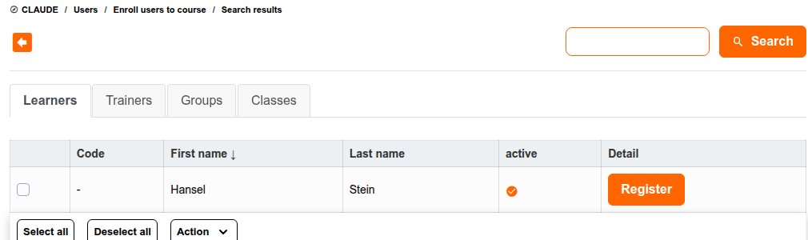
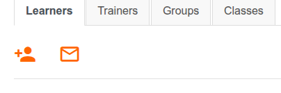
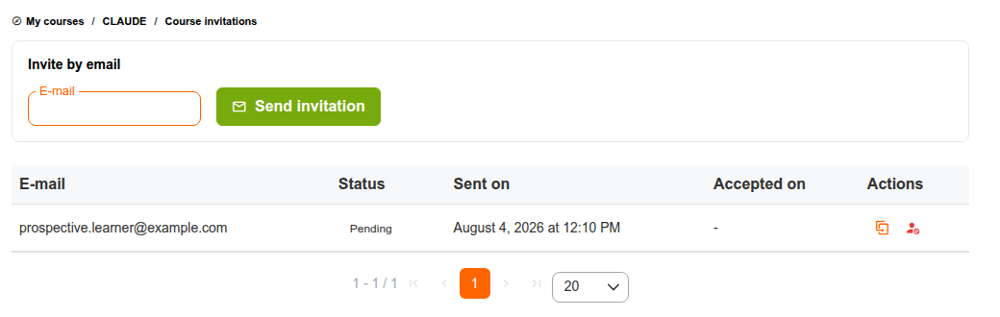

# Gebruikers inschrijven

Voordat u een cursist kunt beoordelen, moet die persoon voor uw cursus zijn ingeschreven. Chamilo biedt vier manieren om iemand toe te voegen, afhankelijk van wie de inschrijving uitvoert en of de persoon al een platformaccount heeft.

| Methode | Wie doet het | Bestaand account nodig? |
|--------|-------------|------------------------------|
| [Inschrijving door de beheerder](#administrator-enrollment) | Platformbeheerder | Ja |
| [Zelfinschrijving via de cursuscatalogus](#self-enrollment-via-the-course-catalog) | De cursist zelf | Ja |
| [Handmatige inschrijving via de tool Gebruikers](#manual-enrollment-via-the-users-tool) | Docent (of cursusbeheerder) | Ja |
| [Gebruikers uitnodigen per e-mail](#inviting-users-by-email) | Docent (of cursusbeheerder) | **Nee** |

## Inschrijving door de beheerder

Een platformbeheerder kan elke bestaande gebruiker rechtstreeks vanuit het beheerpaneel inschrijven voor een cursus — handig voor bulkinschrijving (bijv. het importeren van een klassenlijst) of wanneer een docent zelf geen rechten heeft om inschrijvingen te beheren. Zie het gedeelte [Cursussen](../../admin-guide/courses/README.md) van de Beheerdershandleiding.

## Zelfinschrijving via de cursuscatalogus

Als de [zichtbaarheid](../creating-your-course/course-settings.md#course-visibility) van uw cursus dit toestaat, kunnen cursisten met een platformaccount zichzelf inschrijven door uw cursus te vinden in **Meer cursussen verkennen** en op deelnemen te klikken — u hoeft niets te doen. Of dit beschikbaar is en of een wachtwoord vereist is, wordt bepaald door de **Inschrijvingsinstellingen** in [Cursusinstellingen](../creating-your-course/course-settings.md#enrollment-settings).

## Handmatige inschrijving via de tool Gebruikers

Om iemand in te schrijven die al een platformaccount heeft maar zich niet zelf heeft aangemeld, opent u de tool **Gebruikers** van uw cursus en klikt u op het pictogram **Gebruikers toevoegen** .

1. Zoek de persoon op naam, gebruikersnaam, e-mailadres of officiële code
2. Klik op **Registreren** in de betreffende rij, of selecteer meerdere personen met de selectievakjes en gebruik het menu **Actie** om ze allemaal tegelijk te registreren

Alleen gebruikers die nog niet voor de cursus zijn ingeschreven, verschijnen in de resultaten.

> Dit pictogram is standaard beschikbaar voor docenten. Een platformbeheerder kan het beperken tot alleen beheerders via de instelling **Allow User Course Subscription By Course Administrator** (`allow_user_course_subscription_by_course_admin`) — als u het pictogram **Gebruikers toevoegen** niet ziet, vraag het dan aan uw beheerder.

## Gebruikers uitnodigen per e-mail

De drie bovenstaande methoden gaan er allemaal van uit dat de persoon al een platformaccount heeft. **Cursusuitnodigingen** dekken het geval waarin dat niet zo is: u stuurt een uitnodiging naar een e-mailadres en Chamilo mailt die persoon een eenmalige link. Door de link te openen kunnen ze een account aanmaken, en zodra ze de registratie hebben voltooid, worden ze automatisch ingeschreven voor uw cursus — er is geen aparte inschrijvingsstap nodig.

### De tool openen

Open de tool **Gebruikers** van uw cursus en klik vervolgens in de werkbalk op het pictogram **Uitnodigen per e-mail** , naast **Gebruikers toevoegen**:

Hiermee opent u de pagina **Cursusuitnodigingen**.

### Wie kan uitnodigingen versturen

* Platformbeheerders, altijd.
* In een gewone cursus (niet geopend in een sessie): docenten en andere gebruikers met bewerkrechten voor de cursus.
* In een sessie: de algemene coach van de sessie, of een sessiebeheerder — niet de bredere groep cursuscoaches, omdat een uitnodiging hier inschrijft voor de *volledige sessie*, niet alleen voor deze ene cursus.

### Een uitnodiging versturen

1. Voer het e-mailadres van de ontvanger in het formulier **Uitnodigen per e-mail** in
2. Klik op **Uitnodiging versturen**

Elke uitnodiging die u voor deze cursus hebt verzonden, verschijnt onder het formulier, met de status:

| Status | Betekenis |
|--------|---------|
| **In behandeling** | Verzonden, nog niet gebruikt. Nog binnen de geldigheidsperiode. |
| **Geaccepteerd** | De ontvanger heeft zich geregistreerd en is ingeschreven. |
| **Ingetrokken** | U hebt deze geannuleerd voordat deze werd gebruikt. |

Voor een uitnodiging die nog in behandeling is, biedt de kolom **Acties**:

* **Kopiëren**  — kopieert de uitnodigingslink, voor het geval u deze liever zelf deelt (chat, persoonlijk) in plaats van te vertrouwen op de e-mail.
* **Intrekken**  — annuleert de uitnodiging onmiddellijk; de link werkt niet meer. Een reeds geaccepteerde uitnodiging kan niet worden ingetrokken.

> **Het uitgenodigde e-mailadres mag nog geen account op dit platform hebben.** Als dat wel het geval is, mislukt het versturen van de uitnodiging met een bericht waarin u wordt gevraagd die bestaande gebruiker in plaats daarvan rechtstreeks in te schrijven — via [Handmatige inschrijving via de tool Gebruikers](#manual-enrollment-via-the-users-tool) hierboven.

### Uitnodigingen in een sessie

Als u de tool Gebruikers opent vanuit een cursus die binnen een sessie wordt gegeven, toont de pagina een herinnering dat de uitnodiging geldt voor de hele sessie, niet alleen voor deze cursus:

> *Deze cursus is geopend in een sessie. Als u hier een uitnodiging verstuurt, wordt de ontvanger ingeschreven voor de hele sessie, niet alleen voor deze cursus.*

Dit weerspiegelt hoe inschrijving elders in Chamilo werkt: u schrijft iemand in voor een sessie als geheel, of voor een zelfstandige cursus, maar nooit voor "deze ene cursus binnen deze sessie" als afzonderlijke actie.

### Wat de uitgenodigde persoon ziet

De e-mail bevat een link naar de registratiepagina. Bij het openen ervan:

* Wordt het e-mailveld vooraf ingevuld en vergrendeld op het adres dat u hebt uitgenodigd — zij kunnen zich met die link niet registreren onder een ander adres.
* Kunnen zij de registratie voltooien **zelfs als zelfregistratie momenteel platformbreed is uitgeschakeld** — mits uw beheerder de instelling **Registratie via cursusuitnodigingslinks toestaan** heeft ingeschakeld (zie hieronder). Zonder deze instelling helpt een uitnodigingslink alleen wanneer zelfregistratie anderszins openstaat.
* Worden zij onmiddellijk ingeschreven voor uw cursus (of de sessie) zodra zij het formulier verzenden, en worden zij aangemeld.

De link is eenmalig te gebruiken en verloopt na 7 dagen. Als deze verloopt of de bijbehorende uitnodiging wordt ingetrokken, gedraagt het openen ervan zich alsof de link nooit heeft bestaan.

> De platformbrede instelling **Registratie via cursusuitnodigingslinks toestaan** (`registration.allow_invitation_registration`) bepaalt of uw uitnodigingslink registratie kan openen wanneer algemene zelfregistratie is uitgeschakeld. Vraag uw beheerder als uitnodigingen niet lijken te werken op een anderszins gesloten platform.

## Tips

* **Stem de methode af op de situatie** — beheerder of zelfinschrijving voor mensen die het platform al gebruiken, handmatige inschrijving voor een bekende bestaande gebruiker, uitnodigingen voor externe gasten, beoordelaars of iedereen die nog geen account heeft.
* **Trek uitnodigingen in die u niet meer nodig hebt** — een oude uitnodiging in behandeling is nog steeds een geldige, ongebruikte link; trek deze in als de beoogde ontvanger geen toegang meer nodig heeft, of als u niet zeker weet of deze hen heeft bereikt.
* **Overleg met uw beheerder als een methode niet beschikbaar lijkt** — verschillende van deze stromen (handmatige inschrijving, uitnodigingen, zelfinschrijving) kunnen platformbreed worden beperkt of uitgeschakeld.