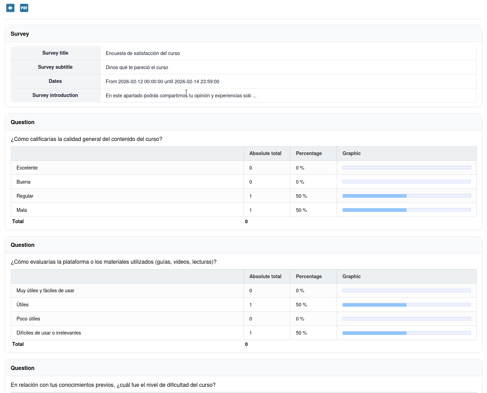

# Enquêtes

Met het enquêtehulpmiddel kunt u vragenlijsten maken om feedback van uw cursisten te verzamelen. Enquêtes zijn nuttig voor cursusevaluaties, behoefteanalyses en opiniepeilingen.

## Een enquête aanmaken

1. Open het hulpmiddel **Enquêtes**  vanaf de startpagina van de cursus
2. Klik op **Enquête aanmaken**
3. Vul de enquêtegegevens in:
   * **Code** — Dit is een unieke code voor de enquête. Deze wordt gebruikt in e-mails en links.
   * **Titel** — De naam van de enquête
   * **Ondertitel** — Een optionele secundaire kop
   * **Startdatum** — Vanaf wanneer deze enquête openstaat voor deelname
   * **Einddatum** — Tot wanneer deze enquête openstaat voor deelname
   * **Anoniem** — Of antwoorden anoniem zijn of gekoppeld aan individuele cursisten
   * **Zichtbaarheid van resultaten** — Wie de resultaten kan zien (alleen tutor, tutor en studenten, iedereen)
   * **Inleiding** — Een bericht dat aan cursisten wordt getoond voordat zij de enquête starten
   * **Bedankbericht** — Een bericht dat na het indienen wordt getoond
4. Opslaan

### Geavanceerde instellingen

* **Cijfer in het beoordelingsinstrument** — Of de antwoordstatus van deze enquête wordt opgenomen in het beoordelingsinstrument (cijferboek). Iedereen die de enquête heeft voltooid, krijgt 100%; iedereen anders krijgt 0%
* **Bovenliggende enquête** — Wordt op dit moment niet echt gebruikt (verouderde functie)
* **Eén vraag per pagina** — Presentatiestijl voor de vragen
* **Shufflemodus inschakelen** — Of vragen door elkaar worden gehaald
* **Vraagnummer tonen** — Of (automatisch gegenereerde) vraagnummers worden getoond

### Sjablonen aangemaakt door een beheerder

Platformbeheerders kunnen herbruikbare **enquêtesjablonen** met eigen vragen aanmaken. Wanneer de beheerder een sjabloon **Zichtbaar als sjabloon** maakt, kan een docent dit kiezen bij het aanmaken van een enquête in een geautoriseerde cursus of sessie. De gekopieerde enquête kan vervolgens worden nagekeken en gepubliceerd via de gebruikelijke uitnodigingsworkflow. Docenten kunnen geen sjablonen toewijzen aan andere cursussen of sessies buiten hun onderwijscontext.

Beheerders kunnen een sjabloon ook rechtstreeks toewijzen aan een gekozen cursus of aan een sessie die die cursus bevat. Zie [Enquêtesjablonen](../../admin-guide/survey-templates.md) voor de workflow voor beheerders (PR #9208, issue #8760).

### Resultaten verborgen voor docenten en tutors

Voor enquêtes waarvan de antwoordgegevens vertrouwelijk moeten blijven voor het onderwijzend personeel, kan een platformbeheerder **Resultaten verborgen voor docent/tutor** inschakelen in de enquêteconfiguratie. Docenten en tutors kunnen nog steeds het aantal antwoorden zien en herinneringen versturen, maar **kunnen de resultaten niet openen of exporteren**. Deze beperking geldt ook voor rapportdownloads; alleen een platformbeheerder mag de beperkte resultaten raadplegen. Dit staat los van de normale selectie **Zichtbaarheid van resultaten** en de globale instelling voor de rapportageknop.

### Sjabloon voor tevredenheid over de training

Als u een standaardvragenlijst aan het einde van een training wilt, gebruikt u de actie **Tevredenheidsenquête aanmaken** in de werkbalk Enquêtes. Chamilo maakt een anonieme **Tevredenheidsenquête over de training** aan op basis van het ingebouwde sjabloon met zeven vragen en opent direct de vrageneditor.

De enquête wordt aangemaakt in de huidige cursus of cursus-sessiecontext en wordt niet automatisch gepubliceerd. Bekijk of bewerk eerst de gegenereerde vragen, publiceer de enquête daarna en kies ontvangers op de gebruikelijke manier. Deze actie is alleen beschikbaar voor gebruikers die enquêtes mogen aanmaken, en wordt verborgen wanneer het aanmaken van enquêtes is uitgeschakeld door de platformconfiguratie.

## Vragen toevoegen

Zodra de enquête is aangemaakt, voegt u vragen toe:

1. Kies het vraagtype:
   * **Ja/Nee** — Een eenvoudige binaire keuze
   * **Meerkeuze** — Selecteer één antwoord uit meerdere opties
   * **Meerdere antwoorden** — Selecteer één of meer antwoorden uit meerdere opties
   * **Open vraag** — Vrij tekstantwoord
   * **Keuzelijst** — Selecteer uit een keuzelijst
   * **Percentage** — Kies een percentagewaarde
   * **Score** — Beoordeel op een numerieke schaal
   * **Opmerking** — Een tekstblok (geen vraag) om instructies tussen vragen toe te voegen
   * **Meerkeuze met optie "anders"** — Selecteer één antwoord uit meerdere opties, met een alternatieve keuze
   * **Selectieve weergave** — Speciaal type waarmee u het verloop van de vragen kunt aanpassen op basis van eerdere antwoorden
   * **Pagina-einde** — Voeg pagina-einden toe in het vragenverloop. Alleen nuttig als "Eén vraag per pagina" in de vorige stap **niet** was geselecteerd
2. Configureer de vraagtekst en de antwoordopties
3. Opslaan

Elke vraag kan als verplicht worden gemarkeerd. Doet u dat niet, dan is het overslaan van een vraag acceptabel gedrag.

---
## Een enquête publiceren

Nadat alle vragen zijn toegevoegd:

1. Klik op **Publiceren**
2. Kies de ontvangers — Selecteer specifieke cursisten of groepen (u selecteert ze). De knop **Cursisten toevoegen** voegt alle cursisten in één keer toe en laat de docenten achterwege
3. Extra gebruikers toevoegen — Hiermee kunt u gebruikers van buiten Chamilo uitnodigen om deel te nemen aan de enquête. Zij ontvangen een e-mail met een link en verschijnen met hun e-mailadres in de enquêtedetails
4. Onderwerp van de e-mail
5. Tekst van de e-mail — Leg uit waar de enquête over gaat en wanneer/hoe te antwoorden
6. Er zijn verschillende opties beschikbaar voor herhaalde uitnodigingen
7. Bevestigen

Cursisten ontvangen een uitnodiging (per e-mail) om de enquête in te vullen.

Onderaan de publicatiepagina is een link beschikbaar om nog meer externe gebruikers uit te nodigen om deel te nemen. Deelnemers die deze link gebruiken, worden niet geïdentificeerd en verschijnen als anoniem in de enquêteresultaten.

## Resultaten bekijken

Nadat cursisten hebben gereageerd:

1. Open de enquête
2. Klik op **Resultaten** of **Rapport**
3. Bekijk samenvattingen van de antwoorden:
   * Grafieken en percentages voor gesloten vragen
   * Individuele tekstantwoorden voor open vragen
   * Voltooiingspercentage (hoeveel genodigden hebben gereageerd)

U kunt de resultaten exporteren naar een spreadsheet voor verdere analyse.

## Tips

* **Houd het kort** — Cursisten vullen kortere enquêtes eerder in
* **Gebruik de anonieme modus** — Schakel anonieme antwoorden in voor eerlijke feedback
* **Kies het juiste moment** — Verstuur enquêtes halverwege de cursus om aanpassingen te doen, niet alleen evaluaties aan het einde van de cursus