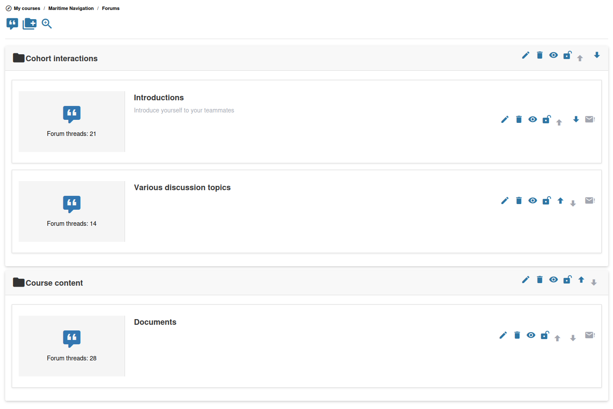

# Forums

Met de forumtool kunt u gestructureerde discussies binnen uw cursus organiseren. Cursisten kunnen berichten plaatsen, op elkaar reageren en deelnemen aan discussies in threads.

## Forumstructuur

Forums in Chamilo zijn georganiseerd in drie niveaus:

1. **Forumcategorieën** — Groeperingen op het hoogste niveau (bijv. "Algemene discussies", "Vragen bij module 1")
2. **Forums** — Afzonderlijke discussieborden binnen een categorie
3. **Onderwerpen (threads)** — Afzonderlijke discussieonderwerpen binnen een forum, elk met een reeks antwoorden

## Een forumcategorie aanmaken

1. Open de tool **Forums**  vanaf de startpagina van uw cursus
2. Klik op **Een forumcategorie toevoegen**
3. Voer een **Categorienaam** en een optionele beschrijving in
4. Opslaan

## Een forum aanmaken

U kunt pas een forum toevoegen als er minstens één categorie bestaat.

1. Klik binnen een categorie op **Een forum toevoegen**
2. Vul de basisgegevens in:
   * **Titel** — De naam van dit discussiebord
   * **Beschrijving** — Een optionele beschrijving van het doel van het forum
   * **Aanmaken in categorie** — De categorie waartoe dit forum behoort
3. Open **Geavanceerde instellingen** om het volgende te configureren:
   * **Publicatiedatum** / **Sluitingsdatum** — Optioneel tijdvenster waarin het forum open is
   * **Gemodereerd forum** — Vereisen dat nieuwe berichten door een docent worden goedgekeurd voordat ze zichtbaar worden
   * **Kunnen cursisten hun eigen berichten bewerken?** — Cursisten toestaan of verhinderen om berichten na het plaatsen te bewerken
   * **Gebruikers toestaan nieuwe threads te starten** — Indien ingesteld op Nee, kunnen cursisten alleen reageren op bestaande threads
   * **Standaardweergavetype** — Kies hoe berichten worden weergegeven: **Plat**, **Threaded** of **Genest**
   * **Voor groep** — Koppel dit forum aan een cursusgroep
   * **Openbare toegang / Privétoegang** — Bepaal voor groepsforums of elk cursuslid het forum kan lezen of alleen groepsleden
4. Opslaan

Als de zichtbaarheid van de cursus is ingesteld op "Open voor de wereld", toont het formulier ook de optie **Anonieme berichten toestaan?**. Deze optie is verborgen in cursussen met beperkte zichtbaarheid.

## Onderwerpen beheren

Cursisten (en u) kunnen nieuwe onderwerpen binnen een forum aanmaken. Als docent kunt u:

* **Een onderwerp vastzetten (sticky message)** — Markeer een thread als sticky wanneer u deze aanmaakt of bewerkt, zodat deze altijd bovenaan verschijnt
* **Een onderwerp vergrendelen** — Verdere antwoorden voorkomen
* **Berichten bewerken of verwijderen** — De discussie modereren
* **Een onderwerp verplaatsen** — Een onderwerp overbrengen naar een ander forum
* **De berichten van nieuw naar oud weergeven** — Een thread toont de berichten van oud naar nieuw. De pijlknop op de werkbalk van de thread (**Nieuwste eerst**) toont ze van nieuw naar oud, zodat u de laatste activiteit van een lange thread kunt volgen; klik er opnieuw op (**Oudste eerst**) om terug te gaan. In de threaded en geneste weergaven worden de antwoorden op elk bericht van nieuw naar oud weergegeven. Cursisten lezen de thread altijd vanaf het oudste bericht, en binnen een leerpad ziet iedereen de nieuwste berichten eerst.

Bij zeer lange threads toont uw platform mogelijk slechts een deel van de berichten van elke thread aan iedereen behalve platformbeheerders — u inbegrepen — wanneer de beheerder **Maximum aantal berichten weergegeven in een forumthread** instelt (`thread_max_posts_for_non_admins`, zie [Foruminstellingen](../../admin-guide/platform-settings/forum-settings.md)). In de threaded en geneste weergaven geldt de limiet voor de antwoorden op elk bericht: u ziet de eerste antwoorden in de tool Forums, en de laatste binnen een leerpad, waar de limiet ook voor beheerders geldt. De berichten van nieuw naar oud weergeven toont u in plaats daarvan de laatste. Vraag een beheerder als u de overige berichten van zo'n thread moet lezen.

## Forumbeoordeling

Wanneer u als docent een nieuwe thread aanmaakt, kunt u onder Geavanceerde instellingen **Deze thread beoordelen** inschakelen. U stelt vervolgens een maximumscore, een kolomkop voor het cijferboek en een weging in het rapport in. U kunt ook **Thread beoordeeld door peers** inschakelen, waarbij elke cursist minstens twee andere cursisten moet beoordelen voordat de eigen score meetelt.

Om te beoordelen, klikt u op **Thread beoordelen** bij de thread in de threadlijst van het forum. Het venster toont de cursisten die in de thread hebben geplaatst, met een scoreveld voor elk. Klik op de naam van een cursist om diens deelname te openen voordat u deze beoordeelt: het aantal cursusgebruikers, het aantal berichten in de thread, hoeveel daarvan van de cursist zijn en hun aandeel in de thread, en vervolgens elk bericht dat de cursist heeft geschreven, met de bijlagen. U kunt de score van de cursist ook vanuit dit venster opslaan. Een rode prullenbak naast elk bericht verwijdert het na bevestiging, bijvoorbeeld om een bericht buiten het onderwerp of een dubbel bericht te verwijderen vóór de beoordeling; de aantallen worden bijgewerkt, en een cursist die geen enkel bericht meer heeft, verdwijnt uit de lijst. De prullenbak wordt niet meer getoond zodra het cijferboek de score van de thread heeft vergrendeld.

## Deelnamevereisten en categorie-informatie

Beheerders kunnen optioneel drie forumwijde gedragingen inschakelen onder **Beheer > Configuratie-instellingen > Forums**:

* **Toon threadantwoorden pas na deelname** (`show_thread_replies_after_participation`) — Een cursist ziet het openingsbericht van de thread, maar niet de antwoorden van anderen totdat hij of zij zelf een bericht heeft geplaatst. Docenten, beheerders, sessiecoaches en groepstutoren vallen niet onder deze beperking. Een bericht van een cursist dat op moderatie wacht, telt nog steeds als deelname, hoewel de normale moderatieregels van toepassing blijven.
* **Toon de beschrijving van de forumcategorie in threads** (`show_category_description_in_thread`) — De categorietitel en een fragment van de beschrijving verschijnen boven de discussie. **Lees meer** vouwt lange beschrijvingen uit.
* **Berichten vereist om een forumthread te voltooien** (`thread_participation_progress_posts`) — Wanneer groter dan `0`, toont een voortgangsbalk het aantal berichten van een cursist ten opzichte van het geconfigureerde doel. Berichten die op moderatie wachten, tellen mee. Instellen op `0` verbergt de balk.

Het voortgangsdoel is een informatieve indicator, **niet** de drempel voor het ontgrendelen van antwoorden: als deelnamegebonden antwoorden zijn ingeschakeld, volstaat één bericht om die beperking op te heffen. Deze instellingen zijn standaard uitgeschakeld. Zie [Foruminstellingen](../../admin-guide/platform-settings/forum-settings.md).

Deze drie instellingen gelden voor elke cursus van het platform, tenzij de beheerder ook **Forumdeelname-instellingen kunnen per cursus worden gewijzigd** (`forum_participation_can_be_modified_in_course`) inschakelt. Elke cursus kiest dan zijn eigen waarden in de sectie **Foruminstellingen** van de [cursusinstellingen](../creating-your-course/course-settings.md#forum-settings) — bijvoorbeeld om antwoorden te verbergen totdat cursisten een bericht plaatsen in slechts sommige cursussen, terwijl de platforminstellingen uitgeschakeld blijven. Een cursus die **Gebruik de platforminstelling** behoudt, volgt de platformwaarde.

## Forumdiscussies binnen een leerpad

Wanneer cursisten een forumdiscussie **vanuit een stap van een leerpad** openen, worden de antwoorden **nieuwste eerst** weergegeven. In de threaded en geneste weergaven blijft het openingsbericht bovenaan staan en komen de nieuwste antwoorden er direct onder, elk antwoord gevolgd door zijn eigen antwoorden, eveneens nieuwste eerst — zodat cursisten hun antwoord direct na het plaatsen zien. Een bericht zonder bovenliggend bericht in de thread wordt getoond als antwoord op het openingsbericht. Gewone forumnavigatie buiten het leerpad behoudt de normale volgorde. De forumpagina verbergt in deze ingebedde context de overbodige acties **Terug naar threads** en **Terug naar leerpad**; cursisten moeten de navigatie van de leerpadspeler gebruiken om naar een andere stap te gaan.

Als cursisten dezelfde discussie openen vanuit het gewone hulpmiddel **Forums**, gebruiken zij de normale forumnavigatie en de chronologische berichtvolgorde. Dit contextuele gedrag is gecorrigeerd in [PR #9163](https://github.com/chamilo/chamilo-lms/pull/9163).

## Meldingen

Elk forum en elke thread heeft een schakelaar **Houd mij op de hoogte** die u en uw cursisten kunnen gebruiken om zich te abonneren op e-mailmeldingen over nieuwe berichten. Meldingen zijn een abonnement per gebruiker en worden niet geconfigureerd bij het aanmaken van het forum.