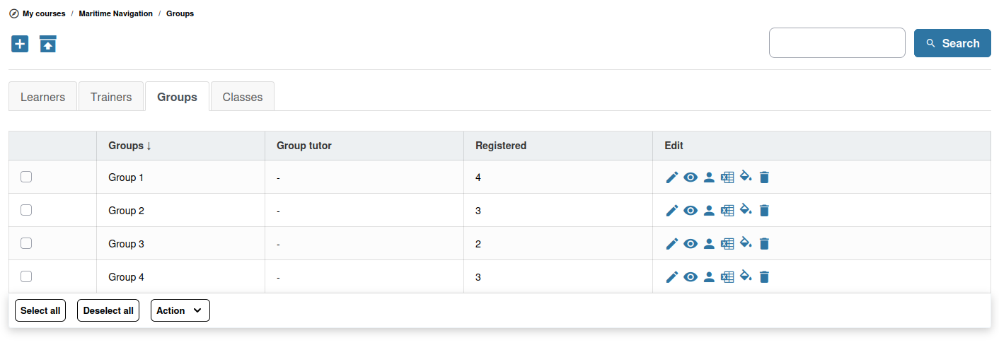

# Groepen

Groepen stellen u in staat uw cursisten in kleinere teams te verdelen voor samenwerkend werk. Elke groep kan over eigen gedeelde tools beschikken, zoals documenten, forums en een wiki.

## Groepen aanmaken

1. Open de tool **Groepen** vanaf de startpagina van de cursus
2. Klik op **Groepen aanmaken**
3. Configureer de groepsinstellingen:
   * **Aantal groepen** — Hoeveel groepen er moeten worden aangemaakt
   * **Maximum aantal leden per groep** — De maximale grootte van elke groep (0 voor onbeperkt)
   * **Zelfregistratie** — Of cursisten zelfstandig bij groepen kunnen aansluiten
   * **Zelfafmelding** — Of cursisten zelfstandig een groep kunnen verlaten

## Groepstools

Elke groep kan toegang hebben tot een deelverzameling van cursustools die alleen onder groepsleden worden gedeeld:

* **Documenten** — Een gedeelde bestandsruimte voor de groep
* **Forum** — Een groepsspecifiek discussieforum
* **Wiki** — Een collaboratieve wiki voor de groep
* **Chat** — Een chatruimte voor de groep
* **Agenda** — Agenda-items die beperkt zijn tot de groep
* **Aankondigingen** — Stuur aankondigingen alleen naar groepsleden
* **Opdrachten** — Verzamel werk van de groep

Voor elke tool kunt u het toegangsniveau kiezen: **Niet beschikbaar**, **Openbaar** (elk cursuslid) of **Privé** (alleen groepsleden). Deze instellingen kunnen op het niveau van de groepscategorie worden toegepast, zodat meerdere groepen in dezelfde categorie dezelfde toolconfiguratie delen.

## Groepsleden beheren

U kunt het groepslidmaatschap op verschillende manieren beheren:

* **Handmatige toewijzing** — Voeg specifieke cursisten toe aan elke groep
* **Geselecteerde groepen vullen** — Verdeel cursisten die nog niet zijn ingeschreven automatisch over de geselecteerde groepen, met inachtneming van de capaciteit van elke groep en de groeplimiet per gebruiker
* **Zelfregistratie** — Laat cursisten hun eigen groep kiezen
* **Importeren uit klassen** — Maak automatisch groepen aan op basis van de klassen die al in de cursus zijn ingeschreven

Om leden handmatig te beheren, klikt u op een groepsnaam en gebruikt u vervolgens de sectie **Leden** om cursisten toe te voegen of te verwijderen.

## Groepstutoren

U kunt **tutoren** aan groepen toewijzen. Een tutor is doorgaans een cursist of assistent die helpt bij het beheer van het groepswerk. Tutoren kunnen extra rechten binnen de groep hebben, zoals het modereren van het groepsforum.

## Groepswerk volgen

Als cursusdocent hebt u toegang tot alle groepen en hun gedeelde tools, ongeacht het lidmaatschap. Hierdoor kunt u:

* Documenten bekijken die door elke groep zijn geüpload
* Discussies in het groepsforum lezen
* Wikibijdragen controleren
* Groepssamenwerking beoordelen