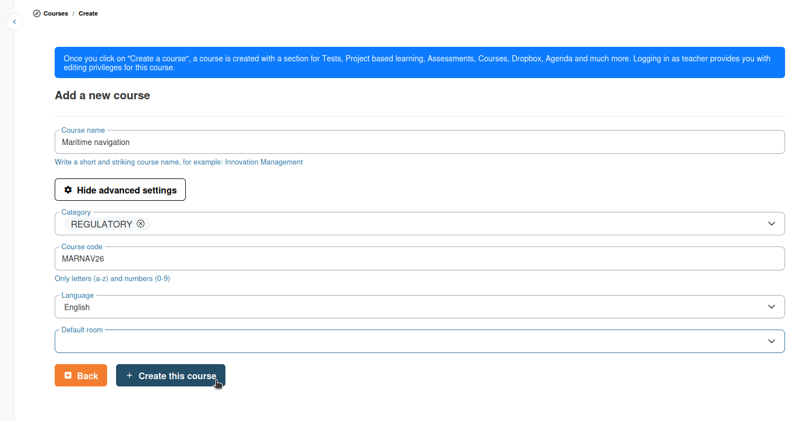
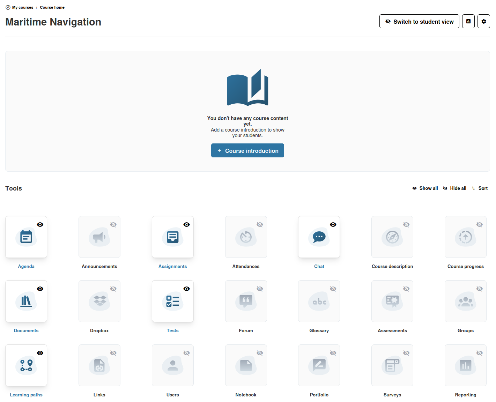

# Uw cursus aanmaken

In dit gedeelte wordt uitgelegd hoe u een nieuwe cursus aanmaakt in Chamilo en deze naar uw behoeften configureert.

## Een nieuwe cursus aanmaken

Een cursus aanmaken:

1. Klik op **Mijn cursussen** in de zijbalk
2. Klik op de knop **Cursus aanmaken** (meestal een groen boek  pictogram met een +-teken)
3. Vul het formulier voor het aanmaken van de cursus in:

| Veld | Verplicht | Beschrijving |
|-------|----------|-------------|
| **Cursusnaam** | Ja | Een korte, beschrijvende titel voor uw cursus (bijv. "Innovatiemanagement") |
| **Cursuscategorie** | Nee | Selecteer een categorie om cursussen op het platform te organiseren |
| **Cursuscode** | Nee | Een korte code met alleen letters en cijfers (max. 40 tekens). Als dit veld leeg blijft, wordt er automatisch een code gegenereerd op basis van de cursusnaam |
| **Taal** | Nee | De primaire taal van de cursus. Standaard ingesteld op uw huidige taal |

Indien ingeschakeld, vindt u mogelijk ook een instelling **Standaardruimte** en de mogelijkheid om een **Cursussjabloon** te gebruiken, zodat u uw cursus niet volledig vanaf nul hoeft aan te maken.

4. Klik op **Deze cursus aanmaken**

U wordt doorgestuurd naar de startpagina van uw nieuwe cursus. Er verschijnt een bevestigingsbericht: "Cursus succesvol aangemaakt."

## De cursusstartpagina

Zodra uw cursus is aangemaakt, komt u op de startpagina terecht. Dit is het centrale punt van uw cursus, waar u en uw cursisten toegang hebben tot alle tools en inhoud.

De startpagina toont:

* **Cursustitel** — De naam van uw cursus, bovenaan weergegeven.
* **Cursusintroductie** — Een optionele beschrijving of welkomstbericht. Klik op de knop **+ Cursusintroductie** om er een toe te voegen, of op de knop **Introductie bewerken**  bovenaan om deze te wijzigen. Dit ondersteunt opgemaakte tekst met afbeeldingen, links en opmaak.
* **Toolraster** — Een raster van alle beschikbare cursustools, elk weergegeven als een kaart met een pictogram en een naam.

### Zichtbaarheid van tools beheren

Als docent kunt u bepalen welke tools uw cursisten kunnen zien:

* Klik op het **oogpictogram**  naast een tool om deze voor cursisten te verbergen. Verborgen tools tonen een **doorgestreept oog**  en blijven voor u toegankelijk.
* Gebruik de knoppen **Alles tonen** en **Alles verbergen** om alle tools tegelijk te wijzigen
* Klik op **Sorteren** om slepen-en-neerzetten voor het herschikken van het toolraster in te schakelen

### Studentweergave

Klik op de knop **Studentweergave** om de cursusstartpagina precies te zien zoals een cursist deze zou zien. Dit is handig om te controleren of verborgen tools en niet-gepubliceerde inhoud niet zichtbaar zijn. Klik nogmaals op de knop om terug te keren naar de docentweergave.

## Volgende stappen

* [Cursusinstellingen](course-settings.md) — Configureer toegang, inschrijving en andere opties op cursusniveau
* [Cursusstartpagina](course-homepage.md) — Gedetailleerde handleiding voor het aanpassen van uw cursusstartpagina
* [Cursusbeschrijving](course-description.md) — Schrijf een gestructureerde beschrijving van uw cursus voor de cursuscatalogus