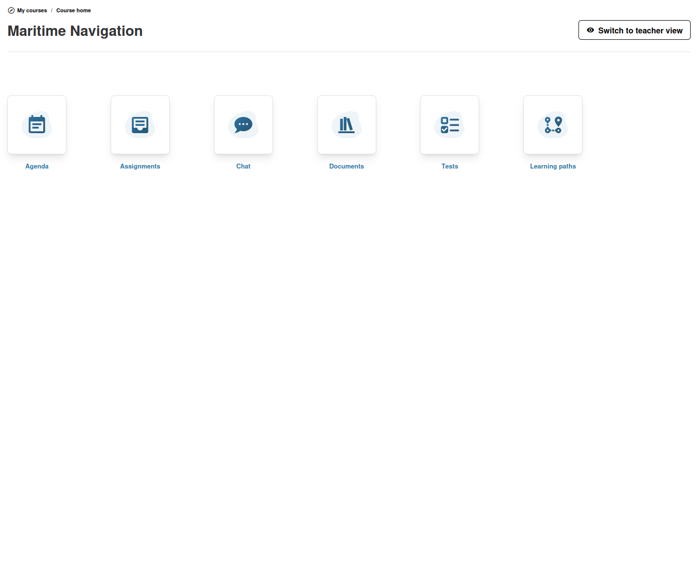

# Cursusstartpagina

De cursusstartpagina is de eerste pagina die uw cursisten zien wanneer zij een cursus openen. Op deze pagina wordt beschreven hoe u deze kunt aanpassen om een aantrekkelijk startpunt te creëren.

## Cursusintroductie

De cursusintroductie is een gebied voor opgemaakte tekst dat bovenaan de startpagina wordt weergegeven, boven het toolraster. Gebruik het om:

* Uw cursisten te verwelkomen
* De cursusdoelstellingen te beschrijven
* Instructies te geven om aan de slag te gaan
* Afbeeldingen, video's of links in te sluiten

De introductie bewerken:

1. Klik op de knop **Introductie bewerken** 
2. Gebruik de editor voor opgemaakte tekst om uw inhoud te schrijven
3. Sla uw wijzigingen op

Als er nog geen introductie is aangemaakt, ziet u een knop om **Een introductie aan te maken**.

## Toolraster

Onder de introductie worden de cursustools weergegeven in een rasterindeling. Elke tool verschijnt als een kaart met:

* Een pictogram dat de tool voorstelt
* De naam van de tool

De tools die in uw cursus beschikbaar zijn, kunnen onder meer zijn:

| Tool | Pictogram | Doel |
|------|------|---------|
| Agenda |  | Evenementen en deadlines plannen |
| Aankondigingen |  | Berichten sturen naar ingeschreven cursisten |
| Opdrachten |  | Werk van studenten verzamelen en beoordelen |
| Documenten |  | Bestanden en inhoud uploaden en organiseren |
| Toetsen |  | Quizzen en toetsen maken |
| Forum |  | Discussies organiseren |
| Woordenlijst |  | Belangrijke termen definiëren |
| Beoordelingen |  | Cijfers en certificaten beheren |
| Leerpaden |  | Gestructureerde leerreeksen opbouwen |
| Links |  | Nuttige URL's delen |
| Gebruikers |  | Ingeschreven gebruikers bekijken en beheren |
| Enquêtes |  | Enquêtes maken en verspreiden |

> Sommige tools worden mogelijk niet weergegeven als uw beheerder ze op platformniveau heeft uitgeschakeld of als u ze hebt verborgen.

Een opvallende wijziging ten opzichte van Chamilo 1.* is dat we de tools niet langer in 3 verschillende secties verdelen. Dit geeft docenten volledige controle over welke tools in welke volgorde worden getoond.

Ook zijn de tools **Opvolging** en **Onderhoud** verplaatst naar de bovenkant van de pagina, onder de pictogrammen voor statistieken en het tandwiel, om tools die nooit aan cursisten worden getoond uit de lijst te verwijderen.

## Tools organiseren

### Volgorde wijzigen

1. Klik op de knop **Sorteren** bovenaan het toolraster
2. Sleep tools om hun volgorde te wijzigen
3. De nieuwe volgorde wordt automatisch opgeslagen

### Verbergen en tonen

* Klik op het **zichtbaarheidspictogram** van een tool om deze voor cursisten zichtbaar of verborgen te maken
* Gebruik **Alles tonen** of **Alles verbergen** voor wijzigingen in bulk
* Verborgen tools blijven voor u als docent toegankelijk — ze zijn alleen verborgen voor cursisten

## Functies voor automatisch starten

U kunt bepaalde tools zo configureren dat ze automatisch starten wanneer een cursist de cursus opent. Indien ingeschakeld, verschijnt bovenaan de cursusstartpagina een melding die aangeeft welke automatische start actief is:

* Automatisch starten van een document — Opent automatisch een specifiek document
* Automatisch starten van een oefening — Start onmiddellijk een toets
* Automatisch starten van een leerpad — Start een leerpad bij het openen van de cursus
* Automatisch starten van het forum — Opent het forum rechtstreeks