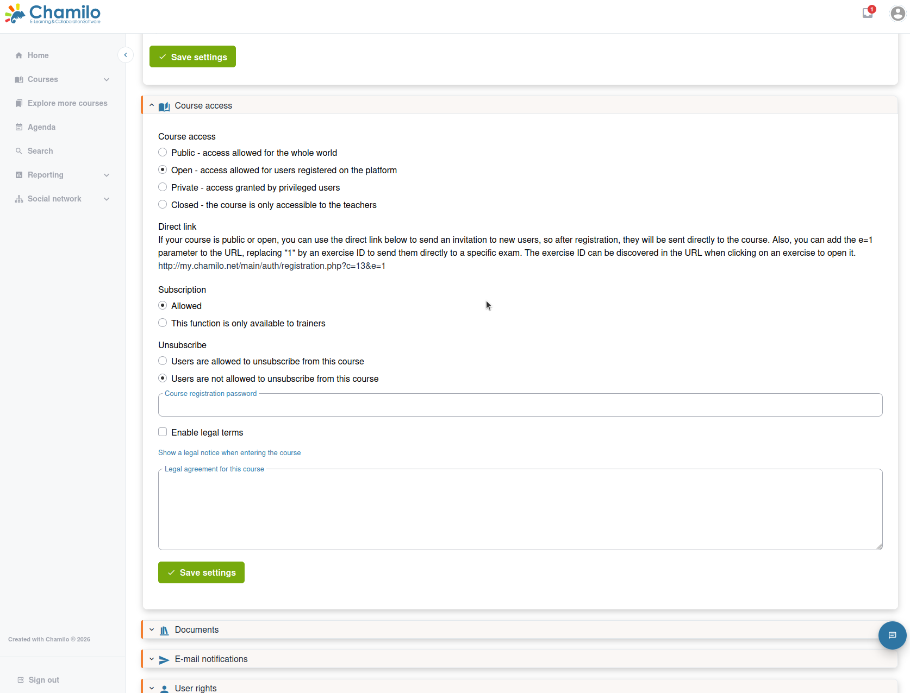

# Cursusinstellingen

Cursusinstellingen stellen u in staat te bepalen hoe uw cursus zich gedraagt — wie er toegang toe heeft, hoe deze wordt weergegeven en welke functies zijn ingeschakeld.

Om de cursusinstellingen te openen, gaat u naar uw cursus en klikt u op het pictogram **Instellingen**  naast de knop **Overschakelen naar studentweergave**.

## Algemene instellingen

### Cursusinformatie

* **Cursustitel** — De weergavenaam van uw cursus
* **Cursustaal** — De primaire taal voor de cursusinterface
* **Cursuscategorie** — De categorie waaronder de cursus in de catalogus verschijnt
* **Cursusafbeelding** — Upload een miniatuur die uw cursus vertegenwoordigt in cursusoverzichten (wordt afhankelijk van de context verkleind)

De cursuscode (de korte unieke identificatie) wordt ingesteld bij het aanmaken van de cursus en kan niet vanaf deze pagina worden bewerkt.

Standaard zien alle gebruikers die uw cursus openen de volledige Chamilo-interface in de taal van uw cursus. Dit is een immersieve functie. Beheerders kunnen dit gedrag wijzigen, maar u kunt het ook wijzigen met een van de eerste opties: **Cursus weergeven in de taal van de gebruiker** (standaard ingesteld op Nee) als u van mening bent dat dit te moeilijk is voor uw gebruikers.

Het departement en de departements-URL zijn verouderde velden. Ze worden alleen behouden om redenen van ondersteuning van oudere versies.

Indien ingeschakeld, kunt u de stijl binnen uw cursus wijzigen met de optie **Stijlbladen**, met behulp van bestaande stijlbladen op uw portaal. Deze optie wordt vaak door beheerders uitgeschakeld, voor een meer geïntegreerd globaal ontwerp.

### Schijfquotum

Elke cursus heeft een opslaglimiet (schijfquotum) voor geüploade bestanden. Het quotum wordt ingesteld door de platformbeheerder. U kunt uw huidige limiet zien in de cursusinstellingen en het huidige gebruik in de tool **Documenten**.

> Als u ruimte tekortkomt, neem dan contact op met uw platformbeheerder om een verhoging van het quotum aan te vragen, of verwijder ongebruikte bestanden uit de tool Documenten.

### Cursuszichtbaarheid

Bepaal wie toegang heeft tot uw cursus:

| Instelling | Beschrijving |
|---------|-------------|
| **Openbaar** | Iedereen, inclusief anonieme bezoekers, heeft toegang tot de cursus |
| **Open voor het platform** | Alle geregistreerde gebruikers op het platform hebben toegang tot de cursus |
| **Privé — toegang verleend door bevoorrechte gebruikers** | Alleen gebruikers die expliciet voor de cursus zijn ingeschreven, hebben er toegang toe |
| **Gesloten** | De cursus is vergrendeld; niemand heeft er toegang toe behalve de docent |

#### Inschrijvingsinstellingen

Afhankelijk van de configuratie van uw platform kunt u mogelijk het volgende beheren:

* **Zelfinschrijving toestaan** — Of cursisten zichzelf kunnen inschrijven via de cursuscatalogus
* **Zelfuitschrijving toestaan** — Of cursisten de cursus zelf kunnen verlaten
* **Inschrijvingswachtwoord** — Een wachtwoord vereisen voor zelfinschrijving (nuttig om de toegang tot een specifieke groep te beperken), maar het beveiligingsniveau is laag omdat hetzelfde wachtwoord voor cursustoegang door alle gebruikers wordt gedeeld.

Deze instellingen hebben alleen betrekking op zelfinschrijving. Voor het volledige overzicht — inclusief het zelf inschrijven van een bestaande gebruiker of het uitnodigen van iemand die nog geen platformaccount heeft — zie [Gebruikers inschrijven](../assessing-learners/subscribing-users.md).

### Documentinstellingen

Kies of u de systeemmappen in de tool **Documenten** wilt tonen of verbergen (standaard verborgen; in de meeste gevallen hebt u ze niet echt nodig en het tonen ervan kan problemen veroorzaken met verborgen inhoud en cursisten).

* **Standaardzichtbaarheid voor nieuwe documenten** — Bepaal of de documenten, mappen en bestanden die u aanmaakt of uploadt meteen zichtbaar zijn voor cursisten, of onzichtbaar blijven totdat u ze publiceert. Deze optie verschijnt alleen wanneer de platformbeheerder elke cursus toestaat zelf te kiezen; anders geldt de platformstandaard (zichtbaar, tenzij gewijzigd).

### Instellingen voor e-mailmeldingen

Configureer hoe cursusactiviteit meldingen activeert:

* **E-mailmeldingen voor nieuwe inhoud** — Stel ingeschreven gebruikers op de hoogte wanneer u nieuwe documenten, aankondigingen of andere inhoud toevoegt

### Chatinstellingen

Bepaal hoe de tool **Chat** wordt weergegeven.

### Instellingen voor leerpaden

* **Cursusthema's inschakelen** — Leerpaden toestaan hun weergave te wijzigen (niet aanbevolen voor een geïntegreerde gebruikerservaring)
* **Terugkoppeling van het leerpad** — Bepaal waar gebruikers terechtkomen wanneer zij op het pictogram **Start** klikken in een leerpad: de lijst met leerpaden, de startpagina van de cursus, *Mijn cursussen*, *Mijn sessies* of de startpagina van het portaal
* **Standaardzichtbaarheid voor nieuwe leerpaden** — Bepaal of een leerpad dat u aanmaakt (of importeert uit een SCORM-pakket) meteen zichtbaar is voor cursisten, of onzichtbaar blijft totdat u het publiceert. Deze optie verschijnt alleen wanneer de platformbeheerder elke cursus toestaat zelf te kiezen; anders geldt de platformstandaard (onzichtbaar, tenzij gewijzigd).

---
### Testinstellingen

* **Standaardzichtbaarheid voor nieuwe tests** — Bepaal of een test die u aanmaakt (of importeert) meteen zichtbaar is voor cursisten, of onzichtbaar blijft totdat u deze publiceert. Deze sectie verschijnt alleen wanneer de platformbeheerder toestaat dat elke cursus dit zelf kiest; anders geldt de platformstandaard (zichtbaar, tenzij gewijzigd).

### Instellingen voor thematische voortgang

Configureer hoe de berichten over thematische voortgang op de startpagina van de cursus worden weergegeven.

### Foruminstellingen

Bepaal het gedrag in het forumhulpmiddel van deze cursus.

Wanneer de platformbeheerder toestaat dat elke cursus deze zelf kiest (`forum_participation_can_be_modified_in_course`), toont deze sectie ook de opties voor forumdeelname. Anders gelden de platforminstellingen voor elke cursus, zoals beschreven in [Forums](../collaboration-and-communication/forums.md#participation-requirements-and-category-information).

* **Toon antwoorden in een discussie alleen na deelname** — **Ja** om cursisten alleen het openingsbericht van een discussie te tonen totdat zij erin hebben gepost, **Nee** om altijd elk antwoord te tonen, of **Gebruik de platforminstelling**
* **Toon de beschrijving van de forumcategorie in discussies** — **Ja** om de titel en een verkorte beschrijving van de forumcategorie bovenaan elke discussie te tonen, **Nee** om deze te verbergen, of **Gebruik de platforminstelling**
* **Berichten vereist om een forumdiscussie te voltooien** — Het aantal berichten dat een cursist in een discussie moet schrijven om de voortgangsbalk voor deelname op 100% te brengen. Stel `0` in om de balk te verbergen, of laat leeg om de platforminstelling te gebruiken

### Opdrachtinstellingen

* **Standaardinstelling voor de zichtbaarheid van nieuw geplaatste bestanden** — Bepaal of nieuwe documenten die cursisten uploaden in het hulpmiddel **Opdrachten** worden gedeeld met alle andere cursisten (standaard Nee)
* **Cursisten toestaan hun eigen publicaties te verwijderen** — Sta cursisten toe de opdrachten die zij al hebben geüpload te verwijderen (voor het geval zij een correctie willen uploaden).

### Tijd besteed in de cursus

Wanneer de platformbeheerder toestaat dat elke cursus dit zelf kiest (`show_clock_time_spent_can_be_modified_in_course`), kunt u in deze sectie bepalen of cursisten op elke pagina van de cursus, inclusief de leerpaden, een klok zien met de totale tijd die zij in de cursus hebben doorgebracht. Anders geldt de platforminstelling (`show_clock_time_spent_on_all_course_page_for_learner`) voor elke cursus.

* **Toon cursisten de tijd besteed in de cursus** — **Ja** om de klok te tonen aan de cursisten van deze cursus, **Nee** om deze te verbergen, of **Gebruik de platforminstelling**

De klok verschijnt linksonder op de pagina. Deze toont de tijd die door de cursustracking is vastgelegd, dezelfde als in de cursusrapporten, en stopt met tellen wanneer de cursist langer inactief is geweest dan het platform toestaat. Docenten zien deze nooit, ook niet in de cursistenweergave.

### Instellingen voor automatisch starten

Een cursus kan worden ingesteld met een gedrag voor automatisch starten, waardoor het pad van cursisten naar de belangrijke onderdelen van uw cursus wordt verkort. Indien ingeschakeld, worden cursisten die uw cursus openen rechtstreeks naar het geselecteerde hulpmiddel gestuurd en zien zij de startpagina van de cursus niet als tussenstap. U kunt zelfs specifieke leerpaden of oefeningen selecteren die bij aankomst in de cursus worden gestart. In dat geval selecteert u hier de optie, gaat u vervolgens naar de lijst met leerpaden of oefeningen en klikt u op het raketpictogram  bij het geselecteerde item.

### Instellingen voor AI-hulpmiddelen

Deze sectie verschijnt alleen als uw beheerder AI-hulpmiddelen op het platform heeft ingeschakeld. Hiermee kunt u de selectie van AI-hulpdiensten verfijnen die beschikbaar zijn via verschillende hulpmiddelen van uw Chamilo-platform. Schakel ze uit als u ze niet wilt gebruiken, maar dat is waarschijnlijk geen goed idee, want ze zijn zeer krachtig.

Deze functies worden uitgelegd in de sectie **AI-hulpmiddelen** van deze handleiding.

### Externe hulpmiddelen (LTI)

Indien ingeschakeld op uw platform, kunt u met Learning Tools Integration externe, compatibele activiteiten in deze cursus integreren, als afzonderlijke pictogrammen op de startpagina van de cursus. Het bespreken van LTI valt buiten het bestek van deze handleiding, maar dit is een krachtig integratiesysteem voor docenten.

### Overige

Afhankelijk van de opties en versies van Chamilo kunnen op deze pagina extra secties of opties verschijnen.